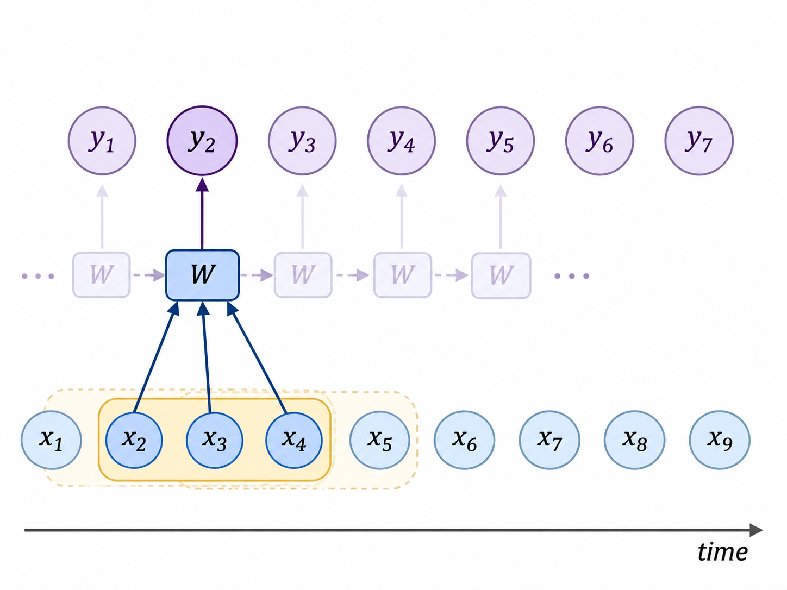
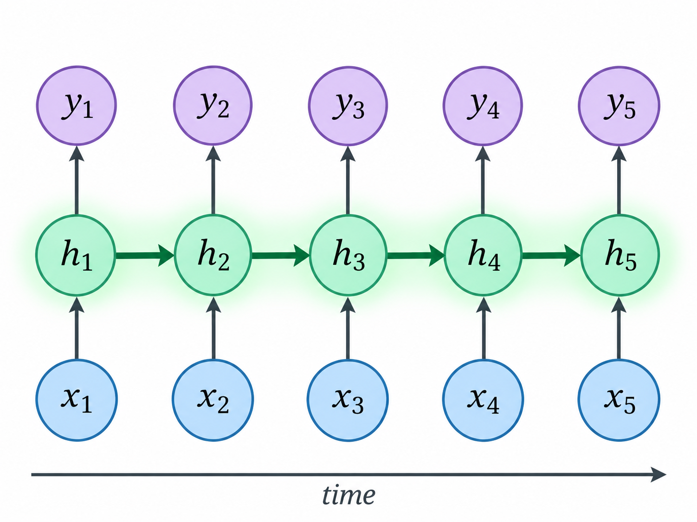
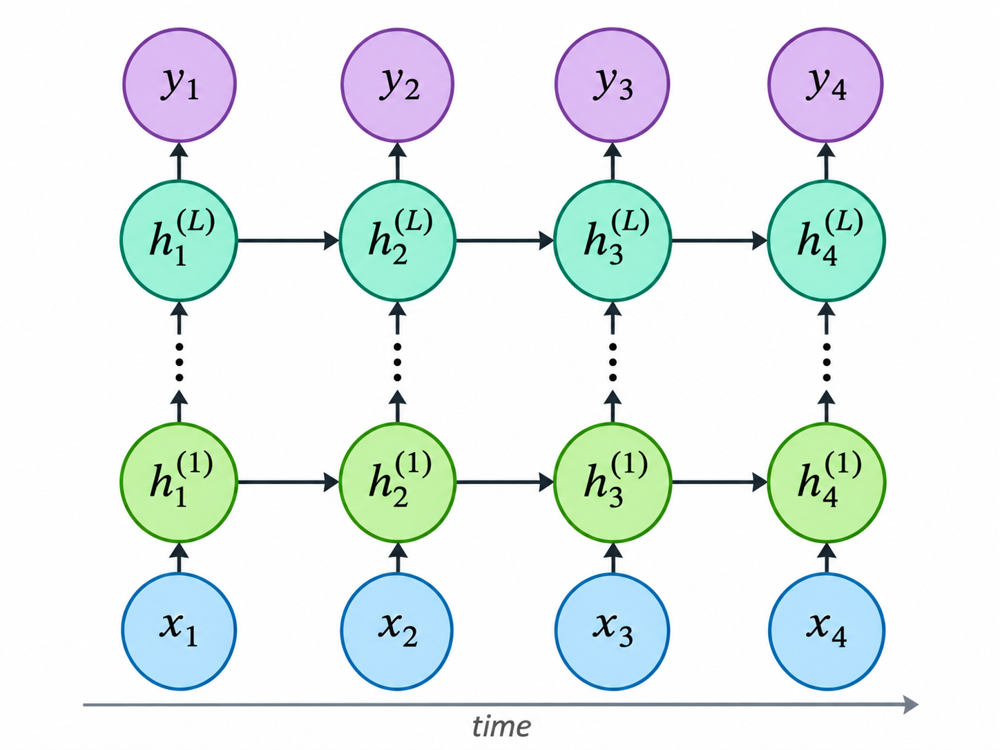
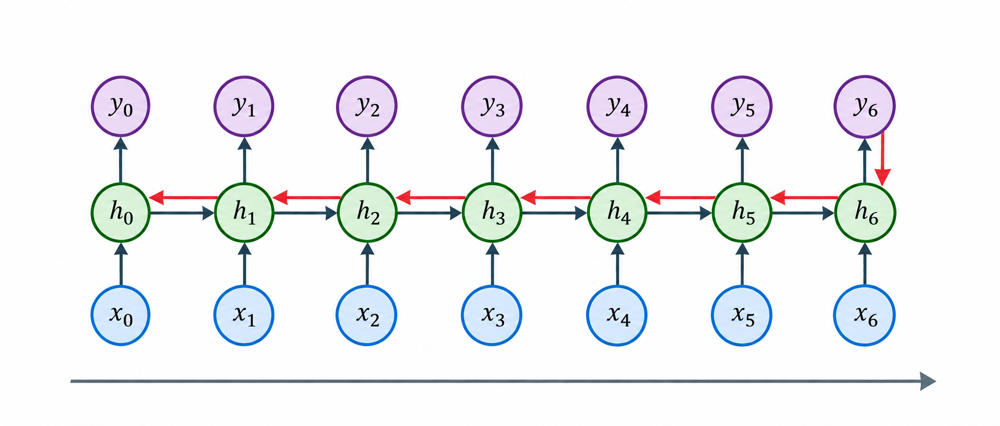
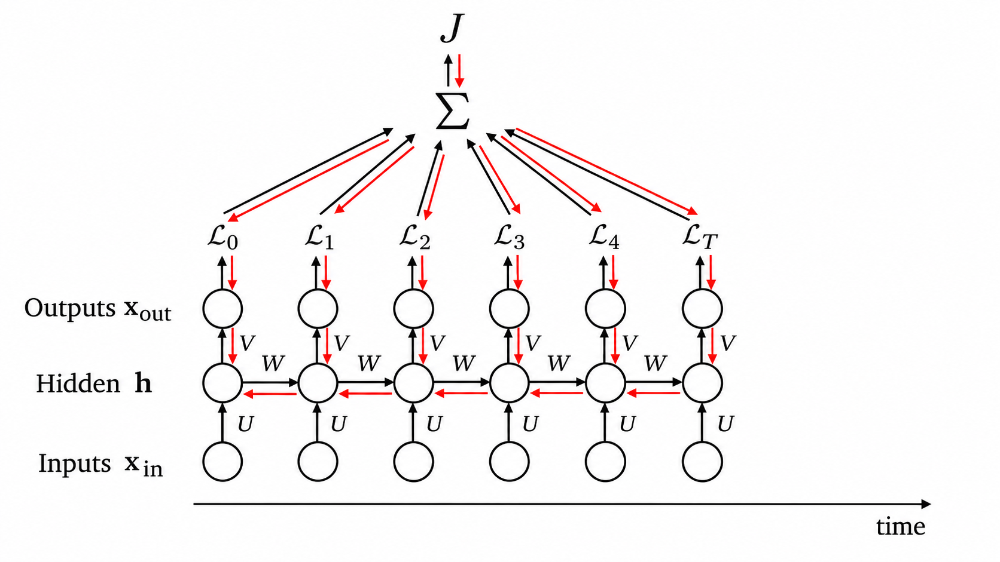
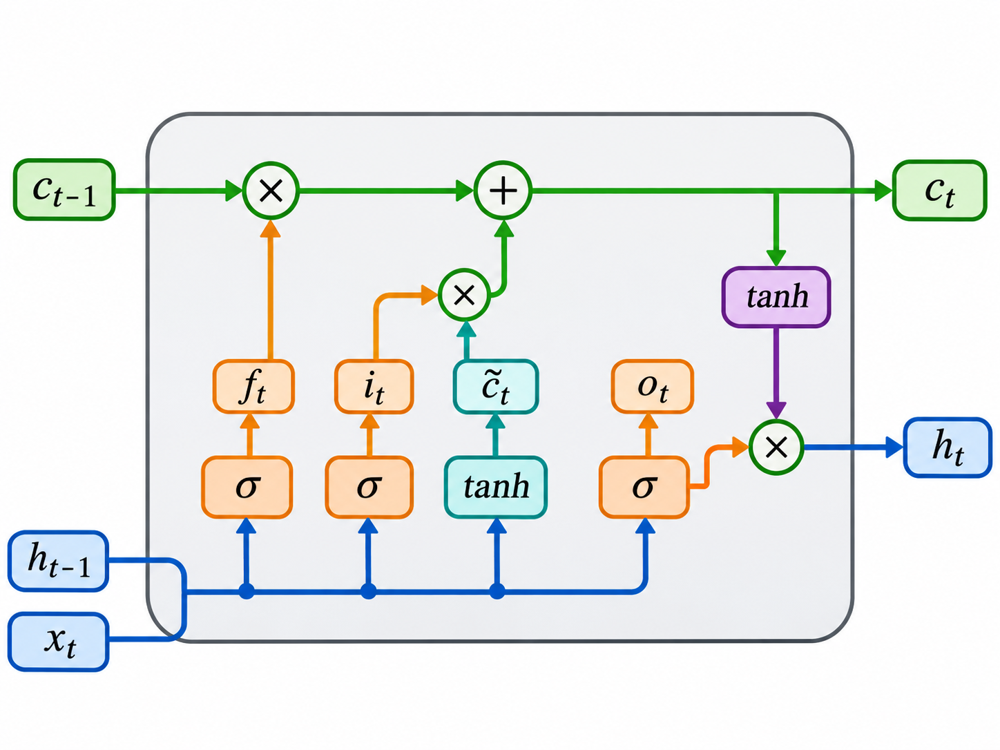
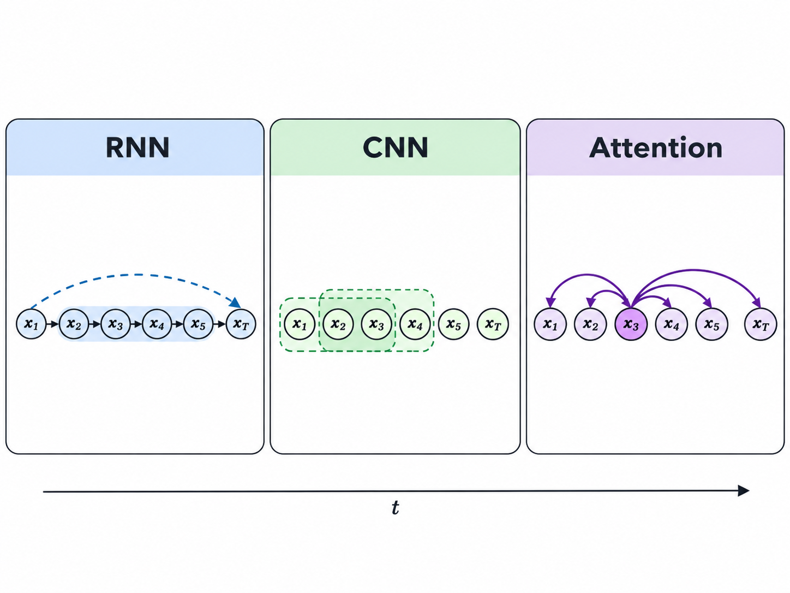

Video: [Lec 10. Architectures: Memory](https://www.youtube.com/watch?v=IiHknRHA-Gk&t=4251s)

Lecture Note: [ocw.mit.edu](https://ocw.mit.edu/courses/6-7960-deep-learning-fall-2024/mit6_7960_f24_lec10.pdf)

## CNNs for Sequence

비디오, 오디오, 텍스트와 같은 데이터는 "순서"를 가지는 데이터이다. 비디오와 오디오는 시간에 따라 이미지, 음성이 변하고, 텍스트는 순차적인 단어로 구성이 된다. 이러한 데이터를 sequence data라고 부르며 sequence data는 time index를 사용해서 $$X=(x_1, x_2, \dots, x_T)$$와 같이 표현이 가능하다. $$T$$라는 길이의 sequence에 대해서 시점 $$t$$의 데이터를 표현하는 방식이다.

기존의 CNN에서는 이미지의 공간적 위치에 따라서 필터를 이동했지만 sequence data에서는 시간축을 따라 필터를 이동할 수 있다.

Convolution을 수행할 때 인접한 몇 개의 시점만 참고하게 되며 가중치는 모든 time index에서 공유된다. $$H\times W$$ 크기의 이미지가 $$T$$개 프레임만큼 배열된 비디오는 $$X\in\mathbb{R}^{H\times W\times T}$$으로 표현할 수 있으며 $$K\in\mathbb{R}^{k_H\times k_W\times k_T}$$라는 필터를 사용해 convolution 연산이 가능하다. 이때 필터는 너비, 높이, 시간 방향으로 이동하며 비디오의 시간적, 공간적 특징을 추출한다. 그러나 일반적인 CNN은 제한된 receptive field를 가지므로 오래전의 정보를 활용하기 어렵다. 이러한 한계를 보완하기 위해 과거의 정보를 hidden state에 유지하는 memory 기반 모델이 도입되며, 이것이 RNN의 기본 아이디어로 이어진다.

## Recurrent Neural Networks (RNNs)

$$
\begin{aligned}
h_t&=f(h_{t-1}, x_t)\\
y_t&=g(h_t)
\end{aligned}
$$

RNN은 $$t$$ 시점에서의 입력과, 이전 시점의 hidden state를 함께 사용해 새로운 hidden state를 계산하는 과정을 반복한다. 위의 함수를 다시 표현하면 $$h_t=f(x_t, h_{t-1})=f(x_t, f(x_{t-1}, h_{t-2}))=f(x_t, f(x_{t-1}, f(\dots)))$$와 같이 이전 $$t$$ 시점의 hidden state를 계산할 때 이전까지 모든 시점의 정보가 반영이 되며 $$t$$ 시점의 출력에도 역시 반영됨을 확인할 수 있다.

$$
\begin{aligned}
h_t&=\sigma_1(Wh_{t-1}+Ux_t+b)\\
y_t&=\sigma_2(Vh_t+c)
\end{aligned}
$$

위의 식을 실제 신경망 연산으로 나타낼 수 있다. $$h_t\in \mathbb{R}^{d_h}, x_t\in \mathbb{R}^{d_x}, y_t\in\mathbb{R}^{d_y}$$라고 하면 각각의 가중치는 $$W\in \mathbb{R}^{d_h\times d_h}, U\in \mathbb{R}^{d_h\times d_x}, V\in \mathbb{R}^{d_y\times d_h}$$의 공간의 행렬이 된다. 이때 $$W, U, V$$는 $$t$$에 independent이며 모든 시점에서 공유되는 가중치가 된다(weight sharing).

$$
\begin{aligned}
h_t^{(1)}&=\sigma(W_1h_{t-1}^{(1)}+U_1x_t+b_1)\\
h_t^{(2)}&=\sigma(W_2h_{t-1}^{(2)}+U_2h_t^{(1)}+b_2)
\end{aligned}
$$

Hidden layer를 여러 층으로 구성하면 위의 식에서 나타나듯이 $$h_t^{(i)}$$에는 $$h_{t-1}^{(i)}$$와 $$h_t^{(i-1)}$$이 입력으로 전달된다. 즉 Deep RNN에서는 같은 층 안에서의 시간적 정보 전달과 같은 시점에서의 레이어간 정보 전달이 발생하며 복잡한 관계를 학습할 수 있게 된다.

## Backpropagation through time

RNN에서도 backpropagation을 수행할 수 있으며 시간순으로 RNN을 펼친다고 했을 때 $$y_T$$의 $$x_t$$에 대한 그래디언트를 chain rule로 구할 수 있다.

$$
\frac{\partial y_T}{\partial x_t}
=
\frac{\partial y_T}{\partial h_T}
\frac{\partial h_T}{\partial h_{T-1}}
\cdots
\frac{\partial h_{t+1}}{\partial h_t}
\frac{\partial h_t}{\partial x_t}
$$

만약에 $$L_t=\mathcal{L}(y_t, \hat{y}_t)$$에 대해 $$J=\sum^T_{t=1}\mathcal{L}_t$$로 loss를 정의 후 이에 대한 gradient를 계산한다고 한다면 아래의 그림과 같이 parameter sharing에서 gradient를 계산하는 것처럼 $$\frac{\partial \mathcal{J}}{\partial W}=\sum^T_{t=1}\frac{\partial\mathcal{L}_t}{\partial W}$$로 전체 시점에 대해서 gradient를 계산 후 누적해야 한다.

## The problem of long-range dependencies

$$
h_t=f(x_t, h_{t-1})=f(x_t, f(x_{t-1}, h_{t-2}))=f(x_t, f(x_{t-1}, f(\dots)))
$$

RNN에서 수식적으로는 이전 모든 시점의 입력 정보가 현재 hidden state에 반영이 된다. 하지만, RNN은 Markov assumption에 의해 동작하고 $$p(h_t\mid h_{t-1},h_{t-2},\ldots)=p(h_t\mid h_{t-1})$$ Markov property에 의해 직전 시점의 hidden state에만 영향을 받는다. 물론 직전 시점의 hidden state에 그 이전 시점의 정보가 반영은 되어 있겠지만 시퀀스가 길어질수록 이를 유지하기는 쉽지 않다.

$$
\frac{\partial y_T}{\partial x_t}
=
\frac{\partial y_T}{\partial h_T}(
\frac{\partial h_T}{\partial h_{T-1}}
\cdots
\frac{\partial h_{t+1}}{\partial h_t})
\frac{\partial h_t}{\partial x_t}
$$

위와 같은 backpropagation 수식에서 괄호 친 부분을 보자. $$\frac{\partial h_T}{\partial h_{T-1}}\cdots\frac{\partial h_{t+1}}{\partial h_t}=\prod^T_{j=t+1}\frac{\partial h_j}{\partial h_{j-1}}$$ 여기에서 $$\lvert\frac{\partial h_j}{\partial h_{j-1}}\rvert<1$$이면 gradient가 매우 작아지고, $$\lvert\frac{\partial h_j}{\partial h_{j-1}}\rvert>1$$이면 gradient가 매우 커져 gradient vanish, explode하는 현상이 발생한다. 반드시 gradient가 vanish나 explode하지 않아도 멀리 떨어진 시점의 정보를 충분히 반영하기는 어려운 점이 있다.

## Long Short Term Memory (LSTM)

RNN에서 gradient vanishing, exploding 문제를 피하고, 장기 기억을 유지하기 위해 LSTM이 등장했다. LSTM에서는 cell state $$C_t$$를 통해 장기적으로 유지할 정보를 저장한다. 이전에 RNN에서는 hidden state가 $$h_t=\tanh(Wh_{t-1}+Ux_t+b)$$와 같이 나타났는데 LSTM은 hidden state 이전에 cell state를 추가해 어느 정보를 더 유지할지를 선택한다.

### Forget gate

$$
f_t=\sigma(W_f[h_{t-1},x_t]+b_f)
$$

Forget gate는 이전 cell state의 정보를 얼마나 보존할지 결정한다. Forget gate에서는 activation function으로 0, 1사이의 값을 가지는 sigmoid를 사용한다. Forget gate의 값을 이전 cell state와 element-wise multiplication$$(f_t\odot C_{t-1})$$을 수행하면 이전 cell state의 값을 0, 1 사이의 값 중 어느 비중만큼 보존할지를 정할 수 있다.

### Input gate

$$
\begin{aligned}
i_t&=\sigma(W_i[h_{t-1},x_t]+b_i)\\
\widetilde C_t&=\tanh(W_C[h_{t-1},x_t]+b_C)
\end{aligned}
$$

Input gate는 새로운 정보를 얼마나 cell state에 반영할지 결정한다. Activation function은 역시 sigmoid를 사용한다. Input gate는 새로운 정보를 0, 1 사이의 값 중 어느 비중만큼 반영할지를 결정 후 새로운 cell state 후보와 element-wise multiplication $$(i_t\odot\widetilde C_t)$$을 수행한다.

### Cell state update

$$
C_t
=
f_t\odot C_{t-1}
+
i_t\odot\widetilde C_t
$$

Forget gate와 input gate를 결합하면 cell state를 업데이트할 수 있다. $$t$$ 시점의 cell state는 $$(t-1)$$ 시점의 cell state를 forget gate에서 결정한 만큼 반영하고, 새로 추가되는 정보를 input gate에서 결정한 만큼 반영해 더한다.

### Output gate

Output gate는 cell state에서 어느 정보를 hidden state로 내보낼지 결정한다.

$$
\begin{aligned}
o_t&=\sigma(W_o[h_{t-1},x_t]+b_o)\\
h_t&=o_t\odot\tanh(C_t)
\end{aligned}
$$

다음 시점에서는 hidden state와 cell state를 모두 전달받아 같은 과정을 반복한다.

LSTM은 Cell State와 Gate 구조를 도입하여 과거 정보 중 필요한 것은 유지하고, 불필요한 것은 삭제하며 새로운 정보를 선택적으로 저장한다. 특히 Cell State가 덧셈 기반으로 업데이트되므로 그래디언트가 장기간 전달되기 쉬워져, 기존 RNN의 gradient vanishing 문제를 완화하고 long-range dependencies를 효과적으로 학습할 수 있다.

## Sequence models

### Autoregressive models

"Once upon a " 다음에 올 단어는 무엇일까? "time"이 올 가능성이 높다고 생각이 드는데 이는 우리가 "Once", "upon", "a"라는 이전 단어의 맥락을 보고 파악한 것이다. 이는 $$P(x_4=\text{time}\vert{}x_1=\text{Once}, x_2=\text{upon}, x_3=\text{a})$$가 다른 단어에 비해 가장 높은 확률을 가져서 선택을 하게 된 것이라고도 말할 수 있다. Autoregressive model은 이전에 등장한 데이터를 조건부로 해 다음에 올 확률이 가장 큰 데이터를 선택하도록 학습된다.

$$
p(X)=\prod_{t=1}^{T}p(x_t\mid x_{<t})
$$

$$
p(\text{Once upon a time})
=p(\text{Once})p(\text{upon}\mid\text{Once})p(\text{a}\mid\text{Once, upon}) p(\text{time}\mid\text{Once, upon, a})
$$

핵심은 이전까지 등장한 모든 시퀀스를 조건부로 삼아 다음 시퀀스의 확률을 계산하는 것이다. 만약에 모든 단어의 집합의 크기가 $$K$$라면 다음에 나올 단어를 선택하는 기준은 단어 집합 중 $$K$$개의 단어 중 가장 큰 확률을 가지는 단어가 될 것이고 $$p(x_t=k\mid x_{<t})=\frac{\exp(z_{t,k})}{\sum_{j=1}^{K}\exp(z_{t,j})}$$ 이는 소프트맥스로 계산이 된다. 실제로는 각 단어를 embedding space에 투영해 단어를 벡터로 변환해 사용한다.

### Sequence model training

"Once upon a time"이라는 정답 문장에 대해 우리는 모델이 이 문장을 생성하도록 학습하고 싶다. 이때 모델은 해당 문장이 생성될 확률을 최대화하는 방향으로 학습된다.

$$
\begin{aligned}
\theta^*&=\operatorname*{argmax}_\theta\log p_\theta(y\mid G)\\
&=\operatorname*{argmax}_\theta\sum_{t=1}^{T}\log p_\theta(y_t\mid y_{<t},G)
\end{aligned}
$$

Sequence model에서는 각 시점의 출력에 대한 확률 분포가 실제 ground truth 확률 분포와 같도록 학습하기를 원하기 때문에 cross-entropy를 loss function으로 사용한다.

$$
f^*=\operatorname*{argmin}_{f\in\mathcal{F}}\sum^N_{i=1} H(y_i, \hat{y}_i)
$$

$$
H(P, Q)=-\int p(x)\log q(x)dx=-\int p(x)\log p(x)+\int p(x)\log\frac{p(x)}{q(x)}
$$

Cross-entropy는 ground-truth 확률 분포와 학습한 확률 분포가 일치할 때 최소화되며 cross-entropy를 최소화하는 것은 KL-divergence를 최소화하는 것과 동일하다.

## Long-range dependencies: comparing architectures

RNN에서는 hidden state에 이전 시점까지의 누적 정보를 반영하지만 이는 어느 정보를 오랫동안 보존해야 하는지 학습하는 데 어려움이 있다. $$t$$ 시점에서 이전까지의 모든 정보를 $$M_t=(x_1, x_2, \dots, x_t)$$와 같은 nonparametric memory 방식으로 저장해 사용할 수도 있겠지만 이는 시간이 지날수록 저장해야 하는 데이터가 증가하고 고정된 크기의 파라미터로 표현할 수 없다. 그래서 과거 정보를 전달하는 방법만이 아니라 과거 정보에 다시 접근하는 방법까지 고려하게 되었다.

### RNN

$$
h_t=f_\theta(h_{t-1},x_t)
$$

RNN에서는 이전 시점의 hidden state로 현재 시점의 hidden state를 업데이트한다. 이때 Markov property가 적용이 되며 모든 시점에서 weight는 공유가 되고 먼 과거 정보를 활용하려면 여러 단계의 시점을 거쳐야 한다.

### CNN

$$
y_t=\sum_{j=0}^{k-1}w_jx_{t-j}
$$

Temporal CNN은 인접 시점에 동일한 필터를 사용한다. 역시나 convolution kernel은 시점에 관계없이 공유가 된다.

### Attention

$$
y_t=\sum_{j=1}^{T}\alpha_{tj}v_j
$$

Attention은 attention weight와 value vector의 곱으로 전체 시점의 정보를 얼마나 강하게 반영할지를 결정한다. RNN과 CNN에서는 weight sharing을 통해 모든 시점에서 동일한 weight를 사용했지만 attention은 weight를 학습해 동적으로 value vector의 반영 비율을 결정할 수 있게 된다. Transformer와 Attention은 별도의 강의에서 더 자세히 다룬다.
