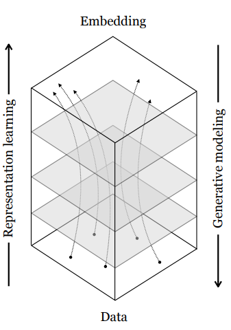
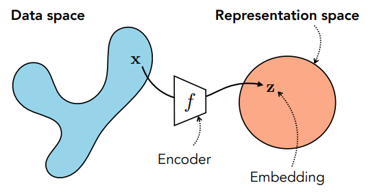
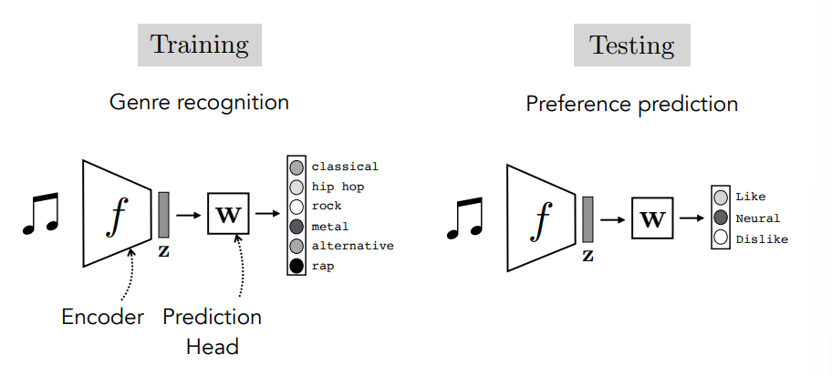
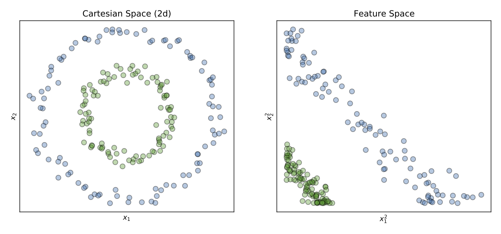
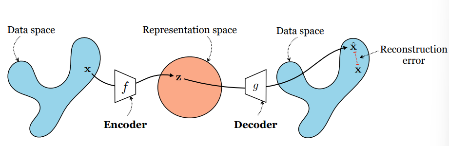
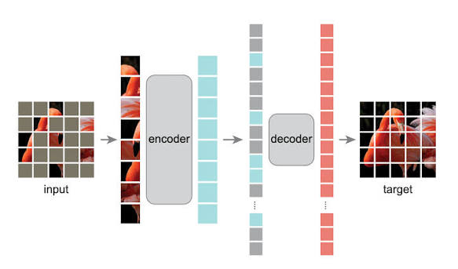

Video: [Lec 11. Representation Learning: Reconstruction-Based](https://www.youtube.com/watch?v=QxOzQRtd440&list=PLUl4u3cNGP63URZnh5iqBzDTDYPUTQT-8&index=11)

Lecture Note: [ocw.mit.edu](https://ocw.mit.edu/courses/6-7960-deep-learning-fall-2024/mit6_7960_f24_lec11.pdf)

## Representation Learning

문장, 그림, 음성 등의 표현은 단어, 픽셀, 주파수 등의 요소로 구성이 된다. 우리는 이러한 다양한 유형의 데이터를 모델에서 처리하기 좋은 형태로 변환할 필요가 있고 이 과정이 representation learning이다. 데이터가 여러 레이어를 통과하면서 각 레이어에서 데이터의 다양한 representative를 생성하게 되고 전체 레이어를 거치며 데이터에 대한 embedding 또는 latent representation이 생성된다. 즉 representation learning은 원본 데이터를 원래 정보가 포함되면서, 사용하기 좋은 feature space로 변환하기 좋은 모델을 학습하는 과정이다.

이때 데이터에 representation learning을 수행하는 과정을 encoding, latent space로부터 원본 형식과 맞는 데이터를 generative modeling, decoding이라고 부른다.

### x2vec

Word2vec, image2vec 등과 같이 우리는 다양한 형태의 데이터를 벡터 형태로 변환할 수 있다. Embedding은 데이터를 신경망의 activation들로 이루어진 벡터, 텐서로 표현한 것이다. 즉, embedding은 다른 vector space로 원본 데이터를 mapping하는 함수라고 생각할 수 있다. 여러 layer를 거치면서 원본 데이터는 각 layer의 함수를 거쳐 이후 작업에 적합한 representation space 위에 위치하게 된다. 이는 layer의 함수들을 어떻게 구성하는지에 따라서 달라진다. 우리가 학생들의 시험 점수로 등수를 낼 때 $$N$$개 과목의 평균 점수를 사용하는 것도 $$f: \mathbb{R}^n\rightarrow\mathbb{R}$$과 같은 함수를 사용하는 것이고 "순위"라는 작업을 위해 편리한 형태로 데이터를 변환하는 것과 유사하다고 생각할 수 있다.

### What do deep nets internally learn?

CNN을 예시로 representation learning에서 실제로 무엇을 학습하는지 확인해보자. [arxiv.org](https://arxiv.org/pdf/1311.2901) 이 논문에서는 CNN에서 특정 레이어를 잘 활성화 시키는 이미지 패치를 살펴보았다. 레이어별로 선, 모서리, 객체와 같이 서로 다른 이미지 패치에 반응하게 되며 여러 레이어별로 이미지의 다른 특징에 반응하게 된다. 한 레이어에서 하나의 특징에만 반응하는 것은 아니고 여러 레이어에서 복합적으로 특징에 학습할 수도 있다.

### What is a representation?

$$
f:\mathcal X\rightarrow\mathbb R^d
$$

Representation learning을 수학적으로 살펴보자. $$\mathcal{X}$$의 원소를 $$\mathbb{R}^d$$ 공간으로 mapping하는 함수를 encoder라고 부른다. 이때 $$z=f(x)$$에서 $$z$$는 $$x$$라는 데이터의 representation이 된다. Encoder는 함수, representation은 함수를 통해 mapping된 새로운 데이터라는 것을 알아두자.

## Why learn representation?

Representation은 왜 필요할까? 이미지의 경우, 각 픽셀과 그 픽셀 RGB 값을 그대로 가지고 작업을 수행할 수 있다고 생각할 수 있다. 그럼에도 representation을 사용하는 이유는 당연하겠지만, representation을 사용했을 때 작업이 더 쉽고, 잘 되기 때문일 것이다. 예를 들어 음악 장르 분류 모델을 생각해보자.

$$
x\xrightarrow{f}z\xrightarrow{g}\hat y
$$

음악을 encoder에 통과시켜 representation을 생성하고, representation을 가지고 classification function을 학습해 음악 장르를 분류할 수 있다.

사실, 위와 같은 작업에서, 우리의 최종 목표는 음악 장르 분류이지 representation을 학습하는 것이 아니다. 그렇다면, representation은 거쳐가게 되는 중간 단계이고, 이후의 단계를 학습해야 하는데 만약 encoder $$f$$로 학습한 representation이 충분히 좋다면, 이를 계속해서 반복 사용할 수 있고 이는 transfer learning의 기본 아이디어가 된다.

### Linear adaptation vs fine-tuning

계속해서 음악 관련 작업을 한다고 생각해보자. 우리는 이전에 음악에 대한 representation을 생성하는 encoder $$f$$를 학습했고, 장르를 분류하는 prediction head $$W$$를 학습했다. 만약, 음악 장르 분류가 아니라 사용자의 음악 선호도 예측을 수행하고 싶다고 하자. 음악 관련 작업이니 이미 학습해 두었던 음악 관련 representation을 재사용할 수 있을 것이라는 생각이 든다. Linear adaptation은 encoder $$f$$는 고정하고, prediction head $$W$$만 재학습한다. 이는 encoder를 재학습하지 않아 비용도 적고 pretrained representation이 새로운 작업에 얼마나 유용한지 평가하기도 쉽다. 하지만, encoder와 representation이 같은 음악 관련 작업이라도, 다른 작업에는 적합하지 않을 수 있다. 이때는 fine-tuning을 수행하게 되고 fine-tuning에서는 encoder $$f$$와 prediction head $$W$$를 모두 학습한다. Encoder pretrain에는 많은 데이터가 필요하지만, fine-tuning은 소량의 데이터만으로도 새로운 representation을 원하는 방향으로 학습할 수 있고, 전체 encoder를 다시 학습하는 것보다 경제적이다. Fine-tuning의 방법으로는 low rank adaptation (LoRA) 등이 있다.

[https://ddungjae.github.io/posts/adam-stochastic-optimization/](https://ddungjae.github.io/posts/adam-stochastic-optimization/)

## How do you learn a good representation?

좋은 representation의 조건으로는 compact, explanatory, disentangled, interpretable 등이 있다. 원본 데이터에서 유의미한 정보만 남기고 불필요한 것을 없애야 하고, 설명력이 필요하며, 독립적인 데이터 요인들이 분리되어야 하고, 사람이 이해할 수 있도록 해석 가능한 특징을 가지면 좋다. 가장 중요한 기준은 "make subsequent problem solving easy"라는 특징이다. Representation은 그 자체가 목적이라기보다는 representation을 가지고 이후의 모델 학습을 하기 위한 것이며 원본 데이터를 사용할 때보다 이후의 과정이 쉬워야 한다.

예를 들어 원본 데이터가 왼쪽과 같이 분포해 있었다면 이를 직접 classification 하기 위해서는 비선형 경계가 필요하지만, 오른쪽과 같이 representation이 feature space에 분포할 때에는 비교적 간단한 linear classification function으로 분류가 된다.

### Supervised learning

Label이 있다면 쉽게 representation을 학습할 수 있다. 데이터와 이에 대한 label이 $$\mathcal D=\{(x_i,y_i)\}_{i=1}^{N}$$ 형태로 주어져 있다면 loss를 최소화하도록 encoder를 학습하면 된다.

$$
f^*=\arg\min_{f\in\mathcal F}
\sum_{i=1}^{N}\mathcal L(f(x_i),y_i)
$$

### Unsupervised learning

하지만, label이 없는 경우가 현실 문제에서는 더 많이 존재한다. 텍스트, 오디오, 이미지 자체에 대한 representation을 학습할 때에는 label이 없고 supervised learning에서 정의한 loss를 사용할 수 없다. 이러한 경우, 데이터 자체의 구조를 학습하게 된다. 이를 위한 두 가지 접근으로 compression과 prediction이 있다.

## Compression

Compression의 종류로는 autoencoding, contrastive, clustering 등이 있다. Compression은 데이터에 포함된 중복 정보를 줄이거나, 특정 변형을 가했을 때 변하지 않는 representation을 학습하는 것을 목표로 한다.

### Autoencoder

Autoencoder는 encoder-decoder 구조로 구성되어 있다. Encoding은 원본 데이터를 의미는 보존하되, 보다 간결하게 표현하는 방법이다. 사실, encoding은 어느 함수나 가지고 수행할 수 있지만, "잘" encoding 되었는지 판단할 수 있는 기준이 필요하고 이 역할을 decoder가 수행한다.

$$
\begin{aligned}
&z=f(x)\rightarrow g(z)=\hat{x}\\
&f^*, g^*=\arg\min_{f, g}\mathbb{E}_\mathbf{x}\|\mathbf{x}-g(f(\mathbf{x}))\|^2_2
\end{aligned}
$$

$$f, g$$는 결국 reconstruction error를 최소화하도록 학습된다. 일반적으로 encoder $$f$$는 원본 데이터를 더 낮은 차원의 벡터로 변환한다. 이때 변환된 데이터가 위치하는 공간을 latent space라고 부른다. "간소화"된 표현을 원하기 때문에 아무래도 낮은 차원으로의 변환이 필요하다. Decoder $$g$$는 latent space의 벡터를 원래 공간으로 복원하는 함수가 된다. 위의 수식은 L2 reconstruction error를 사용해서 모델을 선택하도록 한다. 이때 $$\mathbf{x}\in\mathbb{R}^N, f: \mathbb{R}^N\rightarrow\mathbb{R}^M$$이라고 해보자. 만약, $$f$$가 linear transformation이라면 $$f(x)=W_1x, g(f(x))=W_2W_1x$$라고 표현할 수 있다. 이러한 경우, PCA와 연관이 되어서 $$U_M$$이 PCA의 상위 M개 eigen value에 대응하는 eigen vector로 구성된 행렬일 때 $$\hat{x}=U_M U_M^\top x$$이 L2 error를 최소화한다. PCA는 원래 행렬을 저차원으로 투영할 때 분산이 최대화되도록 하는 방법인데 분산을 최대화한다는 것이 원본 데이터의 성질을 가장 잘 보존하도록 하는 것과 동일하다고 생각할 수 있다. Non-linear function으로 encoder를 구성한다고 한다면 PCA와 비교했을 때 더 다양한, 비선형적인 구조 또한 학습할 수 있다.

### Clustering

Clustering은 데이터를 벡터 등의 연속적 표현이 아닌, 유한 개의 그룹으로 representation을 표현하는 방식이다. Clustering 또한 $$\mathbf{x}\in\mathbb{R}^N, f: \mathbb{R}^N\rightarrow A=\{1, 2, 3, \dots, M\}$$과 같이 원본 데이터를 특정 set의 원소로 대응하는 representation이 된다.

K-means clustering은 데이터를 $$K$$개의 cluster로 나누는데 이때 각 cluster의 중심과 데이터 간의 거리를 최소화하는 알고리즘이다.

$$
\begin{aligned}
&c_1, c_2, \dots, c_K\in \mathbb{R}^d\\
&a_i=\arg\min_{k\in\{1,\dots,K\}}
\|x_i-c_k\|_2^2
\end{aligned}
$$

$$K$$개의 clustering의 중심을 $$c_i$$라고 할 때 각 데이터 $$x_i$$는 자신과 가장 가까운 cluster의 중심에 해당하는 cluster에 할당된다. 이후, decoding에서는 cluster의 중심으로 latent variable을 복원한다 $$(\hat x_i=c_{a_i})$$. 그러면 이때 encoder와 decoder는 각각 $$f(x_i)=a_i,g(a_i)=c_{a_i}$$로 정의가 된다. K-means clustering에서는 다음과 같은 loss function을 최소화하도록 학습된다.

$$
\min_{\{c_k\},\{a_i\}}
\sum_{i=1}^{N}
\|x_i-c_{a_i}\|_2^2
$$

사실상 이 또한 autoencoder와 동일하게 $$f^*, g^*=\arg\min_{f, g}\mathbb{E}_\mathbf{x}\|\mathbf{x}-g(f(\mathbf{x}))\|^2_2$$ L2-reconstruction error를 최소화하는 것이고 단순화된 autoencoder로 볼 수 있다. K-means clustering은 다음과 같은 과정으로 학습된다.

- Initial cluster center에 대해 각 데이터를 가장 가까운 cluster center의 cluster에 할당 $$(a_i\leftarrow\arg\min_k\|x_i-c_k\|_2^2)$$
- 각 cluster center를 해당 cluster에 할당된 데이터의 평균으로 업데이트 $$(c_k\leftarrow\frac{1}{\vert{}C_k\vert{}}\sum_{i:a_i=k}x_i)$$
- 위의 과정을 반복

K-means clustering은 굳이 복잡한 신경망 없이도 clustering을 수행할 수 있도록 한다.

K-means clustering은 일종의 labeling을 학습하는 것과 유사한데 clustering에 할당을 하는 것이 아니라 유한한 벡터 집합인 codebook의 원소로 대응하도록 encoder를 구성할 수 있고 이를 vector quantization (VQ)이라고 부른다.

$$
\mathcal C=\{e_1,e_2,\dots,e_K\}
$$

Codebook은 위와 같이 유한한 개수의 벡터로 구성된다. K-means clustering에서 가장 가까운 cluster의 중심을 선택하는 것처럼 VQ에서도 encoder 출력 결과와 가장 가까운 codebook vector를 대응한다.

$$
k^*=\arg\min_k\|z_e-e_k\|_2^2
$$

이후 encoding된 결과인 $$z_e$$를 $$e_{k^*}$$로 대체한다. 이러한 encoder를 학습할 때에는 이산적인 선택을 수행하기 때문에 일반적인 backpropagation이 아닌 backpropagation with approximation으로 학습을 하게 된다.

## Prediction

Prediction의 종류로는 feature prediction, imputation, pretext tasks 등이 있다. Prediction은 데이터의 일부분을 사용해 다른 부분을 예측하도록 학습하는 것으로 일종의 self-supervised learning과 같은 방식이다.

### Self-supervised learning

Self-supervised learning은 데이터의 일부를 가지고 나머지를 예측하는 방법을 학습한다. Label이 없는 상황에서, 데이터를 feature와 label로 분류해서 학습한다고 생각할 수 있다. 하나의 데이터 $$x=(x_1, x_2)$$가 이와 같이 두 부분으로 구성되어 있다고 해보자. 이때 $$x_1$$을 입력으로 $$x_2$$를 예측하도록 encoder를 학습할 수 있다. Autoencoder는 decoder에서 원본 데이터를 재구성하는 것을 학습했다면 self-supervised learning에서는 decoder가 $$x_2$$를 예측하도록 학습한다.

$$
\begin{aligned}
&\text{Autoencoder: }z=f(x)\rightarrow g(z)=\hat{x}\\
&\text{Self-supervised learning: }z=f(x_1)\rightarrow g(z)=\hat{x}_2\\
&f^*, g^*=\arg\min_{f, g}\mathbb{E}_\mathbf{x}\|\mathbf{x_2}-g(f(\mathbf{x_1}))\|^2_2
\end{aligned}
$$

L2 error를 loss function으로 사용한다면 위와 같은 loss function을 최소화하는 $$f, g$$를 찾게 된다. Self-supervised learning은 label 없이도 supervised learning과 유사한 방식으로 학습이 가능하다.

### Masked autoencoder

Imputation은 데이터에서 누락된 부분을 나머지로부터 추정하는 방법이다. $$x=(x_{\text{observed}},x_{\text{masked}})$$와 같이 원본 데이터를 사용할 부분, 가릴 부분으로 나눈 후 다음과 같이 masking된 부분을 재구성하는 autoencoder를 학습한다.

$$
\hat x_{\text{masked}}
=g_\phi(f_\theta(x_{\text{observed}}))
$$

Masked autoencoder는 이미지를 패치로 분할 후, 전체 패치의 25%만을 사용해 나머지 75%를 재구성하는 것을 학습한다.
