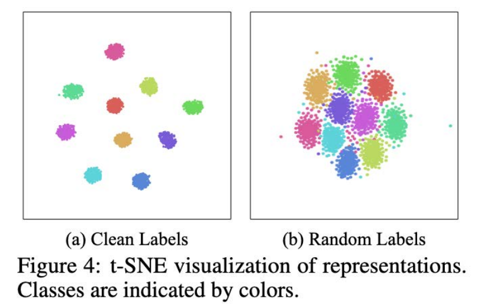
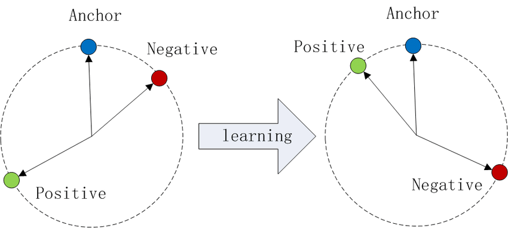
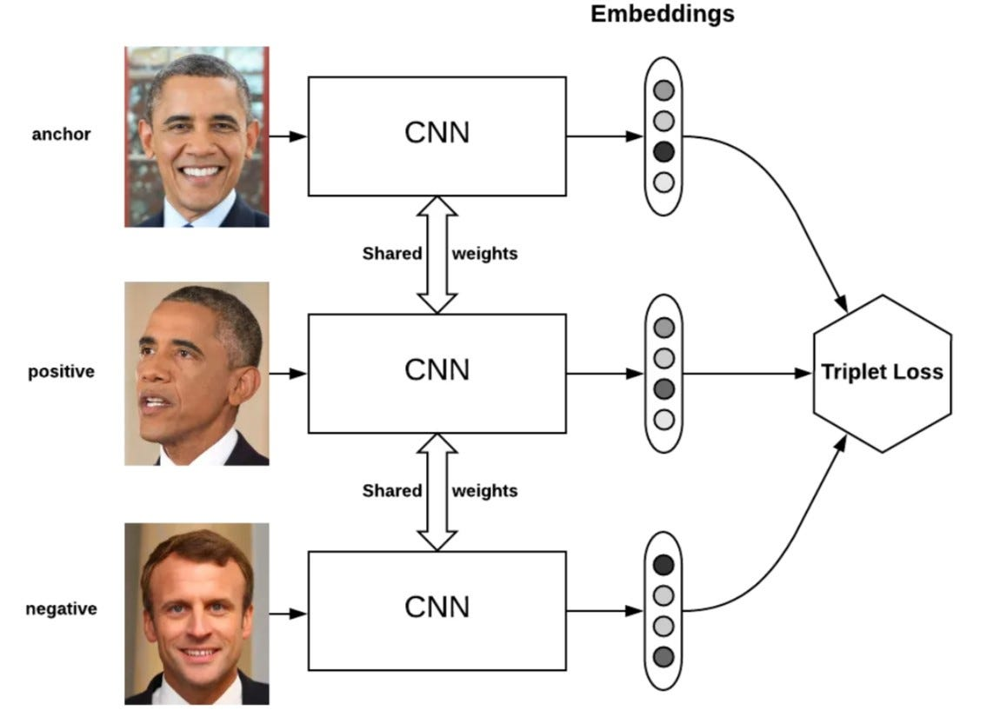
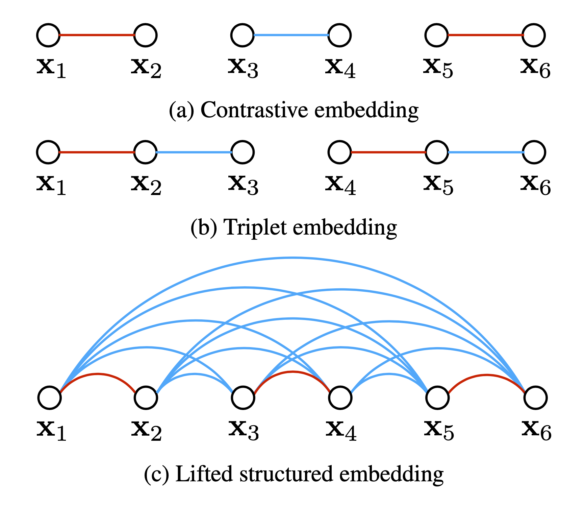
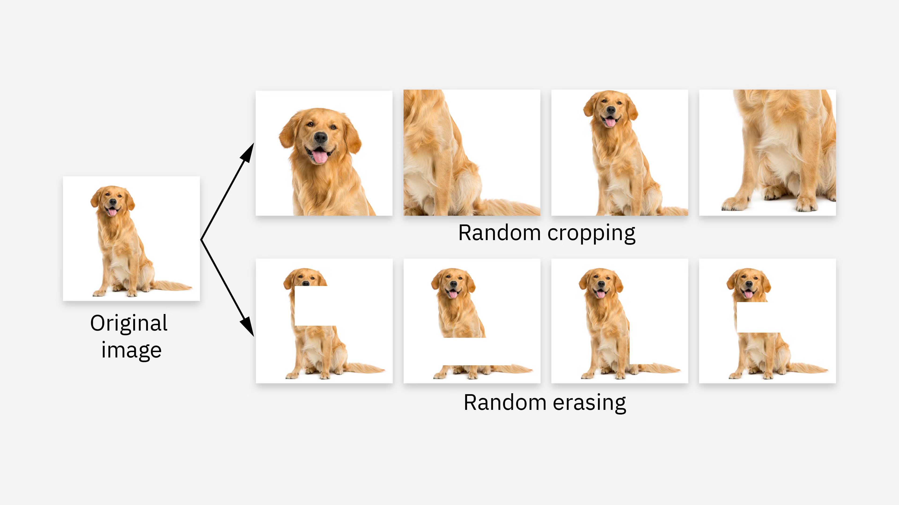
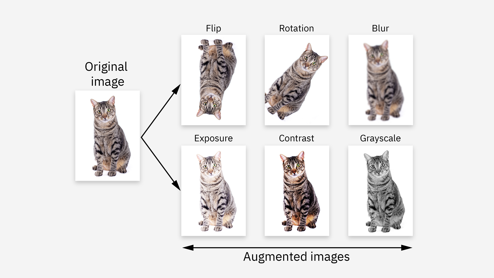
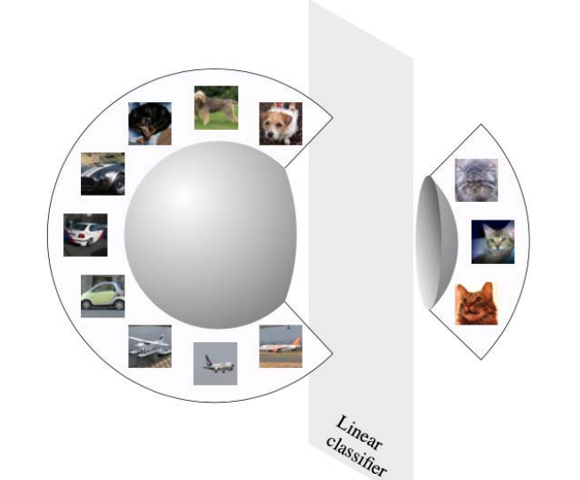

Video: [Lec 12. Representation Learning: Similarity-Based](https://www.youtube.com/watch?v=yUh1fEGGdl4&list=PLUl4u3cNGP63URZnh5iqBzDTDYPUTQT-8&index=12)

Lecture Note: [ocw.mit.edu](https://ocw.mit.edu/courses/6-7960-deep-learning-fall-2024/mit6_7960_f24_lec12.pdf)

## Why learn representations

이전 강의에 이어서 representation을 다룬다. Representation을 다시 살펴보자면 입력 데이터 $$x$$를 새로운 feature space로 mapping 하는 함수를 학습하는 것이 representation learning이 된다.

$$
f: \mathcal{X}\rightarrow\mathbb{R}^d
$$

Representation을 학습하는 목적은 다음과 같은 이유가 있다.

- To improve generalization
- To do more learning (transfer learning)
- To exploit geometric similarity for new data or queries
- To improve clustering with side information
- Dimensionality reduction

## What is a "good" representation?

"좋은" representation은 어떤 특징을 가져야 할까? Representation은 그 자체에 목적이 있다기 보다는 후속 작업, 학습에 좋은 성질을 가져야 한다. 이를 위해 다음과 같은 특징을 가져야 한다.

- Compact and explanatory
- Concentration and separation: 같은 class에 속하는 데이터는 가까워야 하고, 다른 class에 속하는 데이터는 충분히 멀리 떨어져야 함
- Robustness: 의미적으로 중요하지 않은 변화에 대해서는 representation이 크게 변하지 않아야 함

위 그림은 CIFAR-10 데이터셋의 10개 클래스를 clean label과 random label을 사용해 학습한 representation을 t-SNE로 시각화해 보여준다. Clean label을 사용했을 때 클래스별 경계가 뚜렷하고, 같은 클래스끼리 밀집해 있음을 확인할 수 있다. 즉, concentration, separation이 잘 적용된 representation이 된다.

## Similarity-based Representation Learning

이전에 배운 reconstruction-based learning에서는 인코더-디코더 구조를 통해 원본 데이터를 복원하도록 모델을 학습했다. Similarity-based representation은 기하학적 성질을 직접 학습 목표로 사용해 representation을 학습한다. 기준 데이터 $$x$$와 $$x$$와 유사한 $$x^+$$, $$x$$와 다른 특징을 가지는 $$x^-$$가 있다고 해보자. 이때 representation space에서 유사한 샘플끼리는 가까이, 다른 샘플끼리는 멀리 떨어져 있도록 학습하고 싶다.

$$
d(f(x),f(x^+))
<
d(f(x),f(x^-))
$$

Similarity-based representation learning은 이 아이디어를 기반으로 한다.

## Metric Learning

Metric learning은 유사한 샘플의 거리는 가깝고, 다른 샘플의 거리는 멀도록 하는 metric을 직접 학습하는 방법이다. 우리가 일상적으로 사용하는 metric으로는 Euclidean distance$$(d(x_i,x_j)=\vert{}x_i-x_j\vert{}_2)$$가 있다. 어느 두 이미지간의 거리를 Euclidean distance로 계산한다고 할 때, 이미지 픽셀 값을 벡터로 펼친 후 비교한다고 생각해보자. 이러한 방법은 같은 객체에 대해서도 정면인지, 측면인지에 따라서 값이 크게 달라질 수 있고, 서로 다른 객체여도 우연히 픽셀 값이 유사하다면 거리가 가깝다고 나타날 것이다. 그래서 회전, 구도와 같이 객체 자체의 의미 변화가 없는 변형에 강건하고, 유사한 구도여도 다른 객체는 구별할 수 있는 metric 학습이 필요하다. 이를 위해서는 학습 과정에서 서로 다른 객체가 동일한지, 아닌지 정도만 알려주는 weak supervision 정도만 있어도 metric을 학습할 수 있다.

### Metric Learning (Linear)

입력 데이터를 다음과 같이 선형 변환한다고 생각해보자.

$$
z=Wx
$$

원본 데이터 $$x$$를 transform 하는 행렬 $$W$$를 학습하는 것이 목표이다. 이후, transform된 representation space에서 Euclidean distance를 계산해보자.

$$
d(z_i, z_j)^2=||z_i-z_j||^2_2=||Wx_i-Wx_j||^2_2=||W(x_i-x_j)||^2_2=(x_i-x_j)^\top W^\top W(x_i-x_j)
$$

이때 $$A=W^\top W$$라는 새로운 행렬을 정의하자. 그러면 representation space에서의 distance를 다시 표현할 수 있다.

$$
d_A(x_i, x_j)^2=(x_i-x_j)^\top A(x_i-x_j)
$$

이러한 distance를 Mahalanobis distance라고 부른다. Mahalanobis distance를 Euclidean distance와 비교해보자.

$$
\begin{aligned}
&\text{Mahalanobis distance: }d_A(x_i, x_j)^2=(x_i-x_j)^\top A(x_i-x_j)\\
&\text{Euclidean distance }: d(x_i, x_j)^2=(x_i-x_j)^\top I(x_i-x_j)
\end{aligned}
$$

행렬 $$A$$에 따라서 $$x_i^2$$의 비중을 각기 다르게 반영할 수 있음은 물론 $$x_ix_j$$의 상호작용도 distance에 반영할 수 있게 된다. 이때 $$A$$는 positive semidefinite matrix가 된다(거리의 제곱은 음수가 아니어야 함). 이렇게 positive semidefinite matrix $$A$$를 사용한다면 linear transform으로 적절한 representation을 학습할 수 있다.

### Losses: upper/lower bound constraints

그렇다면, matrix $$A$$를 학습하기 위한 최적화 방법을 생각해보자. $$\mathcal{S}$$를 similar pair, 유사한 데이터 쌍의 집합, $$\mathcal{D}$$를 dissimilar pair, 차이가 있는 데이터 쌍의 집합이라고 해보자. 우리가 학습하고자 하는 metric은 similar pair간의 거리는 가깝고, dissimilar pair 간의 거리는 멀기를 원한다. 이에 대한 초기 접근방법으로 다음과 같은 목적식, 제약조건을 정의한다.

$$
\begin{aligned}
\min_{A\succeq0}\quad&
\sum_{(i,j)\in\mathcal S}
d_A(x_i,x_j)^2\\
\text{s.t.}\quad&
d_A(x_k,x_l)^2\geq1,
\quad \forall(k,l)\in\mathcal D
\end{aligned}
$$

목적식을 보면, similar pair간의 거리를 최소화 하는 $$A$$를 찾는 것을 목표로 한다. 하지만, $$A=0$$이면 모든 거리가 0이 되어버리기 때문에 이를 방지하기 위해 dissimilar pair의 거리가 일정 수준 이상이 되도록 제약 조건을 부여한다. 직관적으로 봤을 때 similar pair를 가깝게 하고, dissimilar pair를 멀리 떨어트리는 방향으로 $$A$$를 학습하게 되고 이는 "좋은" representation의 조건에 부합한다.

### Deep metric learning

Linear metric learning을 deep neural network로 확장할 수 있다. Linear metric learning에서는 행렬 $$W$$만을 학습했다면, neural network에서는 nonlinear transformation $$z=f_\theta(x)$$를 학습할 수 있다. Transformation 후 distance는 $$d(x_i,x_j)^2=\vert{}f_\theta(x_i)-f_\theta(x_j)\vert{}_2^2$$가 된다. Deep metric learning은 구도, 색상, 배치, 시점과 같은 인간이 인식하는 비정량적인 관계를 반영하는 metric을 학습할 수 있도록 한다.

## Contrastive learning

서로 다른 세 장의 나방 이미지가 있다. 이중에 어느 두 이미지가 같은 종류의 나방일까? 이는 날개 모양, 무늬의 유무와 같이 다양한 기준에 따라 다른 답이 나올 수 있다. 이러한 측면에서, 어느 두 나방이 동일한지 판단하는 것 보다는, 상대적으로 어느 두 나방이 유사한지 판단하는 것이 쉬울 수 있다. 위의 세 개의 이미지 중에서, "A, B가 서로 유사하다"와 "A, C는 상대적으로 덜 유사하다"라는 정보만 있어도 어느 객체가 유사하고 아닌지를 학습할 수 있다. 이러한 접근법이 contrastive learning의 기본 아이디어가 된다.

### Contrastive losses

Contrastive loss는 상대적인 유사성으로 loss function을 구현한다. Contrastive loss로는 triplet loss를 사용하는데 anchor, positive, negative를 가지고 데이터의 유사성을 표현한다. Anchor $$x$$는 비교의 기준이 되는 데이터이고, positive $$x^+$$는 anchor와 유사한, negative $$x^-$$는 anchor와 다른 의미를 가지는 데이터이다. 이제 다음 두 distance를 비교한다.

$$
d_{ap}=\|f(x)-f(x^+)\|_2
\\
d_{an}=\|f(x)-f(x^-)\|_2
$$

우리는 유사한 데이터는 가까이, 차이가 있는 데이터는 멀리 위치하기를 원하기 때문에 위의 두 거리를 사용해 다음과 같은 학습 목표를 만족하고자 한다.

$$
d_{an}^2\geq d_{ap}^2+m
$$

이는 negative pair간의 거리가 positive pair보다 $$m$$ 이상으로 멀도록 설정하는 것이다. 이때 triplet loss는 아래와 같이 나타난다.

$$
\mathcal L_{\text{triplet}}
=
\sum_{x\in\mathcal X}
\max\left(
0,
\|f(x)-f(x^+)\|_2^2
-
\|f(x)-f(x^-)\|_2^2
+m
\right)
$$

$$d_{an}\geq d_{ap}+m$$이 조건이 만족되었을 때 triplet loss는 0이 되고, 아니라면 양수의 loss가 발생하게 된다. 이후 loss를 최소화 하는 방향으로 metric을 학습할 수 있다. Loss를 줄여나간다는 것은 anchor와 positive의 거리를 줄이고, anchor와 negative의 거리를 늘리는 방향으로 representation space의 기하학적 구조를 변경해 나가는 것이다.

Triplet loss는 anchor, positive, negative를 동일한 CNN에 통과시켜 embedding을 생성한 후, 생성된 embedding으로 loss를 계산한다. Triplet loss와 gradient가 발생하면 loss를 줄이는 방향으로 encoder CNN의 파라미터를 업데이트한다.

### Lifted structured loss

Lifted structured loss는 여러 쌍의 negative pair를 고려한다. $$x_1$$이 anchor, $$x_2$$가 positive, $$x_3, x_4, x_5, x_6$$이 negative라면 lifted structured loss는 모든 negative pair를 고려해 loss에 반영한다.

$$
\begin{aligned}
\mathcal L_{\text{struct}}
&=
\frac{1}{2|\mathcal P|}
\sum_{(i,j)\in\mathcal P}
\max(0,\mathcal L_{\text{struct}}^{(ij)})^2\\
\mathcal L_{\text{struct}}^{(ij)}
&=D_{ij}+\max\left(
\max_{(i,k)\in\mathcal N}(\epsilon-D_{ik}),
\max_{(j,l)\in\mathcal N}(\epsilon-D_{jl})
\right)
\end{aligned}
$$

$$i, j$$라는 pair에 대한 lifted structured loss를 보면 $$i, j$$의 거리만이 아니라 $$i, j$$와의 negative pair 쌍을 모두 고려해 각 $$i, j$$와 가장 가까운 negative pair를 loss에 추가적으로 반영한다. Negative pair임에도 $$\epsilon$$이라는 margin보다 가까운 pair에 대해서 패널티를 부과하는 것이다. 이 방법은 batch 전체의 positive, negative pair 관계를 활용하며 negative pair가 최소 $$\epsilon$$이라는 margin 보다 떨어져 있도록 한다.

### Hard Negative Mining

$$
\mathcal L_{\text{triplet}}
=
\sum_{x\in\mathcal X}
\max\left(
0,
\|f(x)-f(x^+)\|_2^2
-
\|f(x)-f(x^-)\|_2^2
+m
\right)
$$

Triplet loss로 metric을 학습할 때 hard negative를 사용하는 것이 효과적이다. Anchor A, positive P, negative N이 있다고 해보자. 모델이 이미 A, N을 충분히 멀리 배치하도록 학습됐다고 생각해보자. 이때 triplet loss는 0이 된다. 이 pair는 loss를 발생시키지 않기 때문에 더 이상 학습에 도움이 안된다. 하지만, A, P의 거리가 A, N 보다 멀게 학습된 상태라고 하자. 이때는 $$\mathcal{L}_\text{triplet}>0$$이라는 loss가 발생하고 이를 줄이는 방향으로 representation이 업데이트 된다. 결국 모델을 개선하려면, loss가 발생하도록 하는, 현재 상태의 모델이 구별을 잘 못하는 pair를 사용하는 것이 효과적이다.

- Hard negative: $$d(a,n)<d(a,p)$$
  - Negative가 positive 보다 anchor에 더 가까움
  - Loss 발생
- Semi-hard negative: $$d(a,p)<d(a,n)<d(a,p)+m$$
  - Positive가 negative보다 anchor에 가깝지만 margin을 만족하지 못함
  - Loss 발생
- Easy negative: $$d(a,n)\geq d(a,p)+m$$
  - Positive가 negative보다 anchor에 더 가깝고 anchor 이상의 차이가 있음
  - Loss가 발생하지 않음

모델 개선을 위해서는 loss가 발생하는 hard negative, semi-hard negative와 같은 pair가 필요하지 easy negative는 도움이 되지 않는다. 그래서 모든 negative를 무작위로 사용하는 것이 아닌 모델이 잘 구별하지 못하는 negative를 활용할 필요가 있고 이를 hard negative mining이라고 부른다.

## Self-supervised contrastive representation learning

Triplet loss, lifted structured loss는 positive, negative pair의 관계를 사용해 metric을 학습한다. 하지만, positive, negative pair를 사람이 직접 정해주어야 한다면 라벨링만 해도 시간이 아주 오래 걸릴 것이다. 이를 해결하기 위해 Self-supervised contrastive representation learning에서는 데이터 자체에서 similarity 관계를 만들어낸다.

원본 데이터의 의미를 유지하면서 positive pair를 만드는 방법으로는 random crop, erase, resize, cutout, gaussian noise, blur 등이 있다. 이러한 augmentation을 가했어도 하나의 강아지 사진에서 파생되었기 때문에 의미가 보존되어 positive로 정의한다. 반면 강아지 사진과 고양이 사진에서 파생된 데이터를 고르면 서로 다른 원본 데이터를 가지기 때문에 이 쌍은 negative가 된다. 이러한 방식으로 라벨링 없이도 데이터의 원본이 어디인지를 기준으로 positive, negative를 구성할 수 있다.

### Common setup

$$
f:\mathcal X\rightarrow\mathbb S^{d-1}
$$

Encoder를 위와 같이 정의하자. 임베딩된 데이터는 $$(d-1)$$차원의 unit hypersphere 표면에 위치한다. 이때 임베딩된 두 벡터의 내적은 cosine similarity로 표현이 가능하다. 두 벡터가 이루는 각이 동일 할 때 cosine similarity는 1로 최대가 되기 때문에 representation 벡터가 이루는 방향이 비슷할수록 이 cosine similarity는 커지고 다를수록 작아진다.

$$
f(x)^\top f(x^+)=\cos\theta
$$

Cosine similarity를 score로 사용해서 positive, negative pair에 대해 softmax를 적용한다. Anchor $$x$$에 대한 하나의 positive $$x^+$$와 $$N$$개의 negative $$x_i^-$$가 있다고 할 때 이를 positive를 맞추는 classification 문제로 볼 수 있게 된다. Positive pair가 unit hypersphere에서 이루는 각도가 작을수록 positive pair가 선택될 확률이 커진다.

$$
P(x^+\mid x)
=
\frac{
\exp(s(x,x^+))
}{
\exp(s(x,x^+))
+
\sum_{i=1}^{N}\exp(s(x,x_i^-))
}
$$

이후 cross-entropy loss를 적용한다. 이 결과를 InfoNCE loss라고 부른다.

$$
\mathcal L_{\text{InfoNCE}}
=
-\log
\frac{
\exp(f(x)^Tf(x^+)/\tau)
}{
\exp(f(x)^Tf(x^+)/\tau)
+
\sum_{i=1}^{N}
\exp(f(x)^Tf(x_i^-)/\tau)
}
$$

$$\mathcal L_{\text{InfoNCE}}=-\log\frac{\text{Positive Score}}{\text{Positive Score}+\text{Negative Scores}}$$위 loss는 이와 같이도 표현할 수 있는데 loss가 감소하기 위해서는 positive score가 커지고, negative score는 감소해야 하기 때문에 embedding space 상에서 positive pair는 가까이, negative pair는 멀리 위치하게 모델이 학습된다.

### Why map to a hypersphere?

우리가 사용한 encoder는 representation을 hypersphere로 설정한다. 즉, 모든 embedding의 norm을 1로 고정하는 것이다. 그 이유는 다음과 같다.

- Cosine similarity 계산시 embedding 벡터의 크기에는 영향을 받지 않고 각도에만 영향을 받음
- 같은 class의 데이터가 hypersphere의 특정 방향에 밀집되어 있다면 이를 linear classifier 만으로 분류가 가능함

### What is the contrastive loss doing?

Contrastive loss를 사용해 representation을 학습하는 것은 embedding space에서 데이터간의 유사성, 차이성이 metric 상에서 잘 반영되도록 하는 것이다. 따라서 contrastive loss를 통해 학습된 representation은 유사한 데이터가 서로 embedding space상에서 밀집되어 있게 해준다. 이는 서로 다른 특징을 가진 데이터의 군집이 생기게 하고 각 군집이 분리 되어 있어 이후 추가 모델을 학습해 분류, 구분이 쉽도록 한다. 그리고 데이터에 perturbation 등을 가해서 변형이 되어도 해당 데이터의 essential characteristic은 훼손되지 않아 representation은 원본 데이터와 유사한 영역에 위치하도록 한다.
