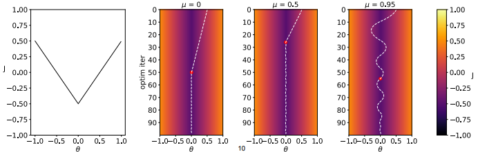
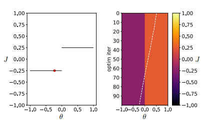
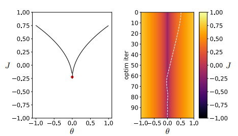
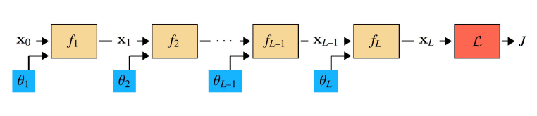
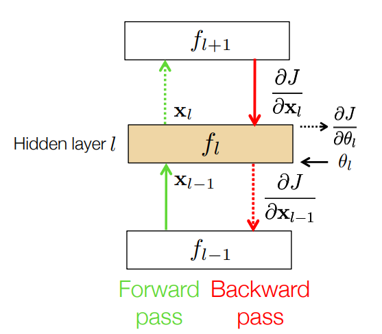
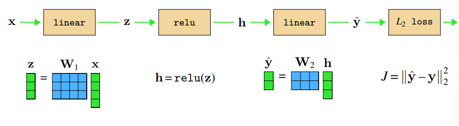
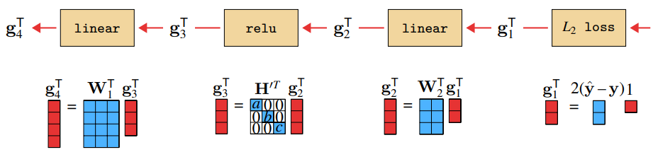
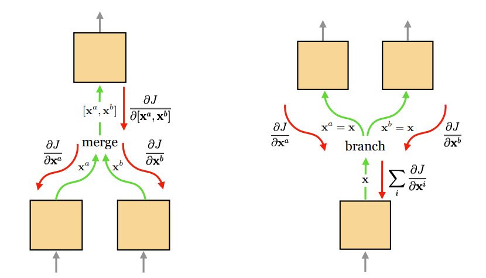

Video: [Lec 02. How to Train a Neural Net](https://www.youtube.com/watch?v=vidCX_dMCu0&list=PLUl4u3cNGP63URZnh5iqBzDTDYPUTQT-8&index=2)

Lecture Note: [ocw.mit.edu](https://ocw.mit.edu/courses/6-7960-deep-learning-fall-2024/mit6_7960_f24_lec2.pdf)

딥러닝의 목표는 실제와 예측의 오차를 줄이는 파라미터를 찾는 것이라고 말할 수 있다. 예측의 대상이 스칼라일수도, 벡터일수도, 행렬일수도, 확률분포일수도 있지만 결국 예측을 "잘"하는 파라미터를 찾아야 한다.

$$
\theta^*=\operatorname*{argmin}_\theta\sum^N_{i=1}\mathcal{L}(f_\theta(\mathbf{x}^{(i)}), \mathbf{y}^{(i)})
$$

예측을  "잘" 하는 기준은 우리가 설정하는 손실함수, 즉 오차 값을 가장 작게 만드는 것이다. 손실함수를 최소화하는 파라미터 $$\theta^*$$을 찾는게 딥러닝에서의 목표이고 이를 위한 여러가지 테크닉이 존재한다.

## Gradient Descent

$$
\theta^{k+1}=\theta^k-\eta\nabla_\theta J(\theta^k)
$$

Gradient descent는 파라미터를 업데이트할 때 해당 시점에서의 손실함수의 gradient 반대 방향(음의 부호 때문)으로 learning rate $$\eta$$ 만큼 이동한다. 직관적으로 봤을 때 물이 높은 곳에서 낮은 곳으로 흘러가는 것처럼 현재 지점에서 가장 변화가 큰 방향은 gradient 반대방향이고 이 방향으로 파라미터를 업데이트를 하며 최적점을 찾는다.

## Stochastic Gradient Descent(SGD)

SGD는 전체 데이터 샘플을 사용해서 gradient을 계산하는게 아니라 매 시점마다 batch에 포함된 데이터에 대해서만 gradient를 계산한다. 수십억 이상의 단위의 데이터 전체에 대해 loss와 gradient를 계산하는 것은 연산량과 시간이 너무 많이 들어 그 중 일부를 선택해 batch를 구성하고 batch에 대해서만 gradient를 계산하면 연산량과 시간에서 이득이 생긴다. 또한 batch 구성은 전체 데이터를 대표하지는 않기 때문에 일종의 노이즈가 추가되는 효과가 있고 이는 local minima에서 파라미터를 탈출해 global minima로 유도해 주기도 한다. 하지만 batch 선택은 일종의 샘플링이기 때문에 전체 데이터를 사용하는 것보다 sample variance가 커져 파라미터가 안정적으로 수렴하지 못하게 될수도 있다.

## Momentum

Momentum method는 이전 시점의 gradient를 exponential average $$m^t=\mu m^{t-1}+(1-\mu)\nabla f(\theta^t)$$ 로 누적해 파라미터 업데이트에 반영한다. Momentum은 gradient가 동일 방향으로 유지될 경우 수렴 속도를 가속해 더 빠른 수렴이 가능하게 한다. 손실 함수 표면이 골짜기 형태인 경우 momentum은 진동은 완화하고, 최적점을 향하는 방향은 누적해 수렴에 도움이 되기도 한다. Saddle point나 local minima에서는 momentum으로 인해 고립되지 않고 해당 지점에서 벗어날 수 있기도 하다. 위의 그림에서 보면 일반 SGD와 비교해 momentum을 적용한 경우 더 빠른 수렴이 가능해진다. 하지만 $$\mu$$를 과도하게 크게 설정한 경우 최적점을 지나 진동하는 overshooting이 발생하고 이를 통해 learning rate을 설정하는 것처럼 momentum 계수도 적절한 선택이 필요함을 볼 수 있다.

## Evolution Strategies

현실 세계의 다양한 문제를 풀다보면 손실함수가 항상 convex이거나, differentiable 하지는 않다. 다양한 형태의 손실함수에 대응하기 위해 다양한 최적화 기법의 발전이 이루어졌다.

### Gradient-like

위와 같이 불연속이지만 평평한 형태의 loss function을 생각해보자. 이러한 경우 gradient descent를 적용해도 gradient가 0이기 때문에 파라미터 업데이트가 발생하지 않는다. 이를 해결하기 위해 gaussian noise를 추가해 파라미터를 업데이트 파면 이와 같은 flat한 손실 함수에서도 최적화가 가능해진다.

$$
\begin{aligned}
&\epsilon_i\sim\mathcal{N}(0, \mathbf{I}), \quad s_i=\mathit{J}(\theta+\sigma\epsilon_i)\\
&\theta^{k+1}=\theta^k-\eta\frac{1}{\sigma M}\sum^M_{i=1}s_i\epsilon_i
\end{aligned}
$$

### Gradient clipping

위의 그림과 같은 손실함수에서는 최적점 근방에서 기울기가 발산하기 때문에 파라미터 업데이트 과정에서 최적점을 지나칠 수 있다. 이러한 경우 gradient clipping을 통해 gradient를 특정 범위 안으로 제한하면 그림에서처럼 최적점을 지나치지 않고 도달할 수 있다.

$$
\begin{aligned}
&\mathbf{v}=\nabla_\theta\mathit{J}(\theta^k)\\
&\theta^{k+1}=\theta^k-\eta[\text{clip}(v_1, -m, m), \cdots, \text{clip}(v_M, -m, m)]^\top
\end{aligned}
$$

## Computation Graphs

현대 딥러닝 아키텍처는 입력에서 출력으로 가는 동안 여러 층의 함수를 거치며 이를 각 노드가 미분가능한 directed acyclic graph (DAG)로 표현이 가능하다.

### Forward pass

위의 그림과 같은 다중 신경망 구조가 있다고 해보자. Loss를 계산할 때에는 입력층부터 시작해서 출력층에 도달할 때까지 순차적으로 레이어를 통과하며 일종의 합성함수를 계산하게 된다. 각 레이어의 입력이 $$\mathbf{x}_{L-1}$$ ($$L-1$$ 번째 레이어의 출력값, 파라미터가 $$\theta_L$$, 함수가 $$f_L$$이고 $$\mathbf{x}_L$$이 출력으로 나와 다음 레이어로 전달된다.

### Learning (Backpropagation)

각 레이어마다 모델 파라미터 $$\theta_L$$을 가진다고 할 때 우리는 최종 loss function $$J$$를 각 $$\theta_L$$에 대해 미분해야 한다. Backpropagation은 연산 결과를 재사용할 수 있게 해주어서 연산량에서 이점을 가진다. 예를 들어 가장 마지막 레이어의 $$\theta_L$$에 대해 그래디언트를 구하면 $$\frac{\partial J}{\partial \theta_L}=\left(\frac{\partial J}{\partial \mathbf{x}_L}\right)\frac{\partial \mathbf{x}_L}{\partial \theta_L}$$이와 같이 나타난다. 다음으로 $$\theta_{L-1}$$에 대해 그래디언트를 구하려면 $$\frac{\partial J}{\partial \theta_{L-1}}=\left(\frac{\partial J}{\partial \mathbf{x}_L}\frac{\partial \mathbf{x}_L}{\partial \mathbf{x}_{L-1}}\right)\frac{\partial \mathbf{x}_{L-1}}{\partial \theta_{L-1}}$$, $$\theta_{L-2}$$에 대해 그래디언트를 구하면 $$\frac{\partial J}{\partial \theta_{L-2}}=\left(\frac{\partial J}{\partial \mathbf{x}_L}\frac{\partial \mathbf{x}_L}{\partial \mathbf{x}_{L-1}}\frac{\partial \mathbf{x}_{L-1}}{\partial \mathbf{x}_{L-2}}\right)\frac{\partial \mathbf{x}_{L-2}}{\partial \theta_{L-2}}$$과 같이 나타난다. 수식을 보면 괄호친 부분이 다음 단계에서 다시 나타나고 이전 단계의 연산 결과를 재사용할수 있음을 알 수 있다. 현대 딥러닝에서 아주 많은 층의 레이어로 신경망을 구성한다는 것을 생각할 때 back-propagation은 모델 학습시 연산량, 학습 시간을 줄이기 위해 필수적임을 알 수 있다.

요약하자면 back-propagation에서는 다음과 같은 과정으로 파라미터를 업데이트한다.

1. Forward pass
   - 입력 벡터 $$\mathbf{x}_0$$부터 $$f_1, f_2, \dots, f_L$$까지를 차례대로 통과시켜 $$f_l$$의 출력 결과인 $$\mathbf{x}_l$$을 얻는다.
2. Backward pass
   - 학습 과정에서 $$l$$번째 레이어는 $$\frac{\partial J}{\partial \mathbf{x}_l}$$을 입력으로 받아 $$\frac{\partial J}{\partial \mathbf{x}_{l-1}}$$을 출력으로 내보내 $$l-1$$ 번째 레이어로 전달한다.
   - 이 과정에서 $$\frac{\partial J}{\partial \theta_l}$$을 계산한다.
3. Parameter update
   - $$\frac{\partial J}{\partial \theta_l}$$을 사용해 gradient descent 등의 방법으로 layer $$l$$의 파라미터 $$\theta_l$$을 업데이트한다.

## Now lets look at a whole MLP

위에서 살펴본 back-propagation에서의 forward, backward pass가 MLP에서 어떻게 적용되는지를 살펴보자.

### Forward

Forward pass는 입력층, 은닉층, 출력층을 차례로 거치며 loss를 계산하기만 하면 된다. 합성함수 형태로 나타내면 $$\hat{\mathbf{y}}=\mathbf{W}_2(\text{relu}(\mathbf{W}_1\mathbf{x}))$$와 같이 표기할 수 있다.

### Backward

Backward pass를 살펴보기 위해 linear layer에서 gradient가 어떻게 계산이 되는지 살펴보자. Forward pass에서 $$\mathbf{x}_l=f_l(\mathbf{x}_{l-1})=\mathbf{W}_l\mathbf{x}_{l-1}$$이라고 하자. 이후 backward pass에서 $$l$$번째 레이어로 $$\frac{\partial J}{\partial \mathbf{x}_l}$$이 입력으로 들어올 때 $$\frac{\partial J}{\partial \mathbf{x}_{l-1}}=\frac{\partial J}{\partial \mathbf{x}_l}\frac{\partial \mathbf{x}_l}{\partial \mathbf{x}_{l-1}}=\frac{\partial J}{\partial \mathbf{x}_l}\mathbf{W}_l$$임을 알 수 있다. 이후 $$\frac{\partial J}{\partial \mathbf{W}_l}=\frac{\partial J}{\partial \mathbf{x}_l}\frac{\partial \mathbf{x}_l}{\partial \mathbf{W}_l}=\frac{\partial J}{\partial \mathbf{x}_l}\mathbf{x}_{l-1}$$과 같이 그래디언트를 계산해 파라미터를 업데이트할 수 있다 $$\mathbf{W}_l^{k+1}=\mathbf{W}_l^{k}+\eta(\frac{\partial J}{\partial \mathbf{W}_l})^\top$$. 이를 MLP에 적용해 backward pass를 구해보자면 $$\mathbf{g}_1^\top=2(\hat{\mathbf{y}}-\mathbf{y})$$, $$\mathbf{g}_2^\top=\mathbf{W}_2^\top\mathbf{g}_1^\top$$, $$\mathbf{g}_3^\top=\mathbf{H}^{'\top}\mathbf{g}_2^\top$$, $$\mathbf{g}_4^\top=\mathbf{W}_1^\top\mathbf{g}_3^\top$$와 같이 계산이 된다.

- linear: $$\frac{\partial J}{\partial \mathbf{x}_{l-1}}=\frac{\partial J}{\partial \mathbf{x}_l}\mathbf{W}_l \rightarrow \mathbf{g}_\text{out}=\mathbf{g}_\text{in}\mathbf{W}\rightarrow \mathbf{g}_\text{out}^\top=\mathbf{W}^\top\mathbf{g}_\text{in}^\top$$
- relu: $$\mathbf{h}=\text{relu}(\mathbf{z})=(\mathbf{1}_{\{z_1>0\}}, \mathbf{1}_{\{z_2>0\}}, \dots, \mathbf{1}_{\{z_n>0\}})^\top \rightarrow \mathbf{H}'=\mathbf{H}'^\top=\begin{bmatrix}\mathbb{1}(z_1>0)&0&0\\0&\mathbb{1}(z_2>0)&0\\0&0&\mathbb{1}(z_3>0)\end{bmatrix}$$

Linear에서 transpose가 등장하는 이유는 chain rule을 적용해서 gradient를 변환할 때 Jacobian의 transpose를 곱해야 하기 때문이다. relu의 경우 indicator function의 형태로 가중치 행렬이 나타나고 이는 전치행렬이기 때문에 forward와 backward process에서 동일하게 사용된다.

## DAGS

Computational graph에서 merge나 branch가 발생하는 경우 gradient는 다음과 같이 계산된다.

- Merge
  - Forward pass: $$\mathbf{x}=[\mathbf{x}^a, \mathbf{x}^b]$$
  - 여러 개의 입력이 합쳐져 다음 노드로 전달
  - Backward pass: $$\frac{\partial J}{\partial \mathbf{x}}=[\frac{\partial J}{\partial \mathbf{x}^a}, \frac{\partial J}{\partial \mathbf{x}^b}]$$
  - Forward pass에서 여러 개의 입력이 concate되어서 다음 노드로 전달되는 경우 이후 backward pass에서도 그래디언트를 입력에 맞게 분리해 이전 노드로 분배
- Branch
  - Forward pass: $$\mathbf{x}^a=\mathbf{x}^b=\mathbf{x}$$
  - 하나의 입력이 여러 개의 다음 노드로 동일하게 전달
  - Backward pass: $$\frac{\partial J}{\partial \mathbf{x}}=\frac{\partial J}{\partial \mathbf{x}^a}+\frac{\partial J}{\partial \mathbf{x}^b}$$
  - $$\mathbf{x}$$가 서로 다른 변환을 수행하는 노드로 전달된 후 최종 loss $$J$$에 영향을 미칠 때 각 노드에서의 그래디언트를 계산해 이전 노드에 합쳐서 전달
