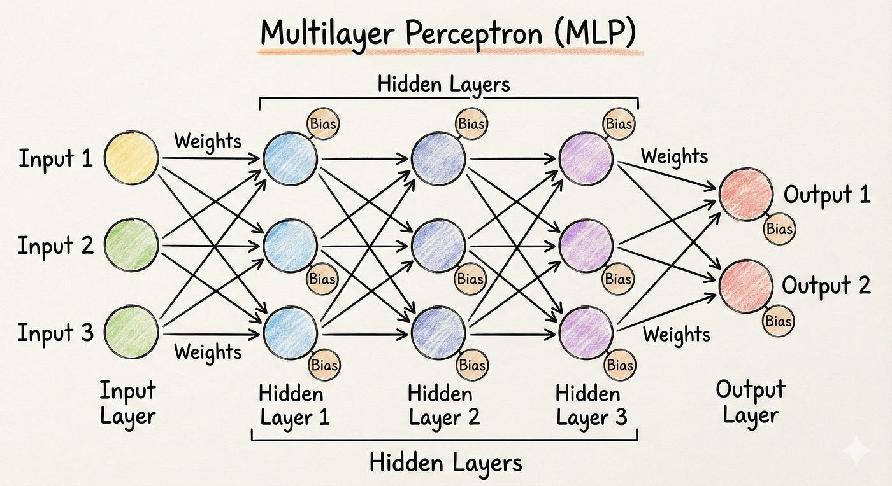
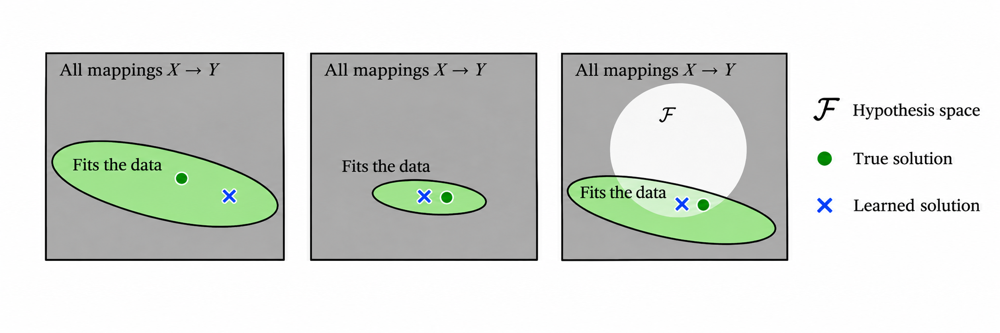
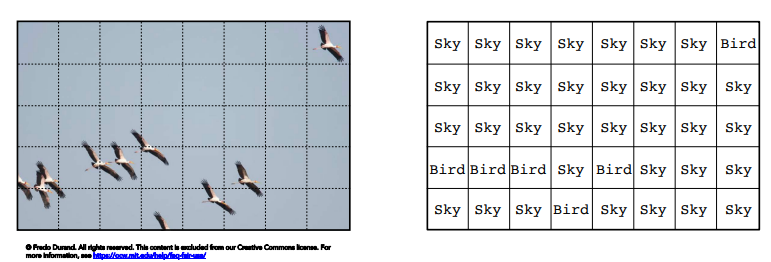
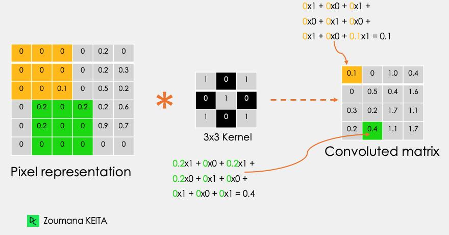
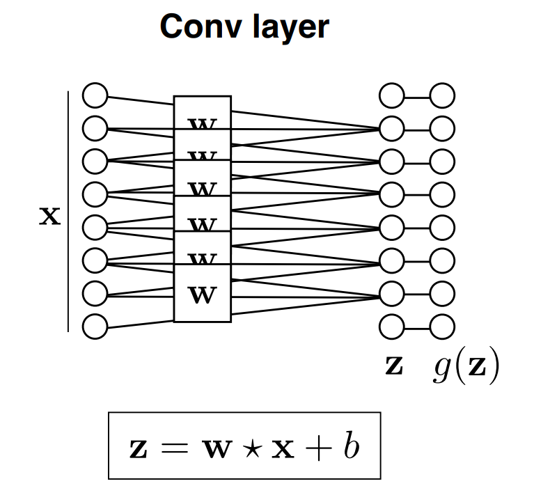
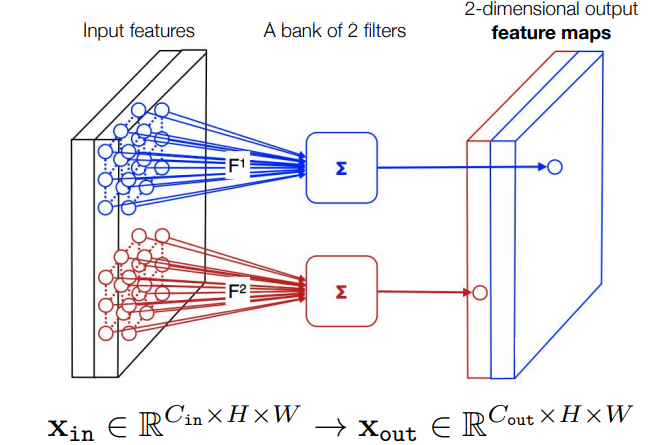
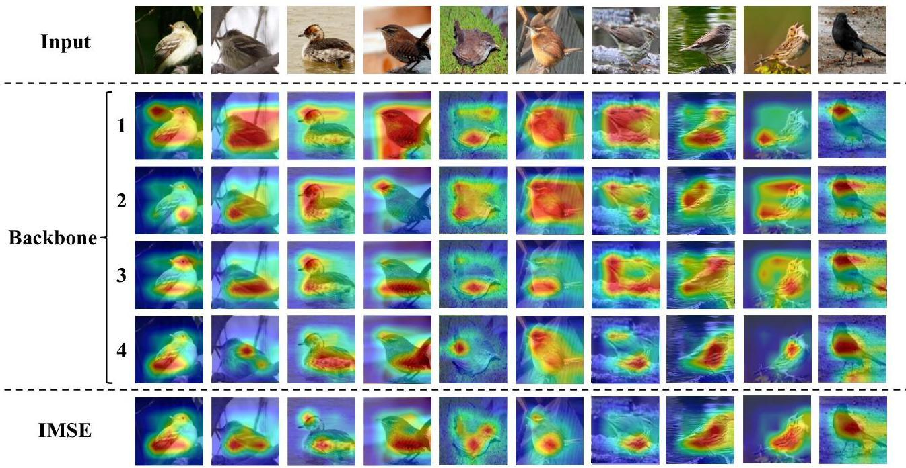
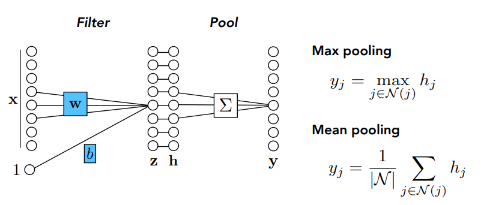
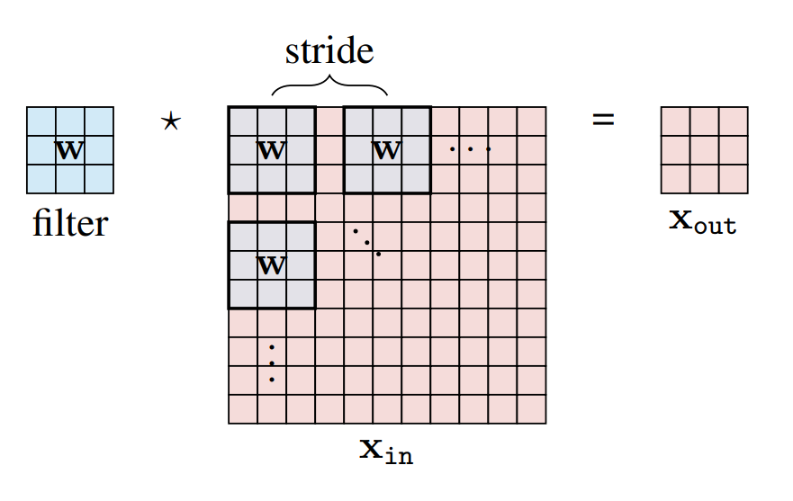

Video: [Lec 04. Architectures: Grids](https://www.youtube.com/watch?v=bxVkZ4M-hIE&list=PLUl4u3cNGP63URZnh5iqBzDTDYPUTQT-8&index=4)

Lecture Note: [ocw.mit.edu](https://ocw.mit.edu/courses/6-7960-deep-learning-fall-2024/mit6_7960_f24_lec4.pdf)

## Multilayer Perceptron

MLP (Multi-Layer Perceptron)에서는 여러 레이어를 거치며 이전 레이어의 출력이 다음 레이어의 입력으로 제공되는 과정을 반복한다. 이때 입력 $$x$$에 대해 $$h=\sigma(Wx+b)$$와 같은 형태로 linear function과 activation function을 거치게 된다. MLP는 다음과 같은 장단점을 가진다.

- 장점
  - Universal approximation theorem에 의해 어느 연속함수도 충분한 수의 노드를 가지는 신경망을 갖추면 근사가 가능함
  - 간단한 linear function, non-linear activation function으로 구성되어 있어 구조가 단순함
  - 같은 레이어에 있는 노드에 대한 독립적 계산이 가능
- 단점
  - MLP는 데이터의 구조적 특성을 고려하지 않고 입력을 하나의 $$\mathbb{R}^n$$ 공간의 벡터로 간주하기 때문에 데이터 특성에 맞는 학습이 어려움
  - 입력에 $$\mathbb{R}^n$$, 출력이 $$\mathbb{R}^m$$인 경우 fully-connected layer에서 $$mn$$개의 가중치를 필요로 하는데 이는 입력, 출력 차원이 커질수록 과도하게 파라미터가 늘어나도록 함

## Why use other architectures?

그렇다면, MLP 이외의 다른 아키텍처를 개발해야 하는 이유는 무엇일까? 데이터가 많아진다면, 자연스럽게 우리는 데이터가 적을 때보다 해당 데이터를 더 잘 근사하는 함수를 찾을 수 있을 것이다. 위의 그림에서, 데이터가 적을 때보다 많을 때, 데이터에 fitting 되는 연두색 영역이 좁아지고 그 안에서 true solution에 더 가까운 solution을 얻을 수 있을 것이다. 하지만 데이터를 무한정으로 많이 수집할 수 없기 때문에 우리는 더 좋은 아키텍처, 즉 모델에 대한 hypothesis space를 설정하는 방법으로 적은 양의 데이터로부터 유의미한 mapping을 얻을 수 있다. 특히 hypothesis space를 적절하게 설정하는 것은 학습 데이터는 물론 out of distribution 데이터에도 모델 성능이 잘 보존이 되도록 한다. 즉 데이터를 많이 수집하는 것만이 아니라 적절한 모델 아키텍처를 개발하는 것도 중요하다.

## Convolutional Neural Networks (CNN)

위와 같이 하늘에서 새들이 날아다니는 사진을 분류하기로 해보자. 전체 그림 자체를 "새", "하늘"이라는 카테고리 중 어느 것으로 분류할지는 살짝 애매하다. 그러면 그림을 여러 패치로 쪼개서 각 패치를 분류해보자. 그러면 몇몇 패치는 확실하게 "새"나 "하늘"로 구분이 되겠지만 새의 일부만 포함된 패치는 어느 카테고리로 포함할지 또다시 모호해지는 면이 있다. 그러면 더욱 정교한 분류를 위해 패치를 아주 작게, 거의 픽셀 단위로 나눈다고 해보자. 하지만 이러한 경우 아주 작은 영역이나, 픽셀만 보고서는 이 패치가 "새"의 일부분인지, "하늘"의 일부분인지 알 수 없다.

- 패치가 너무 큼: 객체가 어느 패치에 속하는지 확실하게 말하기 어려움
- 패치가 너무 작음: 객체를 구분할 만한 최소한의 형태, 맥락을 잃어버림

이에 대한 해결책으로 모든 픽셀을 중심으로 하는 "객체를 인식할 수 있을 정도의" 적당한 패치에 대해서 이 패치를 가지고 중심 픽셀이 어느 클래스에 속하는지를 분류한다. $$\mathcal{D}=\{(X_i, y_i)\}^N_{i=1}$$ 이러한 모델은 $$X_i$$라는 패치의 중심이 $$y_i$$라는 클래스에 속한다는 학습 데이터 쌍으로 지도 학습을 수행한다.

이러한 학습 방법을 위해 convolution이 도입된다.

$$
x_{\text{out}}[n, m]=b+\sum^K_{k_1, k_2=-K}w[k_1, k_2]x_\text{in}[n+k_1, m+k_2]
$$

### Locally connected network+weight sharing

이전에 특정 픽셀을 분류하기 위해서 인접 픽셀을 사용한다고 했다. 즉 하나의 픽셀을 분류하기 위해서는 전체 이미지가 아니라 인접 픽셀만이 필요(locally connected)한 것이다. 또한, 우리는 픽셀의 위치에 관계 없이 같은 가중치를 사용해서(weight sharing) 픽셀을 분류할 수도 있다고 생각할 수 있다. 특정 객체가 이미지의 어느 위치에 있는지는 그 객체의 픽셀을 분류할 때 중요하지 않기 때문이다. 이러한 두 가지 특성을 합쳐 convolution layer을 구성할 수 있다.

이를 행렬로 표기하면 다음과 같이 나타난다.

$$
\begin{bmatrix}
y_1\\y_2\\y_3
\end{bmatrix}
=
\begin{bmatrix}
a&b&c&0&0\\
0&a&b&c&0\\
0&0&a&b&c
\end{bmatrix}
\begin{bmatrix}
x_1\\x_2\\x_3\\x_4\\x_5
\end{bmatrix}
$$

위의 행렬을 보면 $$y_1$$를 계산하는데는 $$x_2$$와 인접한 $$x_1, x_3$$만 사용이 되고, $$y_2$$를 계산하는데는 $$x_3$$과 인접한 $$x_2, x_4$$만 사용이 된다. 이렇게 대각선 방향으로 동일한 값을 가지는 행렬을 Toeplitz matrix라고 부른다. 이러한 convolution layer의 weight matrix는 일반적인 MLP layer의 weight matrix와 달리 구조가 대각 성분 근방으로 성분이 한정되어 있어 학습해야 할 파라미터 수가 적어 학습이 더 쉬워진다. 이처럼 입력이 이동하면 출력도 그만큼 이동하는 성질을 translation equivariance라고 부르는데, weight sharing이 바로 convolution에 이 성질을 부여해준다.

## What if we have color?

지금까지 예시로 다뤘던 이미지는 $$X\in\mathbb{R}^{H\times W}$$ 즉 흑백 grayscale의 $$H\times W$$ 크기의 이미지이다. 하지만 RGB 색상을 가지는 이미지는 $$X\in\mathbb{R}^{3\times H\times W}$$의 공간에 분포하게 된다. 이러한 경우, convolution을 어떻게 수행해야 할까?

각 채널에 대해 $$3\times3$$ kernel을 적용한다고 할 때 weight matrix는 $$W\in\mathbb{R}^{3\times3\times3}$$ 공간에 위치하게 된다. 이는 각 채널별로 독립적인 kernel을 필요로 하기 때문이며 수식으로는 다음과 같이 표현된다.

$$
Y(i,j)=
\sum_{c=1}^{3}
\sum_{u=1}^{3}
\sum_{v=1}^{3}
W(c,u,v)X(c, i+u,j+v)+b
$$

이렇게 생각해보면 우리는 RGB라는 3개의 채널에 대해 각각 convolution을 수행해 하나의 output을 얻은 것으로 볼 수 있다. 하지만, 이미지 내의 다양한 픽셀 간의 관계를 학습하기 위해서는 하나의 채널을 여러 개의 필터에 통과시켜 다양한 채널을 추출할 필요가 있다. 이전에 우리가 입력 차원을 $$X\in\mathbb{R}^{C_{\text{in}}\times H\times W}$$의 형태로 정의했었다. 이미지의 경우로 생각하면 $$H\times W$$의 픽셀 수를 가지는 이미지가 $$C_\text{in}$$만큼의 채널을 가지는 것이다. 이러한 입력에 대한 가중치는 $$W\in\mathbb{R}^{C_{\text{in}}\times K\times K}$$ 영역에 위치하게 된다. 이때 $$K$$는 convolution의 한 변의 크기이다. 이제부터 우리는 단일 채널 출력이 아니라 여러 개의 채널로 출력을 만들기를 원한다. 이러한 경우 $$W\in\mathbb{R}^{C_{\text{out}}\times C_{\text{in}}\times K\times K}$$와 같이 가중치 행렬이 구성되고 일반적인 convolution layer의 가중치 행렬이 이와 같은 구조를 가진다.

$$
\begin{aligned}
Y_{c_2}&=\sum_{c_1=1}^{C_{\text{in}}}W_{c_2,c_1}*X_{c_1}+b_{c_2}\\
X&\in\mathbb{R}^{C_{\text{in}}\times H\times W}\rightarrow Y\in\mathbb{R}^{C_{\text{out}}\times H\times W}
\end{aligned}
$$

이때 convolution은 위와 같은 수식으로 계산이 되며 bias를 포함한 전체 파라미터 수는 $$C_\text{in}$$개의 입력 채널에 대하여 $$C_\text{out}$$의 출력을 위해 각각 $$K^2$$의 파라미터를 필요로 하기 때문에 $$C_{\text{out}}\left(C_{\text{in}}K^2+1\right)$$개가 된다.

여러개의 convolution 필터를 거쳐 생성된 feature map은 각각 이미지의 경계선, 형태, 질감 등 다양한 특징을 학습하게 된다. 이러한 feature map을 다음 convolution layer가 input으로 받아서 새로운 feature map을 생성하게 되고 이미지의 복잡한 형태나 관계를 학습할 수 있게 된다. 레이어가 깊어질수록 한 출력 픽셀이 참조하는 입력 영역인 receptive field도 함께 넓어져서, 뒤쪽 레이어일수록 더 넓은 범위의 맥락을 보고 판단하게 된다.

## Pooling

### Spatial pooling

Pooling은 convolution 이후 영역 안에서 가장 강하게 나타나는 특징을 보존하기 위한 과정이다. 아래와 같은 convolution 결과에서 2 by 2 영역에 대해 max pooling을 수행하면 해당 2 by 2 영역 중 가장 큰 값을 선택하게 된다. 평균을 사용하는 mean pooling도 있다.

$$
\begin{bmatrix}
1&2&3&4\\
5&9&2&1\\
3&4&8&2\\
1&2&3&7
\end{bmatrix}
\quad\longrightarrow\quad
\begin{bmatrix}
9&4\\
4&8
\end{bmatrix}
$$

Pooling은 이미지 내에서 객체나 사물의 미세한 변화가 발생해도 pooling 영역 안에서의 이동은 상쇄시켜 특징을 보존할 수 있도록 해준다.

### Pooling across channels

Spatial pooling이 특정 영역에 대해서 연산을 수행했다면 pooling across channel은 여러 가지의 필터의 출력값 중 가장 큰 값을 선택한다. 예를 들어 수평 방향의 edge, 수직 방향의 edge, 대각선 방향의 edge, 반대 대각선 방향의 edge를 감지하는 필터가 있다고 해보자. 이때 특정 위치에 edge가 존재 유무가 중요하다면 4개의 필터가 출력한 값 중 가장 큰 값을 선택해 "edge"라는 맥락을 보존한다.

즉 spatial pooling은 위치 변화에 대한 안정성을, pooling across channels은 서로 다른 특징 종류에 대한 안정성을 얻을 수 있다. 이렇게 입력이 조금 움직여도 결과가 거의 바뀌지 않는 성질을 translation invariance라고 부르며, 앞서 본 convolution의 translation equivariance와는 구분되는 개념이다.

## Downsampling, strided operation

Downsampling은 feature map에서의 공간적 크기를 줄이는 방법으로 다음 레이어에서 처리할 연산량 감소, 위치 변화 등에 대한 민감도를 줄이기 위해 사용된다. Pooling 또한 downsampling 방법 중 하나이며 pooling은 convolution 수행 결과에 대해 수행하는 반면 stride는 convolution 자체의 연산량을 줄이기 위해 사용한다.

위 그림에서 convolution 필터가 한 픽셀 단위로 움직이지 않고 4픽셀을 건너뛰어 연산을 수행함을 볼 수 있다. 이는 stride, 즉 커널이 이동하는 간격을 4로 설정한 것으로 불필요하게 전체 픽셀에 convolution을 수행하지 않아 연산량 감소에 도움이 된다. Convolution을 반복적으로 적용하면 경계 부분의 픽셀일수록 kernel에 덜 포함되어 정보가 줄어들고 feature map의 크기도 계속 작아지는데, 이를 막기 위해 입력 바깥에 0을 채우는 padding을 사용한다. Padding $$p$$, kernel 크기 $$K$$, stride $$s$$를 적용했을 때 출력 크기는 $$\frac{H-K+2p}{s}+1$$로 계산된다. Convolution 후 pooling을 하거나, stride를 통해 convolution 횟수를 줄이는 방법 모두 downsampling을 위한 기법들이다.
