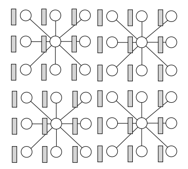
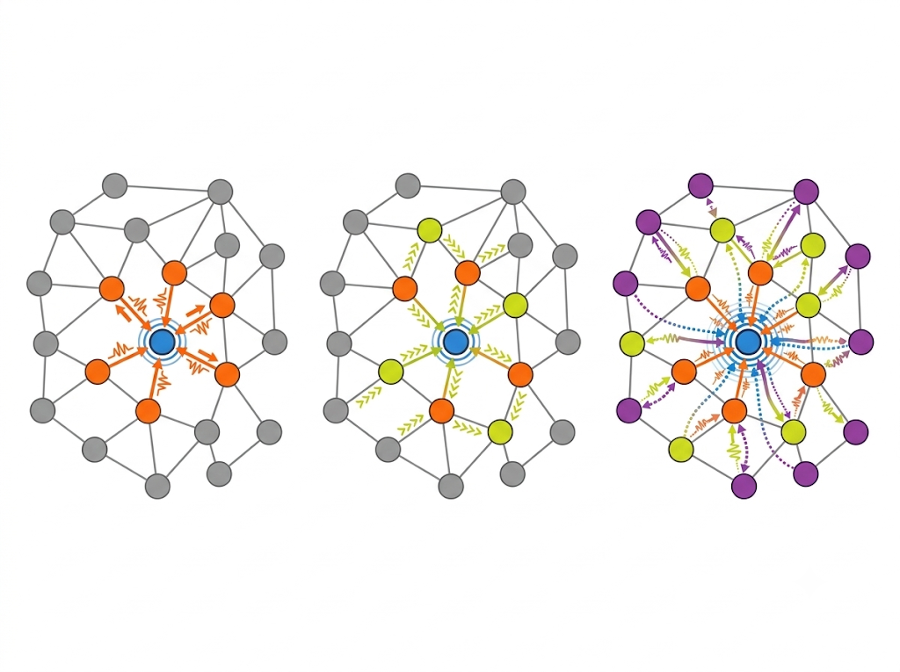
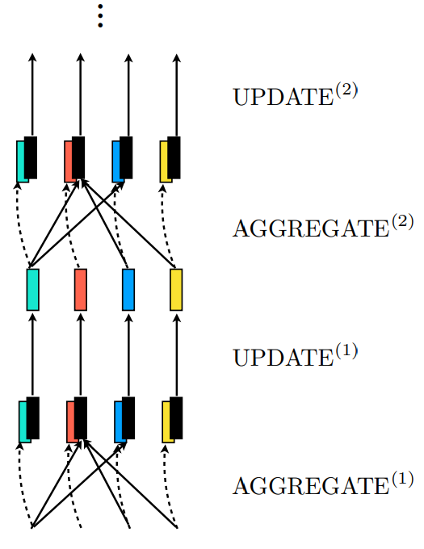
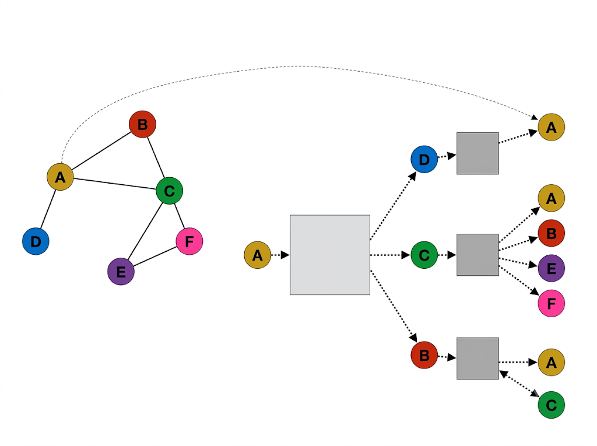
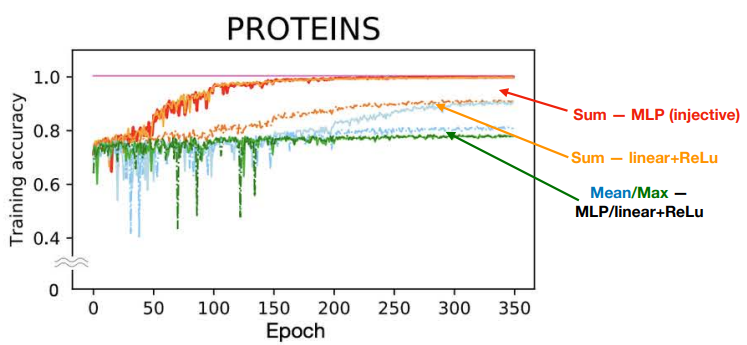

Video: [Lec 05. Architectures: Graphs](https://www.youtube.com/watch?v=0niIwb37nF0&list=PLUl4u3cNGP63URZnh5iqBzDTDYPUTQT-8&index=5)

Lecture Note: [ocw.mit.edu](https://ocw.mit.edu/courses/6-7960-deep-learning-fall-2024/mit6_7960_f24_lec5.pdf)

## Prediction with graphs: examples

GNN을 사용하면 그래프로 나타낼 수 있는 다양한 사회, 자연 현상을 학습, 예측할 수 있다.

- Node classification
- Molecule property prediction
- Polypharmacy side effects
- Predicting traffic times
- Combinatorial optimization

GNN은 다음과 같은 특징으로 인해 위와 같은 문제들을 해결하는 데 효과적으로 사용될 수 있다.

- Graph structure: Node와 edge를 통해 데이터의 관계를 명시적으로 표현 가능
- Message passing: 주변 node의 정보로 현재 node의 상태를 업데이트 가능
- Global information: 여러 레이어를 통해 멀리 떨어진 node의 정보를 반영
- Weight sharing: 동일한 연산을 모든 node에 적용해 다양한 크기의 그래프를 처리

## Two goals

### Idea 1: fully-connected NN?

GNN에서 입력은 그래프와, 각각의 노드에 대한 attribute vector이다. 각 노드 간의 연결 관계는 adjacency matrix로 표현이 되는데 $$n$$개의 노드에 대한 adjacency matrix는 $$A\in \mathbb{R}^{n\times n}$$ 행렬로 표현이 된다. 노드 $$i, j$$가 연결되어 있으면 $$A_{ij}=1$$, 연결되어 있지 않으면 $$A_{ij}=0$$이 된다. 각각의 노드의 특성을 나타내는 feature matrix는 $$X\in \mathbb{R}^{n\times d}$$ 행렬로 표현이 된다. $$X_i$$라는 행벡터는 노드 $$i$$의 feature vector가 된다. GNN은 각 node의 정보를 표현하는 node embedding과 그래프 자체의 정보를 표현하는 graph embedding을 학습해 graph/neighborhood+node/edge attribute로부터 벡터를 생성하는 함수를 얻는 것을 목표로 한다.

GNN을 설계할 때에는 다음과 같은 특성을 고려해야 한다.

1. Permutation invariance for graph embedding

$$
A=\begin{bmatrix}0&1&0\\1&0&1\\0&1&0\end{bmatrix},\quad
P=\begin{bmatrix}0&0&1\\1&0&0\\0&1&0\end{bmatrix}
$$

$$
A'=PAP^\top=\begin{bmatrix}0&0&1\\0&0&1\\1&1&0\end{bmatrix}
$$

노드 간 연결 관계를 나타내는 adjacency matrix는 노드의 순서가 바뀌면 행렬은 변해도 그 행렬이 나타내는 그래프는 동일해야 한다. 즉 $$f(PAP^\top, PX)=f(A, X)$$ permutation에 대해서 GNN은 동일한 값을 출력해야 한다.

2. Permutation equivariance for node embedding

각 노드에 대한 feature matrix의 경우, 노드의 순서가 바뀌면 feature vector의 순서가 바뀌어 각 노드에 맞는 feature가 표현되어야 한다.

$$
f(A', X')=Pf(A, X)
$$

GNN에서는 $$P$$라는 permutation matrix로 노드 순서가 변경된다면 동일하게 $$P$$를 사용해서 permutation을 수행했을 때 올바른 노드에 대해 값이 배정되어야 한다.

### Idea 2: Images are like graphs

그림과 같은 convolution filter를 생각해보자. 3 by 3 kernel을 사용하고 stride를 3으로 설정해 convolution을 수행하는 상황이다. CNN의 픽셀과 convolution을 GNN의 각 구성요소에 대응하면 CNN 또한 GNN과 같이 바라볼 수 있다.

- 픽셀 ↔ node
- 픽셀의 channel vector ↔ node attribute vector
- 인접 픽셀 위치 ↔ 연결된 node
- Convolution ↔ 주변 node 정보를 활용하는 local operator

## Graph Neural Networks

GNN은 다음과 같은 아이디어를 가지고 출발한다.

1. Encode each node (based on message passing between nodes)
2. Aggregate set of node embeddings into a graph embedding

### Encoding neighborhoods: general form

$$
\mathbf{m}^{(k)}_{\mathcal{N}(v)}=\text{AGGREGATE}^{(k)}(\{\mathbf{h}^{(k-1)}_u:u\in\mathcal{N}(v)\})
$$

Aggregate는 주변 노드의 정보를 결합하는 것이다. $$v$$라는 노드와 연결된 $$\mathcal{N}(v)$$라는 노드의 집합이 있을 때 $$\mathcal{N}(v)$$에 속한 $$u$$라는 노드들의 $$(k-1)$$번째 레이어에서의 임베딩을 가지고 연산을 수행해 $$k$$번째 레이어에서 $$v$$에 대한 message를 생성한다. Aggregate function은 주변 노드의 입력 순서에 관계 없이 같은 값을 출력해야 한다. 이러한 특징을 가지는 함수로 sum, average, min/max 등을 사용할 수 있다.

$$
m_{N(v)}^{(k)}=\sum_{u\in N(v)}\frac{h_u^{(k-1)}}{\sqrt{|N(v)||N(u)|}}
$$

각 노드에 연결된 다른 노드의 수(degree)를 고려한 aggregation도 하나의 방법으로 사용된다.

$$
\mathbf{h}^{(k)}_v=\text{UPDATE}^{(k)}(\mathbf{h}^{(k-1)}_v, \mathbf{m}^{(k)}_{\mathcal{N}(v)})
$$

이후 $$v$$라는 노드의 $$(k-1)$$번째 레이어에서의 임베딩과 message를 연산해 $$k$$번째 레이어의 $$v$$의 임베딩을 업데이트한다. 즉 노드의 임베딩을 업데이트할 때에는 인접 노드의 정보를 취합한 후, 해당 노드의 현재 임베딩과 결합해 업데이트를 수행하게 된다.

하나의 레이어만 사용하는 경우 노드와 직접적으로 연결된 1-hop 노드에 대한 정보만 반영할 수 있다. 하지만 충분히 많은 레이어가 사용된다면 2-hop, 3-hop을 넘어 멀리 떨어진 노드와의 관계도 노드 임베딩에 반영이 가능해진다.

### Aggregation functions and updates

$$
m_{N(v)}=\operatorname{MLP}_2\left(\sum_{u\in N(v)}\operatorname{MLP}_1(h_u,h_v)\right)
$$

사실 aggregation function도 고정된 함수를 사용할 필요 없이 학습이 가능하다. 위의 aggregate function의 구조를 보면 첫 번째 MLP가 인접 노드의 정보를 사용해 message를 생성 후 합하면 두 번째 MLP가 최종 aggregated message를 생성한다. 이는 학습 가능한 MLP를 통해 노드 간의 복잡한 관계를 표현할 수 있도록 한다.

$$
h_v^{(k)}=\sigma\left(W_{\text{self}}h_v^{(k-1)}+W_{\text{neigh}}m_{N(v)}^{(k)}+b\right)
$$

이후 update function도 학습 가능한 weight matrix를 사용해 노드 임베딩을 업데이트할 때 사용할 수 있다. GNN에서는 주변 노드의 message를 어떻게 구성할지, 이를 현재 노드의 업데이트에 어떻게 반영할지를 모두 학습 가능하다.

### Graph embeddings

$$
h_G=\operatorname{READOUT}\left(\{h_v^{(K)}:v\in V\}\right)
$$

Message passing을 반복해 모든 노드의 임베딩을 구한 다음에는 READOUT function을 사용해 그래프 임베딩을 구할 수 있다. READOUT function으로는 pooling 등을 사용할 수 있다. 이 값은 그래프 전체를 표현하는 하나의 값이 되고 그래프 자체에 대한 labeling, classification 등에 사용될 수 있다.

## GNNs unrolled

GNN의 한 레이어는 aggregate와 update라는 두 개의 연산으로 구성된다. 이를 MLP의 구조와 비교하면 aggregate는 linear, update는 pointwise와 유사하다. 더 나아가 MLP를 노드 하나로 구성된 GNN이라고 해석할 수도 있다. 노드가 하나뿐이기 때문에 aggregate 연산이 필요하지 않고 update만 수행하면 되는데 이는 $$h^{(k)}=\sigma(W^{(k)}h^{(k-1)}+b^{(k)})$$ 이와 같이 표현되고 linear과 activation function을 차례로 적용한 MLP의 한 레이어에서의 연산과 동일하다.

## Generalizations

GNN에서 그래프의 다양한 관계를 반영하는 여러 가지 방법이 있다. Aggregate를 수행할 때 node feature만이 아니라 edge feature까지 반영해 연결 자체의 특성까지 message 생성에 활용할 수 있다.

$$
m_{N(v)}=\sum_{u\in N(v)}\operatorname{MLP}(h_u,h_v)
$$

이를 edge feature까지 반영하도록 확장하면 다음과 같다.

$$
m_{N(v)}=\sum_{u\in N(v)}\operatorname{MLP}(h_u,h_v,w_{uv}),\quad w_{uv}\text{는 edge feature}
$$

추가적으로 edge type에 대해서도 다른 aggregation 연산을 정의해서 사용할 수도 있다. Attention mechanism을 GNN의 aggregation에 적용한다면 인접 node별로 중요도에 따라 가중치를 부여해 어느 node의 feature를 더 강하게 반영할지도 정할 수 있다.

$$
m_{N(v)}=\sum_{u\in N(v)}\alpha_{v,u}h_u
$$

## Node embeddings: tree view

Node embedding을 계산할 때 인접 노드의 feature를 aggregate해 message를 반영해 계산을 하게 된다. 각 node embedding을 계산하는 데 필요한 노드의 의존 관계를 tree 형태로 표현할 수 있다. 이때 동일한 노드가 tree 안의 여러 계산 경로에서 반복적으로 등장함을 확인할 수 있다.

## Weight sharing

GNN에서는 하나의 레이어 안에서는 모든 노드가 동일한 aggregation function을 공유한다.

$$
\begin{aligned}
h_A^{(k)}&=\operatorname{UPDATE}_{\theta_k}\left(h_A^{(k-1)},m_{N(A)}^{(k)}\right)\\
h_B^{(k)}&=\operatorname{UPDATE}_{\theta_k}\left(h_B^{(k-1)},m_{N(B)}^{(k)}\right)
\end{aligned}
$$

위의 노드 A, B에서의 aggregation function이 같은 파라미터 $$\theta_k$$를 공유하는 것으로 해석할 수 있다. $$\theta_k$$는 몇 번째 레이어인지에만 의존하고 어느 노드에서나 동일한 연산을 수행하는 것이다. 이는 학습 과정에서 등장하지 않았던 노드나, 새로운 그래프에도 동일한 aggregation function을 적용할 수 있도록 한다.

## Training a GNN

GNN에서 우리가 학습하고자 하는 값은 node-level prediction (개별 노드의 label을 예측), graph-level prediction (그래프 전체의 label을 예측) 등으로 나타날 수 있다.

- Node-label prediction
  - 학습 데이터: $$\{(v_i, y_i)\}^m_{i=1}$$
  - $$\hat{y}_v=\text{MLP}(h^{(K)}_v)$$
  - 노드 각각에 대한 라벨링 데이터로 학습 후 node embedding을 MLP로 학습해 예측에 사용
- Graph-label prediction
  - 학습 데이터: $$\{(G_i,y_i)\}_{i=1}^{m}$$
  - $$h_G=\operatorname{READOUT}\left(\{h_v^{(K)}:v\in V\}\right)$$, $$\hat y_G=\operatorname{MLP}(h_G)$$
  - Graph embedding을 계산 후 MLP로 학습해 그래프 자체의 label 예측에 사용

GNN을 학습할 때에도 일반적인 neural network와 유사하게 forward, backward pass를 통해 loss와 gradient를 계산하고 back-propagation으로 파라미터를 업데이트한다.

## Approximation Power

GNN이 $$f$$라는 함수를 통해 그래프 임베딩을 계산한다고 해보자. 이때 서로 다른 그래프 $$G, G'$$에 대해 $$f(G)\not= f(G')$$이 되도록, 즉 GNN이 서로 다른 그래프를 구분할 수 있을까?

### Which functions can GNNs Approximate?

$$
\text{Theorem: If function }H\text{ on a compact domain does not assign different labels to graphs in one equivalence class, then it can be approximated by message passing GNNs:}
$$

$$
\forall\epsilon>0,\;\exists F\in\mathcal{F}_{\mathrm{GNN}}:\sup_{G\in K}\|H(G)-F(G)\|\leq\epsilon
$$

위의 theorem에 따르면 $$H$$라는 함수가 GNN이 구별할 수 없는 그래프들에 서로 다른 값을 부여하지 않는다면 GNN은 이 함수를 $$\epsilon$$ 이하의 오차를 가지도록 근사할 수 있다. 즉 GNN은 서로 다른 그래프를 구분할 수 있는 함수를 근사할 수 있다는 점이다. 그렇다면, 구분할 수 있는 그래프와, 없는 그래프를 명확히 해야 한다.

$$
\text{Theorem: Any GNN can at best distinguish the same graphs as the 1-dim WL algorithm.}
$$

위 theorem에 따르면 GNN은 1-dimensional Weisfeiler-Leman Algorithm의 구별 능력을 뛰어넘을 수 없다. GNN의 그래프 구분 성능의 상한이 있는 셈인데 그러면 1-dimensional Weisfeiler-Leman Algorithm이 무엇인지도 알아야 한다. 해당 알고리즘에 대한 설명은 [Weisfeiler Leman graph isomorphism test](https://en.wikipedia.org/wiki/Weisfeiler_Leman_graph_isomorphism_test) 이 링크를 참고하자.

### How could we ensure that the aggregation is injective?

GNN에서 서로 다른 인접 node의 multiset을 구별하기 위해 injective한 aggregate function을 필요로 한다. Sum, mean, min/max 등의 함수는 항상 injectivity를 보장하지는 않아 non-linear transformation을 결합하면 injectivity가 보장되는 aggregation을 구성할 수 있다.

$$
f_{\mathrm{Agg}}(S)=g_1\left(\sum_{h\in S}g_2(h)\right)
$$

Non-linear function $$g_1, g_2$$에 대해 aggregation function을 위와 같이 구성하면 multiset function을 표현할 수 있고 $$g_1, g_2$$는 MLP로 학습 가능하기 때문에 아래와 같은 aggregation function을 학습할 수 있다.

$$
m_{N(v)}^{(k)}=\operatorname{MLP}_2\left(\sum_{u\in N(v)}\operatorname{MLP}_1\left(h_u^{(k-1)}\right)\right)
$$

위 실험 결과에서는 MLP로 학습한 injective aggregation function을 사용할 때 단백질 분류 실험에서 더 높은 accuracy를 가짐을 보여준다.
