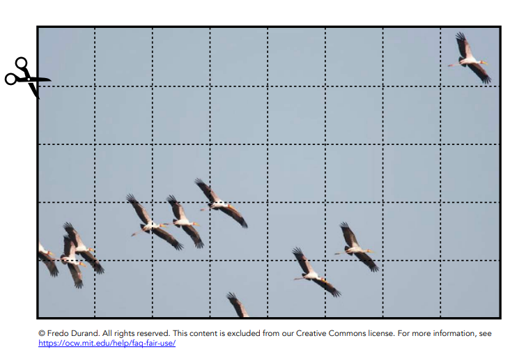
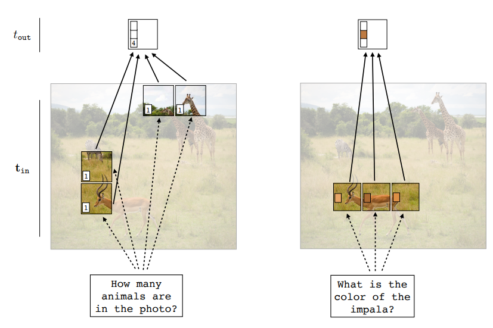
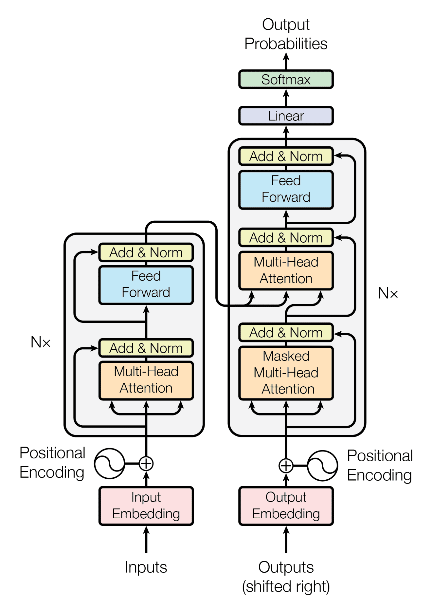
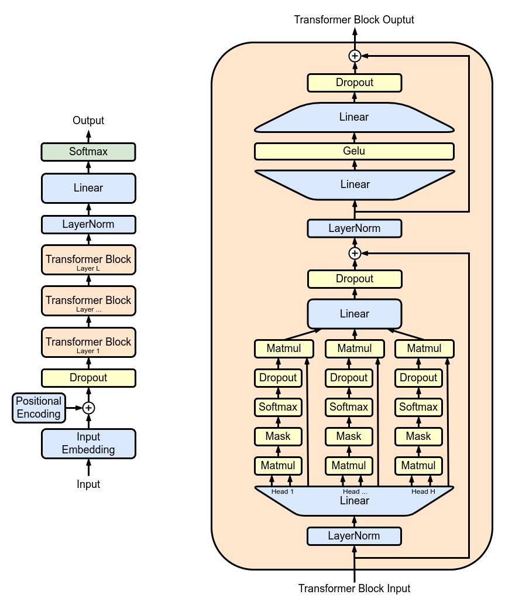

Video: [Lec 08. Architectures: Transformers](https://www.youtube.com/watch?v=Q1HOKrNeh2M&list=PLUl4u3cNGP63URZnh5iqBzDTDYPUTQT-8&index=8)

Lecture Note: [ocw.mit.edu](https://ocw.mit.edu/courses/6-7960-deep-learning-fall-2024/mit6_7960_f24_lec8.pdf)

## A Limitation of CNNs

CNN의 기본 아이디어는 이미지를 패치 단위로 쪼개는 것부터 시작해서, 한 픽셀을 중심으로, 인접 픽셀의 정보를 convolution kernel로 연산해서 반영하는 것이다. 그렇다면, 위의 이미지에서, 오른쪽 위에 있는 새와 왼쪽 아래의 새가 같은 개체인지를 CNN으로 확인할 수 있을까? CNN은 국소적인 특징을 추출하기에는 적합하지만, 멀리 떨어진 위치의 정보를 교환하려면 여러 convolution layer를 거쳐 receptive field를 확장해야 한다.

## New idea #1: tokens

### A New Data Type: Tokens

Token은 여러 개의 scalar neuron을 묶어서 표현한 벡터이다. MLP에서 뉴런 하나에는 보통 activation function을 거친 실수 값이 할당된다. 하지만 token은 이러한 뉴런이 합쳐져 나타난 형태로 벡터가 된다. GNN에서 각 노드가 node attribute로 벡터를 하나씩 가지는 것과 유사하다고 볼 수도 있다. Token이 뉴런으로 구성되어 있다고 해도 transformer에서는 token 하나하나를 연산 단위로 사용한다.

### Tokenizing the input data

이미지를 예시로 들면 CNN에서는 픽셀 단위로 연산을 수행했으나 이미지를 패치 단위로 나눈 후, linear projection 등을 수행해 token으로 변환할 수 있다.

$$
t_i=W_{\text{tokenize}}p_i+b
$$

기존에 MLP에서는 이미지의 픽셀 행렬을 flatten 후 하나의 벡터$$(\mathbb{R}^N)$$로 변환해 입력으로 사용했다면 토큰화된 이미지는 차원이 하나 추가된다고 볼 수 있다$$(\mathbb{R}^{P\times Q})$$.

즉 $$t_1, t_2, \dots, t_N\in \mathbb{R}^d$$와 같이 $$N$$개의 토큰이 $$\mathbb{R}^d$$ 공간에 위치한다면 이를 하나의 행렬로 만들게 된다.

$$
T=
\begin{bmatrix}
t_1^\top\\
t_2^\top\\
\vdots\\
t_N^\top
\end{bmatrix}
\in\mathbb R^{N\times d}
$$

Transformer의 기본 입력은 이와 같이 token matrix가 된다.

### Linear combination of tokens

기존 MLP에서는 $$\mathbf{x}_\text{out}=W\mathbf{x}_\text{in}$$과 같이 뉴런의 선형 결합 후 activation function을 취해 연산을 수행했다. Token에 대해서도 유사한 연산이 사용된다. $$T_\text{out}=WT_\text{in}$$과 같이 계산을 할 때 $$T_\text{in}\in\mathbb R^{N\times d}$$이므로 $$W\in\mathbb{R}^{M\times N}, T_\text{out}\in\mathbb{R}^{M\times d}$$가 된다. $$W$$는 서로 다른 token을 어느 비율로 결합할지 결정하는 행렬이 된다.

### Token-wise nonlinearity

$$
\begin{aligned}
T_{\text{out}}[i,:]&=F_\theta(T_{\text{in}}[i,:])\\
F_\theta(t_i)&=W_2\sigma(W_1t_i+b_1)+b_2
\end{aligned}
$$

Token 간의 linear combination 수행 후에는 token-wise nonlinearity를 일반적으로 MLP를 사용해 적용하게 된다. 이때 $$F_\theta(t_i)$$를 계산할 때 다른 token은 관여가 되지 않으며 다른 token 사이의 정보 결합은 linear combination에서만 발생하고 token-wise로 MLP를 적용할 때는 각 token에 대한 nonlinearity만 적용이 된다.

### Token nets vs GNN

Token 연산에서는 token 간의 linear combination을 통해 token mixing 후 MLP에 통과시켜 token-wise nonlinearity를 추가한다. 이를 aggregate 후 update라는 GNN의 구조와 비교해보면 유사한 점을 발견할 수 있다. Aggregate 단계에서 인접 node attribute를 활용해 node attribute를 업데이트했는데 각 단계가 token mixing과 token-wise nonlinearity에 대응함을 확인할 수 있다. GNN이 서로 연결된 노드끼리 정보를 주고받는 것과 달리 transformer는 모든 노드가 연결된 fully-connected GNN처럼 해석할 수 있다.

## New idea #2: attention

이전 단계에서 token mixing을 수행할 때 $$W$$라는 고정된 가중치를 사용했다. 하지만, 가중치를 고정하는 것이 아니라, 입력 데이터에 따라 동적으로 가중치가 변하도록 하는 것이 attention의 핵심 아이디어이다.

$$
T_\text{out}=WT_\text{in}\text{ vs }T_\text{out}=A(T_\text{in})T_\text{in}
$$

$$A$$가 $$T_\text{in}$$에 대한 함수이기 때문에 입력 token 중 어느 token의 정보를 얼마나 사용할지 유동적으로 결정할 수 있다.

하나의 그림을 보고 위와 같이 서로 다른 질문에 대해 답할 때 질문에 따라 그림에서 집중해서 봐야 하는 부분을 attention은 결정할 수 있게 해준다.

### Query-key-value attention

Query-key-value attention에서는 query, key로 유사도를 계산 후, 이를 사용해 value에 대한 가중치를 결정해

$$
s_{ij}=q_i^\top k_j
$$

Query, key에 대해서 위와 같이 cosine similarity와 같은 방법으로 유사도를 계산한다. 이후 $$s_{ij}$$에 대해 softmax를 취하면 $$i$$번째 query가 $$j$$번째 token을 얼마나 활용할지 결정하는 가중치를 얻을 수 있다.

$$
\begin{aligned}
\alpha_{ij}&=\frac{\exp(s_{ij})}{\sum_{\ell=1}^{N}\exp(s_{i\ell})}\\
o_i&=\sum_{j=1}^{N}\alpha_{ij}v_j
\end{aligned}
$$

가중치 $$\alpha_{ij}$$를 활용해 value에 대한 weighted sum을 계산하면 어느 token을 출력에 가장 크게 반영할지를 반영할 수 있게 된다.

### Self-attention

이전에 설명한 attention에서는 query를 위한 입력이 외부에서 주어졌으나 self-attention은 기존에 보유한 token 집합 내부에서 attention을 계산한다. 예를 들어 $$N$$개의 token이 있다고 했을 때 $$N$$개의 token 모두가 각각 query 역할을 하면서 나머지 token들과의 attention을 계산하게 된다. 그러면 각 token에 다른 token의 정보가 반영되어 업데이트된다.

$$
\begin{aligned}
T&=\begin{bmatrix}t_1^\top\\t_2^\top\\t_3^\top\\t_4^\top\end{bmatrix},\\
q_1&=W_Q^\top t_1,\quad k_j=W_K^\top t_j\\
&\Rightarrow\ o_1=\alpha_{11}v_1+\alpha_{12}v_2+\alpha_{13}v_3+\alpha_{14}v_4
\end{aligned}
$$

Self-attention은 $$T\in \mathbb{R}^{N\times d}$$이라는 token 입력에 대하여 $$N$$개의 모든 token에 대해 attention을 수행해야 한다. 이때 각 token을 학습 가능한 projection matrix에 통과시켜 query, key, value를 계산하게 된다.

$$
\begin{aligned}
Q&=TW_Q\\
K&=TW_K\\
V&=TW_V\\
&\text{where }Q, K\in\mathbb{R}^{N\times m},\ V\in \mathbb{R}^{N\times v}
\end{aligned}
$$

이를 가지고 attention을 계산하면 $$S=QK^\top\in \mathbb{R}^{N\times N}$$이고 $$S_{ij}=q_i^\top k_j$$ 즉 $$i$$번째 token과 $$j$$번째 token의 유사도가 된다. $$S$$는 softmax의 입력값이 지나치게 커져 확률이 극단적으로 치우치지 않도록 scaling된다.

$$
\operatorname{Attention}(Q,K,V)
=
\operatorname{softmax}
\left(\frac{QK^\top}{\sqrt m}\right)V
$$

이후 유사도에 softmax를 취해 가중치 행렬을 만든 후 value matrix를 곱해주면 $$T$$라는 토큰 집합에 대한 self-attention이 계산된다.

### Multihead self-attention

$$
\begin{aligned}
Q^{(h)}&=TW_Q^{(h)}\\
K^{(h)}&=TW_K^{(h)}\\
V^{(h)}&=TW_V^{(h)}\\
O^{(h)}&=\operatorname{Attention}\left(Q^{(h)},K^{(h)},V^{(h)}\right)
\end{aligned}
$$

Multi-head self-attention은 token 간의 다양한 관계를 학습하기 위해 고안되었다. 하나의 query, key, value matrix만 가지고 attention을 계산하면 token 간의 하나의 관계만을 파악할 수 있지만 여러 개의 matrix를 가지고 attention을 독립적으로 계산하면 token 간의 다양한 관계를 학습할 수 있다.

$$
\operatorname{MSA}(T)
=
\operatorname{Concat}
\left(O^{(1)},\ldots,O^{(H)}\right)W_O
$$

이렇게 여러 개의 행렬로 구한 attention을 concat하면 multi-head self-attention을 계산할 수 있게 된다.

지금까지의 과정을 총정리해 transformer block의 전체 구조를 살펴보자. 그전에 transformer block에서 사용되는 연산 두 가지를 알아야 한다.

$$
\operatorname{LN}(x)
=
\gamma\odot
\frac{x-\mu}{\sqrt{\sigma^2+\epsilon}}
+\beta
$$

Layer normalization에서는 token을 평균, 분산을 사용해 정규화한다. 일반적으로 scalar $$\gamma$$와 bias $$\beta$$ 모두 학습 가능하다. 이후 residual connection을 통해 다음과 같은 연산을 수행한다.

$$
y=x+F(x)
$$

신경망을 통과한 연산 결과와 기존 입력을 더하는데 이는 기존 표현을 유지하면서 변화량만 더하는 구조로 해석할 수 있다. Transformer block에서는 위의 두 연산을 활용해 pre-layernorm과 transformer block을 계산한다.

$$
\begin{aligned}
U&=T+\operatorname{MSA}(\operatorname{LN}(T))\\[4pt]
T'&=U+\operatorname{MLP}(\operatorname{LN}(U))
\end{aligned}
$$

위에서 $$U$$는 layer normalization을 거친 token matrix에 multi-head self-attention을 수행 후 residual connection을 적용한 결과이다. 이는 attention을 통해 서로 다른 token의 관계를 학습하면서 기존 token representation에 반영하는 것이다. 이후 $$U$$를 다시 layer normalize 한 후 각 토큰에 MLP를 독립적으로 적용한 후 residual connection을 수행해 $$T'$$을 얻는다. 이 단계에서는 token 간의 관계를 반영하지는 않고 각 token의 내부 feature를 MLP에서 nonlinearity를 반영하게 된다.

## New idea #3: positional encoding

Positional encoding은 self-attention에서 token에 대한 순서 정보를 제공하기 위한 방법이다. 이를 위해 token마다 해당 token의 위치를 나타내는 벡터를 추가한다.

$$
\begin{aligned}
\tilde t_i&=t_i+p_i\\
\tilde T&=T+E_{\mathrm{pos}}
\end{aligned}
$$

이렇게 위치 정보를 추가하게 된다면 같은 token에 대해서도 나타나는 위치에 따라서 다른 값을 가지게 되고 위치 정보를 반영할 수 있게 된다.

### Fourier positional code

$$
p(x,y)=
\begin{bmatrix}
\sin(x)\\
\sin(x/B)\\
\sin(x/B^2)\\
\vdots\\
\sin(y)\\
\sin(y/B)\\
\sin(y/B^2)\\
\vdots
\end{bmatrix}
$$

예를 들어 이미지의 경우 이미지 내 토큰의 위치를 표현하기 위해 서로 주기가 다른 삼각함수를 사용한다. 하나의 주기만 가지는 삼각함수를 사용하는 경우 주기성 때문에 다른 위치에서 같은 positional encoding 값을 가질 수도 있지만 서로 다른 주기를 사용하게 된다면 positional encoding이 겹칠 확률이 작아지고 더욱 풍부한 위치 관계를 표현 가능하다.

Graph의 경우 명확한 순서가 정의되지 않기 때문에 graph laplacian을 사용해 positional encoding을 적용한다.

$$
\begin{aligned}
L&=D-A\\
Lu_i&=\lambda_i u_i
\end{aligned}
$$

Graph laplacian에 대해 고유값 분해를 수행해 eigen vector를 구한 후 node마다의 위치를 표현하는 벡터를 구성한다.

## Autoregressive models

Autoregressive model은 시퀀스로 주어진 데이터에서, 이전 시점까지의 데이터를 조건부로 삼아 다음 시퀀스의 확률을 계산한다.

$$
\begin{aligned}
p(x_1,\ldots,x_T)&=\prod_{t=1}^{T}p(x_t\mid x_{<t})\\
p(\text{Once upon a time})&=p(\text{Once})p(\text{upon}\mid\text{Once})p(\text{a}\mid\text{Once, upon}) p(\text{time}\mid\text{Once, upon, a})
\end{aligned}
$$

Transformer를 사용해서도 이러한 autoregressive model을 구성할 수 있다. 모델 학습시에는 정답 시퀀스가 주어졌을 때 이전까지의 token을 입력 받아 다음 token을 예측하도록 학습을 한다.

$$
\mathcal L(\theta)
=
-\sum_{t=1}^{T}
\log p_\theta(x_t\mid x_{<t})
$$

이와 같이 각 시점의 token에 대한 cross-entropy를 최소화하도록 학습되는 것이다. 하지만, 시퀀스를 생성할 때에는 학습한 확률 분포를 바탕으로 가장 확률이 높은 단어를 출력한다.

### Causal self-attention

Self-attention은 모든 시퀀스 내부의 token 간의 관계를 학습할 수 있도록 한다. 하지만, 샘플링을 할 때에는, 이후 token은 모른 채로 샘플링이 수행되어야 하는데 이를 위해서 GPT에서는 causal self-attention을 사용한다. 위의 그림에서는 GPT의 구조를 보여주는데 GPT는 여러 개의 transformer block을 쌓아서 구성하지만 각 self-attention에서 이후 token을 참조하지 않도록 제한한다.

$$
o_i=\sum_{j=1}^{i}\alpha_{ij}v_j
$$

이와 같이 $$i$$번째 token의 attention은 $$i$$ 이전까지의 token들과만 attention이 계산되는 것이다.

$$
\begin{aligned}
A&=\operatorname{softmax}\left(\frac{QK^\top}{\sqrt{d_k}}+M\right)\\
M_{ij}&=\begin{cases}0,&j\le i\\-\infty,&j>i\end{cases}
\end{aligned}
$$

이는 self-attention에 mask를 추가하는 것으로 구현할 수 있다. Mask는 다음과 같이 구성이 되는데 $$i$$ 이후 token에 아주 작은 값을 부여하면 softmax를 적용했을 때 해당 위치의 weight가 0이 된다.
