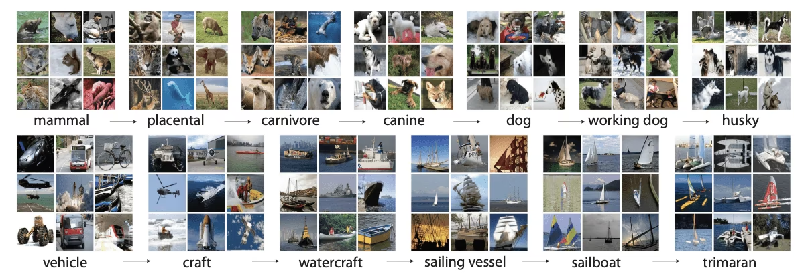
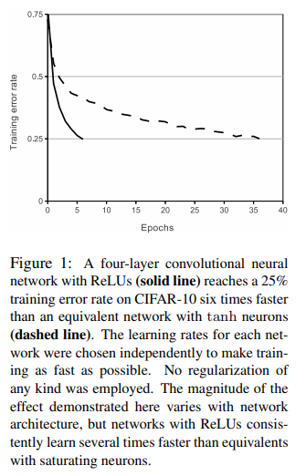
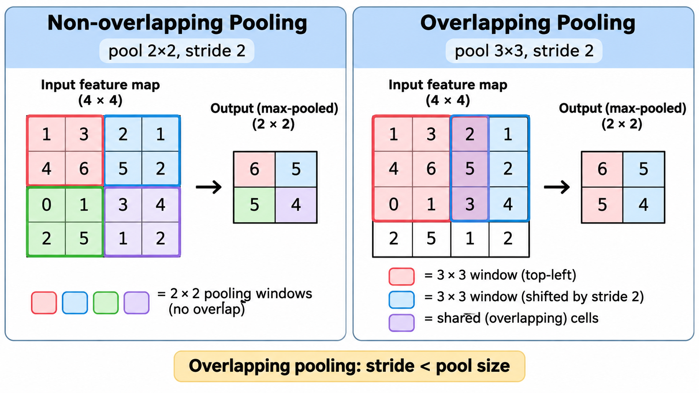
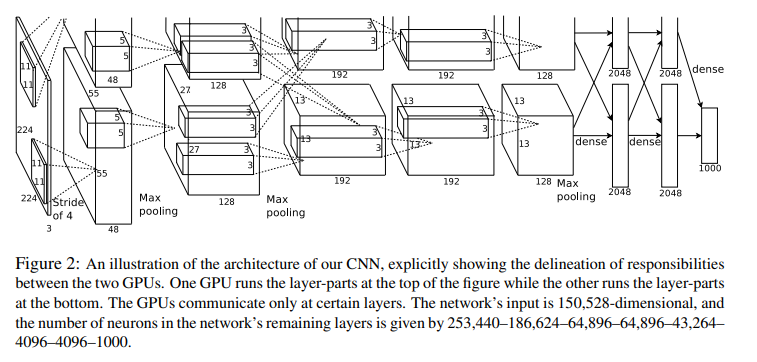
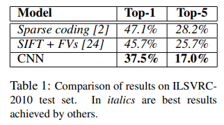
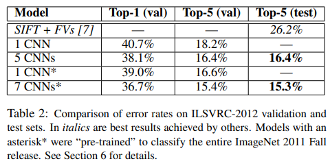

[https://proceedings.neurips.cc/paper_files/paper/2012/file/c399862d3b9d6b76c8436e924a68c45b-Paper.pdf](https://proceedings.neurips.cc/paper_files/paper/2012/file/c399862d3b9d6b76c8436e924a68c45b-Paper.pdf)

## Introduction

이미지 세그멘테이션이나, 분류 문제는 충분한 양의 데이터셋과, 이를 잘 학습할 수 있는 아키텍처를 필요로 한다. ImageNet은 1500만 이상의 고해상도 이미지가 22000가지의 카테고리로 라벨링된 대규모 이미지 데이터셋이다. 수천개의 라벨 분류 문제를 수백, 수천만의 데이터셋에 대해 학습하려면 고성능의 컴퓨팅 용량은 물론 잘 구성된 모델 아키텍처도 필요하다. CNN은 이러한 이미지 분류 문제에서 일반적인 feedforward neural network와 비교해 적은 파라미터 수로도 좋은 성능을 보였다. 본 논문에서는 ILSVRC-2010, 2012 대회의 이미지 분류 문제를 CNN을 통해 학습했으며 가장 좋은 성능을 달성했다. 이때 GPU를 사용해 연산 시간을 줄였고, 오버피팅을 방지하기 위한 다양한 전처리를 수행했다.

## The Dataset

ImageNet은 15 million (1500만)개의 고해상도 이미지를 22000개의 카테고리로 분류하고 있다. 2010년 부터 ImageNet Large-Scale Visual Recognition Challenge (ILSVRC)라는 대회가 개최되는데 본 논문의 연구진은 test set의 라벨이 공개된 2010년 대회의 목록을 가지고 실험을 수행했다. 이미지를 일괄적으로 256 by 256으로 크롭해 사용했으며 이외 픽셀 RGB 정규화 말고 다른 방법은 전처리에 사용하지 않았다고 한다.

## The Architecture

본 논문에서 제안하는 아키텍처를 보면 5개의 convolution 레이어와 3개의 fully-connected 레이어로 구성되어 있다. 모델의 세부 설정을 하나하나 살펴보자.

### ReLU Nonlinearity

기존에는 활성화 함수(activation function)으로 $$f(x)=\text{tanh}(x)$$ 또는 $$f(x)=(1+e^{-x})^{-1}$$(sigmoid)을 주로 사용했지만 본 논문에서는 Rectified Linear Units (ReLU)를 사용했다.

$$
\text{ReLU}(x)=\max(0, x)
$$

기존 연구에 따르면 ReLU를 사용하는 것이 hyperbolic-tangent를 사용하는 것보다 학습 속도가 빨랐기 때문이라고 한다.

위의 figure를 보면 CIFAR-10 데이터셋에 대해서 실선으로 된 ReLU 손실 함수가 점선의 hyperbolic-tangent의 손실함수보다 25% training error에 약 6배 더 빠르게 도달함을 확인할 수 있다. ReLU는 hyperbolic-tangent와 달리 입력값이 커져도 gradient가 0으로 가지 않기 때문에 이를 방지하기 위한 normalization등을 필요로 하지 않는다.

### Local Response Normalization

$$
b_{x,y}^{i}=
\frac{a_{x,y}^{i}}
{\left(
k+\alpha
\sum_{j=\max(0,i-n/2)}^{\min(N-1,i+n/2)}
(a_{x,y}^{j})^2
\right)^\beta}
$$

ReLU는 input normalization이 필요하지는 않지만, activation function을 통과한 후에 출력되는 값의 범위 제한이 없다는 성질이 있다. 이후, 서로 다른 kernel 결과에 따른 결과를 normalization하는 과정이 LRN이다. LRN의 수식을 보면 $$N$$개의 kernel 개수에 대해 kernel 출력값의 제곱합에 대한 정규화와 유사하며 이는 activated된 kernel 출력값에 가중치를 부여한다. 이는 현대 딥러닝에서는 batch normalization 등의 등장으로 많이 사용되지는 않는다.

### Overlapping Pooling

CNN에서 pooling layer는 같은 kernel에서의 출력 결과값 중에서 max, mean 등의 변환을 거쳐 특징은 보존하되 차원은 축소하는 방법이다. 일반적으로는 pooling 영역은 서로 겹치지 않게 구성을 했지만 본 논문에서는 overlapping pooling을 적용했다. Stride를 pooling kernel 크기보다 작게 설정했다고 볼 수 있다. Overlapping pooling을 적용한 결과 top-1, top-5 error rate가 0.4%, 0.3% 감소했으며 오버피팅 또한 감소하는 경향을 보였다고 한다.

### Overall Architecture

아키텍처를 살펴보면 5개의 convolution layer와 3개의 fully connected layer로 구성이 된다. Fully connected layer 이후에는 1000개 클래스의 이미지에 대한 분류를 softmax로 수행한다. 모델 학습시에는 $$\mathcal D=\{(x_i,y_i)\}_{i=1}^{N}$$와 같은 이미지, 라벨 쌍에 대해 아래 loss function을 최대화하도록 학습되었다.

$$
\max_\theta\frac1N\sum_{i=1}^N
\log P_\theta(Y=y_i\mid X=x_i)
$$

위의 목적함수는 multinomial logistic regression objective라고 불리는데 일반적으로는 loss function을 최소화하는 해를 찾도록 식을 구성하기 때문에 음수로 변환하면 다음과 같이도 표현할 수 있다.

$$
\mathcal L(\theta)=
-\frac1N\sum_{i=1}^N
\log P_\theta(Y=y_i\mid X=x_i)
$$

이는 cross-entropy를 최소화하는 식과 동일하고, 결국 multinomial logistic regression objective를 최대화하는 것은 cross-entropy를 최소화하는 것과 동일하다.

5개의 convolution layer를 통과할 때 layer 1, 2를 통과한 후에는 LRN과 max pooling을, layer 5를 통과한 후에는 max pooling을 적용하고 layer 3, 4를 통과한 후에는 별도의 처리를 하지 않는다.

## Reduce Overfitting

본 논문에서의 아키텍처는 60 million개의 파라미터를 가지고, 1000개의 클래스로 이미지를 분류한다. 이는 오버피팅이 발생할 가능성이 있으며 오버피팅을 방지하기 위해 다음과 같은 처리를 했다고 한다.

### Data Augmentation

오버피팅을 방지하기 위한 가장 쉬운 방법으로는 학습 데이터에 특정한 변형을 가하는 것이 있다. 첫번째 방법으로 random crop과 horizontal flip이 있다. 모델 학습을 할 때 256 by 256 이미지에서 224 by 224 패치를 잘라냈는데 이미지 하나에서 1024개의 패치가 나오고, 좌우 반전까지 적용하면 하나의 이미지에서 2048개의 데이터로 증강할 수 있다. 이후 테스트시에는 이미지의 좌상단, 우상단, 좌하단, 우하단, 정중앙에 대해 5개의 패치에 좌우 반전을 적용해 총 10개의 이미지에 대한 softmax 값을 평균 내어 분류를 수행했다. 물론 같은 이미지로부터 2048개의 패치를 만드는 것은 상호 의존성이 높지만 모델이 이미지의 픽셀 자체를 외워버리는 overfitting을 줄일 수 있다.

두 번째 방법으로는 전체 ImageNet 데이터셋의 이미지에 대해 PCA를 수행한 것이다. 모든 ImageNet 데이터의 이미지의 픽셀을 모아 RGB 값의 3 by 3 covariance matrix를 구한 후 eigen value와 eigen vector를 구한다.

$$
[\mathbf{p}_1, \mathbf{p}_2, \mathbf{p}_3][\alpha_1 \lambda_1, \alpha_2 \lambda_2, \alpha_3 \lambda_3]^T
$$

학습시에 각 이미지마다 gaussian random number $$\alpha_1, \alpha_2, \alpha_3$$을 뽑은 후 위와 같은 값을 이미지의 모든 픽셀의 RGB에다 더한다. 이는 각 이미지별로 픽셀 값에 일정한 노이즈를 더하며 이미지 내 객체가 다양한 조명 효과에서도 동일하게 분류되도록 한다.

### Dropout

여러 개의 모델을 학습 후 결과를 앙상블 하는 것은 예측 성능을 올리기 위한 가장 확실한 방법이지만 여러 모델을 학습하는 만큼 시간이 오래 걸린다. 본 논문에서는 dropout을 적용했다. Dropout은 각각의 hidden neuron의 출력을 0.5의 확률로 0으로 만드는 것이다. 이렇게 "dropped out"된 뉴런은 forward, backward pass에서 모두 사용되지 않으며 매 학습마다 서로 다른 뉴런이 활성화되기 때문에 뉴런들 간의 과도한 의존성을 줄이고 더욱 강건한 특징을 학습하게 된다. 본 논문에서는 3개의 fully connected layer 중 1, 2번째에 이를 적용했다.

## Details of learning

모델 학습시에는 stochastic gradient descent를 batch size 128로 학습했다. Weight 업데이트 수식은 다음과 같다.

$$
\begin{aligned}
v_{i+1}
&=0.9v_i-0.0005\epsilon w_i
-\epsilon\left\langle
\left.\frac{\partial L}{\partial w}\right|_{w_i}
\right\rangle_{D_i}\\[6pt]
w_{i+1}&=w_i+v_{i+1}
\end{aligned}
$$

SGD를 기반으로 하되 momentum과 weight decay term을 추가해 파라미터를 업데이트한다. Momentum 항은 이전 파라미터의 업데이트 방향을 반영해 진동을 완화하는 효과가 있고 weight decay 항은 weight 크기에 대한 regularization 효과가 있다. 학습 과정에서 training error 감소에 실제로 효과가 있었다고 한다. 또한 모든 레이어에 동일한 learning rate를 적용했으며 초기값은 0.01로 설정했다. Validation error가 더 이상 개선되지 않으면 learning rate를 10배 줄였으며, 학습이 종료되기 전까지 총 3번 줄였다고 한다.

## Results

ILSVRC-2010 데이터셋에서 본 논문의 아키텍처는 37.5%의 top-1 error rate, 17.0%의 top-5 error rate를 기록했다. 이는 기존에 공개된 가장 높은 성능인 45.7%, 25.7%를 크게 개선한 수치이다.

## 느낀점

현재도 많이 사용되는 ReLU activation function, dropout 등을 제안했고 2010년대 초반에도 이러한 수준의 성능을 낼 수 있었다는 것이 신기하다. 모델 성능을 높이기 위해서는 문제 유형에 맞는 아키텍처와 더불어 전처리, 학습 설정이 모두 함께 연구되어야 좋은 성능이 나옴을 이 논문에서 느낄 수 있었다. 데이터 유형에 맞게 전처리, 증강, 학습 설정 등을 하는 것이 성능 향상에 직접적인 도움이 되긴 하지만 이러한 방법들이 특정 데이터셋에만 효과가 있는 것인지, 일반적으로 효과가 있는 것인지에 대해서는 검증 후 사용해야 할 것 같다.
