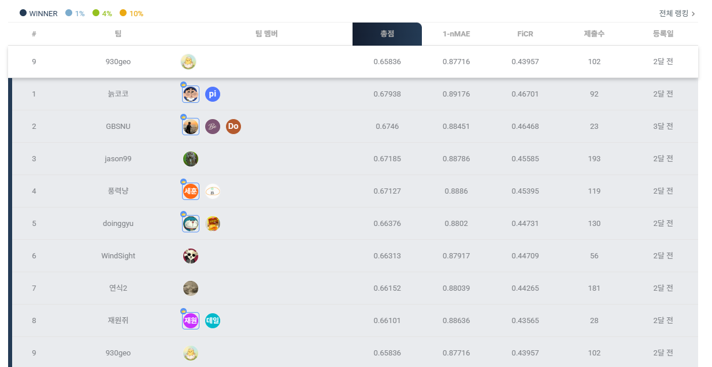

2026년 한국동서발전 주최 제3회 풍력발전량 예측 AI 경진대회에서 우수상을 수상했다. 데이콘 플랫폼을 통해 대회가 진행되었으며 private leaderboard 기준 986팀 중 9등이라는 성과를 거두었다. 과제는 태백 가덕산 풍력단지의 시간당 발전량을 하루 전에 예측하는 것이었는데, 이전에 OIBC 빅데이터 챌린지에서 태양광이라는 재생에너지에 대한 SMP 가격을 예측하는 대회에서 수상한 경험이 있어 이번 대회에도 호기롭게 도전해 보았다.

## 문제 이해

이번 대회에서 예측해야 하는 대상은 태백 가덕산 풍력단지의 3개 그룹 풍력발전기의 2025년 동안의 8,760시간에 대한 시간당 발전량(kWh)이었다. 전날 오후 1시에 발표된 예보만으로 다음날 01시부터 24시간 동안의 발전량을 예측해야 했고 이는 실제 전력 시장에서 입찰자가 가지는 제약과 상당히 유사하다. 전력 시장에서 입찰자는 소유한 발전소에서 다음날 예상하는 발전량과, 이에 대해 받고자 하는 입찰 가격을 제시한다. 이때 예측한 발전량과 실제 발전량에 차이가 발생하면 그 차이만큼을 구매해서 한국전력거래소에 판매하는 등 패널티가 발생하기 때문에 발전사업자 입장에서 발전량을 정확히 예측하는 것은 아주 중요한 문제이다.

<table>
<tr><th>그룹</th><th>기종</th><th>대수</th><th>설비용량</th><th>허브고</th><th>제공 기간</th><th>이용률</th></tr>
<tr><td>kpx_group_1</td><td>VESTAS V126 3.6MW</td><td>6</td><td>21.6 MW</td><td>117 m</td><td>2022–2024</td><td>30.7%</td></tr>
<tr><td>kpx_group_2</td><td>VESTAS V126 3.6MW</td><td>6</td><td>21.6 MW</td><td>117 m</td><td>2022–2024</td><td>32.8%</td></tr>
<tr><td>kpx_group_3</td><td>UNISON U136 4.2MW</td><td>5</td><td>21.0 MW</td><td>117 m</td><td>2023–2024(2년)</td><td>26.5%</td></tr>
</table>

태백 가덕산 풍력단지는 이와 같이 3개의 발전 그룹으로 이루어져 있다. 각 발전 그룹은 다른 기종과 개수의 풍력발전기로 구성되어 있다. 발전 그룹별로 데이터가 제공된 기간이 달라서 별도의 모델 학습 전략을 사용해야 했고 이후에 등장하겠지만 최종적으로도 발전 그룹마다 다른 방식으로 모델을 학습했다.

## 평가지표

대회 리더보드의 순위는 다음과 같은 평가 산식 $$\text{총점} = 0.5 \times (1-\text{NMAE}) + 0.5 \times \text{FICR}$$ 으로 정의된다. NMAE는 익숙하지만, FICR(정산금 획득률)은 대회를 위해 특별히 정의한 점수 체계인 것 같았다. 각각의 정의는 다음과 같다.

$$
\text{NMAE}_g = \frac{1}{\lvert T_g\rvert}\sum_{t\in T_g}\frac{\lvert y_{g,t}-\hat{y}_{g,t}\rvert}{\text{cap}_g}, \qquad 1-\text{NMAE} = 1-\frac{1}{3}\sum_{g=1}^{3}\text{NMAE}_g
$$

$$
\text{FICR}_g = \frac{\sum_{t\in T_g} y_{g,t} \cdot \text{price}(e_{g,t})}{\sum_{t\in T_g} 4\,y_{g,t}}, \quad e_{g,t} = \frac{\lvert y_{g,t}-\hat{y}_{g,t}\rvert}{\text{cap}_g}, \qquad \text{FICR} = \frac{1}{3}\sum_{g=1}^{3}\text{FICR}_g
$$

$$
\text{price}(e) = \begin{cases} 4 & e \le 0.06 \\ 3 & 0.06 < e \le 0.08 \\ 0 & e > 0.08 \end{cases}
$$

여기서 $$g$$는 세 발전 그룹(kpx_group_1~3)의 인덱스, $$y_{g,t}$$는 그룹 $$g$$의 시간 $$t$$ 실제 발전량, $$\hat{y}_{g,t}$$는 그 시점에 제출한 예측값, $$\text{cap}_g$$는 그룹 $$g$$의 설비용량, $$T_g$$는 그룹 $$g$$에서 발전량이 설비용량의 10% 미만인 시간대를 제외하고 남은 시간대이다. 그룹별로 각각 NMAE, FICR을 구한 뒤 세 그룹을 평균하는 구조이기 때문에 3개의 발전 그룹에서 모두 좋은 예측 성능을 얻어야 했다.

모델을 개발하기 전 FICR이라는 점수 산식을 잘 해석해 볼 필요가 있었다. FICR은 재생에너지 발전량 예측제도의 정산금 구조를 그대로 가져온 것이라 오차에 따라서 정산금이 4원, 3원, 0원으로 계단식 구조를 가진다. 이러한 함수는 미분이 불가능해 gradient descent 기반 기법으로 직접 최적화할 수 없어 대안을 찾아야 했다. 또한 FICR은 분모가 $$\sum 4y$$ 형태라 고발전 구간이 FICR 점수에 큰 영향을 미친다. 두 예측 결과를 비교한다고 할 때 MAE를 줄여 오차를 줄여도 어느 시간대의 MAE를 줄이느냐에 따라 FICR이 변할 수 있다.

<table>
<tr><th>시간</th><th>실발전량</th><th>예측1</th><th>예측2</th></tr>
<tr><td>t1</td><td>100</td><td>105</td><td>109</td></tr>
<tr><td>t2</td><td>50</td><td>56</td><td>51</td></tr>
<tr><td>MAE</td><td></td><td>5.5</td><td>5</td></tr>
<tr><td>FICR</td><td></td><td>0.667</td><td>0.333</td></tr>
</table>

위의 표를 보면 단순 MAPE를 사용해 정산금을 부여한다고 할 때 예측2에서 MAE는 작아도 FICR이 더 작다. 이는 예측2가 고발전 구간인 t1에서의 예측 성능이 좋지 않기 때문이고 FICR 점수에 큰 영향을 미치는 고발전 구간에 대한 정확한 예측이 필요하다. 또한 발전량이 설비용량의 10% 미만인 구간은 평가 구간에서 제외가 되는데 이렇게 된다면 전체 시간의 41%가 채점에서 제외가 된다. 이러한 평가 산식과 데이터 특성을 종합적으로 판단할 때 단순히 예측 오차를 최소화하는 모델을 개발해야 하는 것이 아니라 예측분포를 학습해 1-NMAE와 FICR 점수를 균형 있게 획득하는 모델 개발이 필요할 것이라고 방향을 잡게 되었다.

## 데이터 특성과 라벨 오염

대회 주최측으로부터 세 종류의 데이터가 제공되었다. 기상청 국지모델 LDAPS(1.5km, 시간당 16격자×35컬럼), NOAA 전지구모델 GFS(0.25°, 시간당 9격자×40컬럼), 그리고 10분 단위 터빈별 실측 SCADA였다. SCADA는 Supervisory Control And Data Acquisition의 약자로 풍력발전 터빈에 장착된 센서에서 수집한 풍속, 회전수, 가동/정지 상태에 대한 정보 등을 포함한다. SCADA는 학습 기간에만 존재해서 평가 기간에는 입력 피처로 사용할 수 없었기 때문에, 학습 신호를 정제하고 파워커브를 학습하는 용도로만 썼다. 파워커브란 발전량의 풍속에 대한 함수이고 터빈 종류별로 제작사에서 정해 놓은 수치가 있기는 하다. 하지만 고도, 기압, 위치 등 실 운전 상황에서는 변수가 많기 때문에 별도로 파워커브 학습이 필요했다.

제공된 데이터에서 이상치라고 생각되는 부분이 있어 전처리에 신경을 써야 했다. VESTAS 터빈에서는 극단값이 868개(0.046%) 있었는데 터빈별 min/max가 정확히 ±42,512,957로 대칭이라 센서 오류로 인한 오류값이라고 판단했다. 또한 터빈별로 풍속, 출력이 0에 고정되어 있는 장기 미가동 구간도 있었고 상대습도가 110.4%로 측정되는 등의 측정값들도 있었다. LDAPS와 NOAA에서 같은 기상 피처에 대한 스케일이 다른 부분도 있어서 이러한 부분을 맞춰줄 필요도 있었다.

3개의 발전 그룹 중 그룹3의 성능이 세 그룹 중 가장 낮았는데 이와 반대로 풍속-발전량 상관은 오히려 그룹3이 가장 높았다(그룹1 0.793, 그룹2 0.811, 그룹3 0.815). 성능이 가장 나쁜 그룹의 기상-발전 관계가 가장 명확하다는 것에 의문이 들어 SCADA 데이터를 다시 살펴본 결과 그룹 3에서 가용률(그룹 내 전체 터빈 중 정상 가동 터빈 비율)이 0.8 미만인 시간이 전체의 22.6%(2,839시간)나 됐다. 즉 특정 터빈이 미가동되는 현상 때문에 모델 학습이 전반적으로 과소 예측되었고 이후 터빈 가용률을 필터링해 학습 구간을 다시 선정했다.

## 설계: 예측 단계와 입찰값 결정 단계의 분리

데이터 전처리, 문제 정의 후 전체 파이프라인의 방향을 정할 수 있었다. 정산 제도를 손실함수 안에 녹이는 대신, 예측 모델은 확률 분포를 학습하고 확률 분포를 사용해 입찰값을 고르는 입찰값 결정 단계를 별도로 두는 구조다. 이렇게 분리해두면 정산 방식이나 단가가 바뀌어도 학습된 예측 모델은 그대로 재사용할 수 있다는 장점이 있다.

## 전처리: 터빈 작동 반영 학습 구간 설정

이전에 터빈의 정지로 인한 특정 그룹의 발전량 과소 예측 문제가 있었다고 했는데 전처리 단계에서 이러한 구간은 학습에서 제외하도록 했다. SCADA 10분 기준으로 풍속이 4 m/s를 넘는데 출력이 0 이하이면 정지로 판정하고, 그룹 가용률(그룹 내 정상 가동 터빈 비율)이 0.8 미만인 시간을 학습에서만 제외했다. 특정 터빈의 중지로 인한 그룹 발전량 저하는 기상 등의 외부 요인으로 인한 학습 가능한 발전량 저하가 아닌 정비 일정 등으로 인한 예상할 수 없는 발전량 저하이기 때문에 이러한 요인으로 인한 과소예측을 막기 위해 터빈 중지 시간대는 학습에서 제외하는 것이 맞다고 판단했다. 하지만 정지 구간을 학습에서 제외한 경우 평가 기간에서의 실제 정지 시간대에는 과대예측이 발생할 수 있다. 하지만 이로 인한 손실보다 일반적으로 전체 터빈이 가동하는 시간대에서의 예측 정확도 향상이 더 이득이라고 판단했고 외부 요인으로 인한 터빈 정지는 본 대회의 목적과는 별개의 문제라고 생각을 했다.

## 피처 구성

먼저 제공된 데이터에서 발전량과 물리적으로 관련이 있는 값들을 계산해 파생변수, 즉 원본 컬럼을 조합하거나 변환해 새로 만든 피처로 추가했다.

기상모델은 바람을 동서 방향 성분 U와 남북 방향 성분 V로 나눠서 제공한다. 터빈 입장에서는 각 성분보다 바람이 얼마나 세게, 어느 방향에서 부는지가 더 직접적인 정보이므로 이를 풍속 $$\sqrt{U^2+V^2}$$과 풍향으로 변환했다.

다음으로 풍속의 높이를 맞춰주었다. 기상모델의 풍속은 지상 10m처럼 정해진 고도에서만 제공되지만, 터빈 날개가 실제로 받는 바람은 허브고, 즉 날개 회전축 중심 높이인 117m의 바람이다. 바람은 지면 마찰 때문에 높이 올라갈수록 강해지는데 이 관계는 보통 멱법칙 $$v(z) = v_{\text{ref}}(z/z_{\text{ref}})^{\alpha}$$로 근사한다. $$\alpha$$는 전단지수(wind shear exponent)로, 높이에 따라 풍속이 얼마나 빠르게 증가하는지를 나타낸다. 이 식으로 주어진 고도의 풍속을 117m까지 extrapolate해 허브고 풍속을 만들었다.

바람이 가진 에너지는 $$P = \frac{1}{2}\rho A v^3$$으로 풍속의 세제곱에 비례한다. 여기서 $$\rho$$는 공기밀도, $$A$$는 날개가 회전하며 쓸고 지나가는 면적이다. 이 비선형 관계를 모델이 스스로 찾도록 두기보다 풍속의 세제곱 ws³을 피처로 직접 넣어주었고, 같은 이유로 공기밀도 $$\rho = p/(RT)$$와 밀도를 반영한 $$\rho \cdot ws^3$$도 추가했다($$p$$는 기압, $$T$$는 절대온도, $$R$$은 건조공기의 기체상수). 같은 풍속이라도 차갑고 무거운 공기는 터빈에 더 많은 에너지를 전달하기 때문이다.

이외에도 대기 안정도, ramp rate, 일주기 regime을 피처로 추가했다. 대기 안정도는 공기가 위아래로 얼마나 잘 섞이는지를 나타내는 지표로, 대기가 안정한 밤에는 높이별 풍속 차이가 커지고 난류가 약해져서 같은 풍속에서도 발전량이 달라질 수 있다. ramp rate는 시간에 따른 풍속의 변화율로 바람이 급변하는 구간을 알려주고, 일주기 regime은 낮과 밤처럼 하루 주기로 반복되는 바람 패턴을 구분하는 변수이다.

마지막으로 격자 정보를 어떻게 넣을지도 정해야 했다. LDAPS는 시간당 16개 격자점의 값을 제공하는데, 풍속처럼 중요한 바람 변수는 격자마다 별도의 컬럼으로 펼쳐서(피벗) 어느 위치의 바람인지에 대한 정보를 보존했다. 나머지 변수는 16개 격자 값의 평균, 표준편차, 최솟값, 최댓값과 같은 공간통계로만 요약해 피처 수가 지나치게 늘어나지 않도록 했다.

대회 규정에서 외부 공개 데이터의 사용을 허용하고 있어서, 대회에서 제공하지 않은 외부 기상 예보 데이터도 함께 활용했다.

추가한 데이터는 유럽중기예보센터(ECMWF)의 전지구 예보모델 IFS 0.25° 오픈데이터, 일본 기상청(JMA)의 전지구 예보모델 GSM, 그리고 미국 NOAA의 앙상블 예보 GEFS이다. 앙상블 예보는 초기 조건을 조금씩 바꿔가며 같은 모델을 여러 번 돌린 예보 묶음으로, 결과들이 서로 얼마나 다른지를 보고 그날 예보의 불확실성을 가늠할 수 있다. 여기에 더해 예보 센터끼리 예보가 얼마나 엇갈리는지(disagreement)도 피처로 추가했다. 여러 기관의 예보가 크게 다르다면 그 시간대의 날씨 자체가 예측하기 어렵다는 뜻이므로, 확률 분포를 예측하는 모델이 분포의 폭을 정하는 데 도움이 될 것이라고 생각했다.

SCADA로부터도 피처를 만들었다. 앞에서 설명한 파워커브를 SCADA 실측값에 직접 fitting했는데, 이때 웨이크맵과 풍향 오프셋 보정을 함께 반영했다. 웨이크(wake)는 앞쪽 터빈이 바람의 에너지를 가져가고 남긴 약하고 흐트러진 바람으로, 특정 방향에서 바람이 불면 뒤쪽 터빈은 이 웨이크 안에 들어가 발전량이 떨어진다. 웨이크맵은 풍향별로 각 터빈이 이런 영향을 얼마나 받는지를 정리한 것이고, 풍향 오프셋 보정은 풍향 값에 생기는 일정한 어긋남을 보정한 것이다. 또한 나셀, 즉 터빈 꼭대기에서 발전기를 담고 있는 몸체 위의 풍속계가 잰 실제 풍속과 예보 풍속 사이의 편차도 피처로 반영했다.

이때 데이터 누수(leakage), 즉 검증 시점에는 알 수 없어야 할 정답 정보가 학습에 섞여 들어가는 것을 조심해야 했다. 누수가 생기면 검증 점수가 실제 성능보다 좋게 나와 잘못된 판단을 하게 된다. 파워커브는 SCADA 실측값으로 만들기 때문에 검증 기간의 SCADA까지 사용해 커브를 만들면 검증 기간의 정답이 피처에 섞여 들어간다. 그래서 검증용 커브는 뒤에서 설명할 두 가지 검증마다 검증 연도를 뺀 학습 연도의 데이터로만 따로 적합했고(2024년으로 검증할 때는 2022–2023년, 2023년으로 검증할 때는 2022년과 2024년), 최종 제출용 커브는 2022–2024년 전체 데이터로 적합했다.

최종 제출 모델의 학습에 사용한 피처 묶음은 최대 355개 열 규모였고, 앙상블 멤버마다 일부 피처 그룹을 빼고 학습해 멤버끼리 사용하는 정보원이 서로 다르도록 했다.

외부 데이터를 쓸 때는 성능과 별개로 꼭 지켜야 하는 제약이 하나 있었다. 외부 수치예보(NWP, Numerical Weather Prediction), 즉 대기를 물리 방정식으로 시뮬레이션해 만든 예보도 대회 데이터와 마찬가지로 전날 13시 이전에 공개가 끝난 것만 사용할 수 있다는 점이다. 실제 입찰자는 전날 오후에 입찰을 마감해야 하므로 그 이후에 공개되는 예보는 실제로는 쓸 수 없는 정보이기 때문이다. 그래서 소스별로 모델을 돌린 시각과 실제 공개 시각을 확인해 13시까지 얼마나 여유가 있는지 정리했고, 여유가 없는 소스는 성능이 좋더라도 사용하지 않았다.

이 외에도 여러 소스를 검토했다. 여러 국가 기상센터의 앙상블 예보를 모아둔 연구용 아카이브인 TIGGE는 센터마다 라이선스가 달라 일부가 비상업적 이용만 허용하는 CC BY-NC였기 때문에, 상업 주체가 포함된 대회라는 점을 고려해 보수적으로 제외했다. 기상청(KMA) 상층 데이터, 독일 기상청(DWD)의 ICON, 일본 기상청의 지역모델 MSM, 캐나다 기상청(ECCC)의 GEM은 추가해도 점수가 오르지 않아 사용하지 않았다. 최종적으로는 ECMWF, JMA, GEFS, 기상청 단기예보 등의 외부 소스를 사용했다.

## 모델: 39분위수 딥앙상블

앞에서 말했듯 FICR은 계단함수라 gradient descent로 직접 최적화할 수 없다. 계단함수는 대부분의 구간에서 기울기가 0이라서 예측값을 어느 방향으로 움직여야 점수가 오르는지 알려주지 못하기 때문이다. 그래서 예측값을 "30MW"처럼 하나의 숫자로 내는 점추정 대신, 모델은 발전량의 확률 분포를 예측하고 입찰값은 그 분포를 보고 따로 고르도록 했다.

분포는 분위수(quantile)로 나타냈다. 예를 들어 0.1 분위수가 18MW라는 것은 실제 발전량이 18MW 이하일 확률이 10%라는 뜻이다. 모델은 0.025부터 0.975까지 0.025 간격의 39개 분위수를 한 번에 출력하고, 각 출력은 평균 대신 특정 분위수를 예측하도록 학습하는 분위수 회귀(quantile regression)에서 쓰는 pinball loss로 학습했다. 분위수를 이렇게 조밀하게 잡은 근거는 Ehm et al.(2016)의 elicitability 논의다.

💡 **보충: pinball loss와 elicitability** $$\tau$$ 분위수에 대한 pinball loss는 $$L_\tau(y, q) = \max\{\tau(y-q),\ (\tau-1)(y-q)\}$$로, 실제값 $$y$$보다 낮게 예측한 오차에는 $$\tau$$, 높게 예측한 오차에는 $$1-\tau$$의 가중을 준다. 이 손실의 기댓값을 최소화하는 $$q$$가 정확히 $$\tau$$ 분위수가 된다. 이처럼 어떤 손실함수를 최소화해서 원하는 통계량을 답으로 얻을 수 있는 성질을 elicitability라고 한다. 평균은 제곱오차로, 중앙값은 절대오차로, 일반적인 분위수는 pinball loss로 얻을 수 있다.
{: .notice--info}

<table>
<tr><th>그룹</th><th>멤버 1</th><th>멤버 2</th><th>설계 의도</th></tr>
<tr><td>g1</td><td>양방향 GRU(예보 24h 시퀀스, d_model 256), 10시드</td><td>동일 구조 / 다른 정보원(ECMWF 계열), 20시드</td><td>정보원 다양성</td></tr>
<tr><td>g2</td><td>양방향 GRU + SCADA 파워커브 피처, 10시드</td><td>통합학습 MLP 768-768-384, dropout 0.4, 40시드</td><td>구조 다양성</td></tr>
<tr><td>g3</td><td>MLP, 10시드</td><td>통합학습 MLP 1024-1024-512, dropout 0.45, 40시드</td><td>데이터 부족 보완</td></tr>
</table>

발전 그룹마다 성격이 다른 두 멤버를 묶어 딥앙상블을 만들었다. 딥앙상블은 같은 구조의 신경망을 서로 다른 랜덤 시드로 여러 번 학습시킨 뒤 예측을 평균하는 방법으로, 표의 10시드, 40시드가 그 횟수다. 개별 모델이 우연히 틀리는 부분이 평균 과정에서 상쇄되어 예측이 안정된다. 멤버 1은 하루 24시간치 예보를 하나의 시퀀스로 읽는 양방향 GRU, 즉 시계열을 앞뒤 양방향으로 처리하는 순환신경망이거나 기본적인 MLP이고, d_model 256은 GRU 내부 표현의 차원이다. 멤버 2는 그룹1에서는 같은 GRU 구조에 ECMWF 계열의 다른 예보를 넣은 모델이고, 그룹2와 그룹3에서는 세 발전 그룹의 데이터를 한데 모아 학습한 통합학습(pooled) MLP이다. 768-768-384는 각 층의 뉴런 수이고, dropout 0.4는 학습 중 뉴런의 40%를 무작위로 꺼서 과적합을 막는다는 뜻이다.

멤버를 고를 때는 개별 성능보다 두 멤버의 편향(bias), 즉 체계적으로 틀리는 방향이 서로 다른지를 더 중요하게 봤다. 두 모델이 같은 상황에서 같은 방향으로 틀리면 평균을 내도 오차가 그대로 남지만, 틀리는 방향이 다르면 평균하는 과정에서 오차가 상쇄되기 때문이다. 통합학습 멤버가 그 예로, 단독으로는 세 그룹 모두에서 성능이 떨어졌지만 다른 멤버와 편향 방향이 달라 앙상블에 넣었을 때는 도움이 됐다(그룹3에서 뒤에서 설명할 두 가지 검증 중 더 나쁘게 나온 쪽 기준 +0.00377).

멤버를 합칠 때는 Vincentization을 썼다. 여러 분포를 확률 기준으로 섞으면 멤버 간 차이만큼 분포가 넓게 퍼지는데, Vincentization은 각 멤버의 같은 분위수끼리, 예를 들어 0.1 분위수는 0.1 분위수끼리 평균을 내기 때문에 분포가 불필요하게 넓어지지 않는다. 즉 예측분포가 얼마나 좁고 확신 있게 나오는지를 나타내는 sharpness가 유지된다.

마지막으로 학습 손실에 FICR을 반영한 가중치를 주었다. FICR에서 정산금을 받으려면 예측 오차가 설비용량의 6% 또는 8% 이내여야 하는데, 이 글에서는 이 범위를 정산 오차 범위라고 부르겠다. 정격출력, 즉 터빈이 낼 수 있는 최대 출력의 25~50% 구간은 예측이 정산 오차 범위 안에 들어오는지가 자주 갈리는 구간이라 이 구간의 샘플에 더 큰 학습 가중치를 주었다.

$$
w = 1 + \lambda \cdot \exp\left(-0.5 \left(\frac{y - 0.375 \cdot \text{cap}}{0.12 \cdot \text{cap}}\right)^2\right)
$$

가중치 $$w$$는 실제 발전량 $$y$$가 설비용량의 37.5% 근처일 때 $$1+\lambda$$로 가장 크고, 그 지점에서 멀어질수록 가우시안 모양으로 줄어 1에 가까워진다. $$\lambda$$는 가중의 크기를 정하는 하이퍼파라미터이다. 이 가중 방식을 bandweight라고 불렀고, bandweight로 얻은 성능 향상은 모두 FICR에서 나왔다.

앙상블로 만든 분위수 예측은 입찰값을 고르기 전에 그룹별로 예측 수준을 한 번 더 보정했다. LightGBM 분위수 모델의 평균 수준에 맞춰 그룹별 예측값을 정렬하고, 그룹마다 예측값 전체를 일정량 올리는 보정을 추가로 적용했다.

## 입찰값 결정: 기대 점수 최적화

모델이 만든 39개의 분위수를 받아 실제로 제출할 값을 고르는 것이 입찰값 결정 단계이다. 39개 분위수 점과 정산 오차 범위의 경계(±0.059cap, ±0.079cap)를 입찰값 후보로 두고, 평가 산식의 두 항(1−NMAE와 FICR)의 가중을 그대로 옮긴 목적함수를 가장 크게 만드는 후보를 골랐다.

$$
f^*(t) = \underset{f}{\operatorname{argmax}} \sum_{i=1}^{39} \frac{1}{39} \left[ -c_1 \cdot \frac{\lvert f-q_i\rvert}{\text{cap}} + c_2 \cdot q_i \cdot \text{price}\!\left(\frac{\lvert f-q_i\rvert}{\text{cap}}\right) \right]
$$

이 식은 39개 분위수 $$q_i$$를 실제 발전량이 나올 수 있는 39개의 동일한 확률의 시나리오로 보고, 입찰값 $$f$$를 냈을 때 각 시나리오에서 얻는 점수를 평균한 기대 점수를 계산한다. argmax는 이 기대 점수를 가장 크게 만드는 $$f$$를 고른다는 뜻이다. 대괄호 안의 첫째 항은 NMAE로 잃는 점수, 둘째 항은 FICR로 얻는 정산금이다.

여기서 $$c_1 = 0.5/\hat{N}_1$$ 은 NMAE 항, $$c_2 = 0.5/(4\hat{S})$$ 은 FICR 항의 가중이고, price는 오차 6% 이내면 4원, 6~8%면 3원, 8% 초과면 0원이다. 평가에서 발전량이 설비용량의 10% 미만인 시간을 제외하는 규칙과 실발전량 가중도 그대로 반영했다.

다만 이 방식에는 argmax가 고르는 값이 작은 변화에도 크게 흔들리는 문제가 있었다. FICR은 오차가 정산 오차 범위 안에 있는지 밖에 있는지만 따지기 때문에, 입찰값이 범위 경계를 살짝만 넘나들어도 점수가 끊기듯 바뀐다. 실제로 상관계수가 0.99 수준으로 거의 같은 두 예측끼리도 FICR이 0.015나 차이 났다. 기대 점수가 비슷한 봉우리가 여러 개 있으면 최댓값의 위치가 이 봉우리에서 저 봉우리로 쉽게 튀는데, 이를 모드 점프라고 한다. 이를 줄이기 위해 bagged placement를 사용했다. σ=0.02의 잡음을 섞은 복제본 16개를 만들어 각각에서 입찰값을 고른 뒤 평균하는 방식으로, 배깅(bagging)처럼 조금씩 다른 여러 버전의 결과를 평균해 안정성을 높이는 것이다. 잡음의 seed는 고정해서 같은 입력에는 항상 같은 결과가 나오도록 했다.

이 외에도 후보를 501개로 촘촘하게 늘리거나, 분포의 꼬리, 즉 양 끝 분위수 바깥 영역을 extrapolate하거나, 복제 횟수를 늘려봤지만 모두 개선이 없었다. 후보 하나를 고르는 대신 기대 점수에 따라 여러 후보를 가중 평균하는 soft weighting은 오히려 점수가 0.00199 떨어졌고, exp-κ 수축도 예상대로 성능이 나빠져 이 방향의 실험은 여기서 마무리했다.

## 검증 전략: 학습 구간을 나눈 두 가지 검증

테스트 기간은 2025년이었고 학습 데이터는 2022–2024년이었다. 이 상황에서 가장 큰 위험은 과적합(학습 데이터에만 지나치게 맞춰져 새로운 데이터에서 성능이 떨어지는 현상)보다 연도 간 covariate shift였다. covariate shift란 입력 데이터의 분포가 학습 때와 평가 때 서로 달라지는 현상으로, 실제로 2025년 강풍이 부는 달의 예보 풍속은 이전 연도보다 1~3 m/s 높은 쪽으로 이동해 있었다.

그래서 학습 구간을 두 가지로 나누어 검증했다. 검증 A는 2022–2023년으로 학습하고 2024년으로 검증하는 방식이고, 검증 B는 2022년과 2024년으로 학습하고 2023년으로 검증하는 방식이다. 한 해로만 검증하면 그 해의 날씨에 우연히 잘 맞는 변경을 좋은 변경으로 착각할 수 있기 때문에, 서로 다른 두 해로 각각 검증한 것이다. 변경 사항은 두 검증 결과의 평균이 아니라 둘 중 더 나쁜 쪽의 결과에서도 점수가 오를 때만 채택했다. 2025년은 어느 쪽 학습 구간에도 포함되지 않은 해이므로, 한쪽 검증에서만 좋아 보이는 변경은 2025년에도 좋을 것이라고 보기 어렵기 때문이다. 여기에 조건을 하나 더 두었는데, 주 단위 블록 부트스트랩을 2000회 돌려 기존 구성 대비 점수 변화량 Δ가 0보다 클 확률 P(Δ>0)가 0.9 이상이어야 했다. 즉 다시 뽑은 2000번 중 90% 이상에서 점수가 올라야 채택했다.

💡 **보충: 블록 부트스트랩** 부트스트랩은 검증 데이터를 복원추출로 여러 번 다시 뽑아 점수를 반복 계산하고, 그 점수들의 분포로 개선이 우연인지 확인하는 방법이다. 다만 시계열 데이터를 시간 단위로 하나씩 뽑으면 이웃한 시간끼리의 연속성이 깨진다. 그래서 일주일 단위의 블록으로 묶어서 블록째로 뽑았다.
{: .notice--info}

이 원칙을 지키지 않았다가 실제로 점수를 잃은 적이 있다. 2026년 7월 20일에 그룹3의 모델 교체 후보를 검증했는데, 검증 A에서는 +0.0114였지만 검증 B에서는 −0.0067이 나왔다. 이때 "그룹3은 2022년 데이터가 없으니 2023년으로 검증한 B의 결과는 믿기 어렵다"는 이유를 붙여 후보를 채택했다. 결과는 리더보드에서 −0.0046이었고, 검증 B가 가리킨 방향대로 점수가 떨어졌다. 이후로는 두 검증 모두에서 점수가 오르지 않은 변경은 예외 없이 채택하지 않았다. 검증 결과가 마음에 들지 않을 때 그럴듯한 이유를 붙여 넘어가고 싶어지는데, 그때가 가장 조심해야 하는 순간이라는 것을 배웠다.

## 로컬 점수와 리더보드 점수의 관계

로컬 검증에서 좋아진 변경이 리더보드에서도 실제로 좋아지는지도 따로 확인했다. 그동안 제출했던 결과들로 로컬 점수 변화량과 리더보드 점수 변화량을 짝지어 회귀분석을 하고, 로컬 변화량이 리더보드 변화량을 얼마나 설명하는지를 결정계수 R²로 봤다. 로컬 Δ(1−NMAE)는 R² 0.564로 어느 정도 믿을 만했지만, 로컬 총점 변화량은 R² 0.080, 로컬 ΔFICR은 R² 0.003으로 리더보드 변화를 거의 설명하지 못했다. 즉 로컬에서 FICR이 올랐다고 해서 리더보드에서도 오를 것이라고 기대하기는 어려웠다.

25개의 (로컬, 리더보드) 짝으로 회귀한 결과에서 σ=0.00124를 얻었고, 이를 바탕으로 채택 기준을 약 1σ인 +0.00129로 미리 정해두었다. 결과를 보기 전에 기준을 먼저 정해둔 것은 결과를 보고 나서 기준을 유리하게 바꾸는 것을 막기 위해서였다. 이 기준을 적용한 이후로는 잘못 판단한 경우가 없었다. 대회 후반 2주 동안 Public 점수가 오르지 않은 것도 이 때문이다. Public 리더보드는 대회 중에 테스트 데이터의 일부로 매긴 점수이고, Private 리더보드는 나머지 데이터로 매겨 대회가 끝난 뒤 공개되는 최종 점수이다. Public 점수만 올리는 변경은 Private까지 이어지지 않을 가능성이 높다고 보고, 이 기준을 넘지 못한 후보는 제출하지 않았다.

## 결과

최종 성적은 다음과 같다.

- Private 총점 0.65836 (Public 0.65669)
- Private 1−NMAE 0.87716
- Private FICR 0.43957

986팀 중 Private 기준 9위로 한국동서발전으로부터 우수상을 받았다.

## 시도했지만 채택하지 않은 방법들

최종 구성을 정하기까지 여러 대안을 시도했고, 그중 채택하지 않은 것들을 정리하면 아래 표와 같다.

<table>
<tr><th>축</th><th>시도</th><th>결과</th></tr>
<tr><td>외부 NWP 추가</td><td>KMA 상층 → DWD ICON → JMA MSM → ECMWF TIGGE·ECCC GEM</td><td>추가 4개 소스 전부 증분 없음</td></tr>
<tr><td>시드·용량 확대</td><td>5→10→20→40시드, 512→1024</td><td>잔여 상한 +0.00033 → 종결</td></tr>
<tr><td>앙상블 다양성</td><td>멤버 추가</td><td>블렌드 과평활 → FICR 붕괴(−0.0052)</td></tr>
<tr><td>피처 엔지니어링</td><td>dedup / deskew / quantile-norm</td><td>현행 최적 구성 미달</td></tr>
<tr><td>분위수 재보정</td><td>cross-window recalibration</td><td>−0.023</td></tr>
<tr><td>배치 스킴</td><td>soft weighting, exp-κ, 후보격자 501, 꼬리 외삽</td><td>양방향 개선 없음</td></tr>
<tr><td>수준(level) 축</td><td>미세보정(nudge) 재스윕</td><td>현행 구성이 이미 정점</td></tr>
<tr><td>모델 클래스</td><td>FT-Transformer, CatBoost, TabPFN, 격자 CNN, MOS×2, conformal/CQR</td><td>전부 기각</td></tr>
</table>

💡 **보충: 표에 나온 용어** 잔여 상한은 시드나 모델 크기를 더 늘려도 얻을 수 있는 이득의 최대치를 추정한 값으로, +0.00033에 불과해 이 방향은 더 진행하지 않았다. 과평활은 멤버를 너무 많이 섞어 예측분포가 뭉개지면서 FICR에 필요한 sharpness를 잃는 현상이다. dedup은 중복 피처 제거, deskew는 한쪽으로 치우친 피처 분포를 대칭에 가깝게 바꾸는 변환, quantile-norm은 피처 값을 순위 기준으로 정규화하는 것이다. 분위수 재보정(recalibration)은 예측한 분위수가 실제 빈도와 맞도록, 예를 들어 실제값이 0.1 분위수 아래로 10%만 떨어지도록 사후에 조정하는 것이고, cross-window는 한쪽 검증 구간에서 맞춘 보정을 다른 쪽 검증 구간에 적용했다는 뜻이다. 수준(level) 미세보정(nudge)은 예측값 전체를 일정량 올리거나 내리는 보정이다. 모델 중 FT-Transformer는 표 형식 데이터용 트랜스포머, CatBoost는 결정 트리를 순차적으로 쌓는 그래디언트 부스팅 모델, TabPFN은 표 데이터용으로 사전학습된 트랜스포머, 격자 CNN은 기상 격자를 이미지처럼 보고 합성곱 신경망으로 처리하는 방식이다. MOS(Model Output Statistics)는 수치예보 출력을 관측값에 맞게 통계적으로 보정하는 기상 분야의 전통적인 기법이고, CQR(Conformalized Quantile Regression)은 분위수 회귀 결과를 보정해 예측 구간이 정해진 확률로 실제값을 포함하도록 보장하는 방법이다.
{: .notice--info}

그중 기억에 남는 것은 대회 막바지의 실험이다. FICR은 실발전량으로 가중되니 고발전 구간을 더 정확히 맞춰야 한다고 생각해서, bandweight에서 가중이 가장 큰 지점을 설비용량의 0.375에서 0.6~0.7로 옮겨봤다. 고발전 구간의 FICR은 실제로 +0.0138 올라서 생각 자체는 맞았지만, 저·중발전 구간의 FICR이 0.059 떨어지면서 전체로는 0.014 손해였다. 결국 기존의 0.375가 이미 가장 좋은 값이었다. 문제를 제대로 짚었다고 해서 그로부터 나온 해결책까지 맞는 것은 아니라는 것을 배웠다.

## 적용 가능성

대회가 끝나고 나서 이번에 만든 구조가 대회에만 쓸 수 있는 것은 아니라는 생각이 들었다.

FICR의 6%/8% 정산 오차 범위와 4원/3원/0원 구조는 실제 재생에너지 발전량 예측제도의 정산금 구조를 그대로 가져온 것이다. 또 전날 13시 예보로 다음날을 예측하는 조건은 하루전 시장, 즉 다음날 거래할 전력량을 전날 미리 정하는 시장의 입찰 마감 시각과 대응되고, 실발전량 가중은 정산금이 발전량에 비례하는 것과, 설비용량 10% 미만 시간을 평가에서 빼는 규칙은 발전량이 적은 시간을 정산에서 제외하는 것과 대응된다. 그래서 입찰값 결정 단계는 실제 입찰에도 거의 그대로 옮겨볼 수 있다고 생각한다. 정산 단가표와 설비용량만 바꾸면 정산 오차 범위나 단가가 다른 제도에도 적용할 수 있고, 예측 모델이 어떤 구조인지와 상관없이 분위수만 있으면 동작하기 때문에 기존에 쓰던 예측 모델은 그대로 둔 채 입찰값 결정 단계만 바꿔 끼울 수도 있다.

<table>
<tr><th>제출 방식</th><th>총점</th><th>1−NMAE</th><th>FICR</th></tr>
<tr><td>중앙값 q50</td><td>0.63928</td><td>0.88129</td><td>0.39727</td></tr>
<tr><td>기대 점수 최적화</td><td>0.66566</td><td>0.88125</td><td>0.45006</td></tr>
<tr><td>Δ</td><td>+0.02638</td><td>−0.00004</td><td>+0.05279</td></tr>
</table>

위 표는 2024년으로 검증하는 검증 A에서 같은 39개 분위수 입력과 같은 모델을 쓰고, 제출값만 중앙값(0.5 분위수, q50)에서 기대 점수 최적화로 고른 값으로 바꿔 비교한 결과이다. 제출 방식만 바꿨을 뿐인데 FICR이 +0.0528 올랐고, 정확도(1−NMAE)는 −0.00004로 사실상 그대로였다. 정확도를 희생해서 얻은 점수가 아니라, 같은 예측분포에서 정산 오차 범위 안에 들어가는 비율만 끌어올린 결과라는 뜻이다.

이 외에도 대회에서 쓴 방법 중 다른 문제에 쓸 수 있을 것 같은 것들이 있다. 우선 가용률로 학습 구간을 거르는 방법이다. 터빈이 멈춘 시간의 발전량은 날씨와 발전량의 관계를 보여주지 않으므로 학습에서 빼야 한다는 생각은, 태양광 인버터(패널의 직류 전기를 교류로 바꾸는 장치)가 멈춘 시간이나 ESS(에너지 저장 장치) 때문에 출력을 제한한 시간처럼 같은 구조를 가진 다른 발전량 예측에도 적용할 수 있다. SCADA 데이터가 있다면 추가로 데이터를 모을 필요도 없다. 다음으로 로컬 점수와 리더보드 점수의 관계를 회귀로 확인한 방법이다. 실제 서비스에서도 과거 데이터로 시험한 성능이 좋아졌다고 바로 모델을 교체하기보다, 그 개선이 실제 운영 환경까지 이어지는지, 지표가 여러 항의 합이라면 어떤 항이 이어지는지를 먼저 확인하는 데 쓸 수 있을 것이다. 마지막으로 외부 데이터마다 공개 시각을 확인해 실제로 쓸 수 있는 데이터인지 정리해둔 것도 데이터를 다루는 다른 프로젝트에서 그대로 쓸 수 있는 습관이라고 생각한다.

## 결론 및 느낀점

대회에서 좋은 성적을 낼 수 있었던 가장 큰 이유는 문제를 단순한 발전량 예측이 아니라 정산 제도 아래에서 입찰값을 정하는 문제로 다시 정의하고, 분포를 예측하는 예측 단계와 입찰값을 정하는 입찰값 결정 단계를 나눈 것이라고 생각한다. 대회 후반의 점수 향상도 입찰값 결정 단계에서 나왔다. 또 모든 변경은 두 가지 검증에서 모두 점수가 오르고 미리 정해둔 기준을 넘었을 때만 채택했고, 로컬 점수와 리더보드 점수의 관계를 먼저 확인해 어떤 개선이 실제로 이어지는지 판단했다. 그 결과 Public 60위에서 Private 9위(986팀 중)로 순위가 올랐고 최종 총점은 0.65836이었다. 이번 대회를 통해 좋은 모델을 만드는 것만큼이나, 어떤 근거로 변경을 채택하고 어떤 경우에 제출하지 않을지 기준을 먼저 세워두는 것이 중요하다는 것을 배웠다.
