POSTECH FBDA Lab 세미나에서 발표한 논문 리뷰 및 재현 자료다. 리뷰한 논문은 Minseok Shin, Donggyu Kim, Yazhen Wang, Jianqing Fan의 *Factor and Idiosyncratic VAR Volatility Matrix Models for Heavy-Tailed High-Frequency Financial Observations* (Journal of Econometrics 252, 106129, 2025)이다. 논문 내용을 정리해 발표하는 것과 함께, 논문의 empirical study를 직접 코드로 다시 구현해 결과가 얼마나 재현되는지 확인했다. 아래는 슬라이드 한 장마다 발표 때 했던 설명을 붙인 것이고, 슬라이드에 들어간 그림 중 재현 결과가 아닌 것은 모두 위 논문의 figure와 table이다.

발표자료 PDF: [FIVAR_seminar.pdf](/assets/files/FIVAR_seminar.pdf)

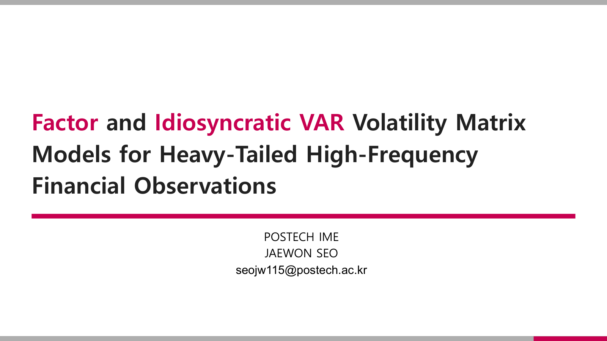

안녕하세요. 이번 세미나에서 *Factor and Idiosyncratic VAR Volatility Matrix Models for Heavy-Tailed High-Frequency Financial Observations* 논문 리뷰를 진행할 산업경영공학과 서재원입니다.

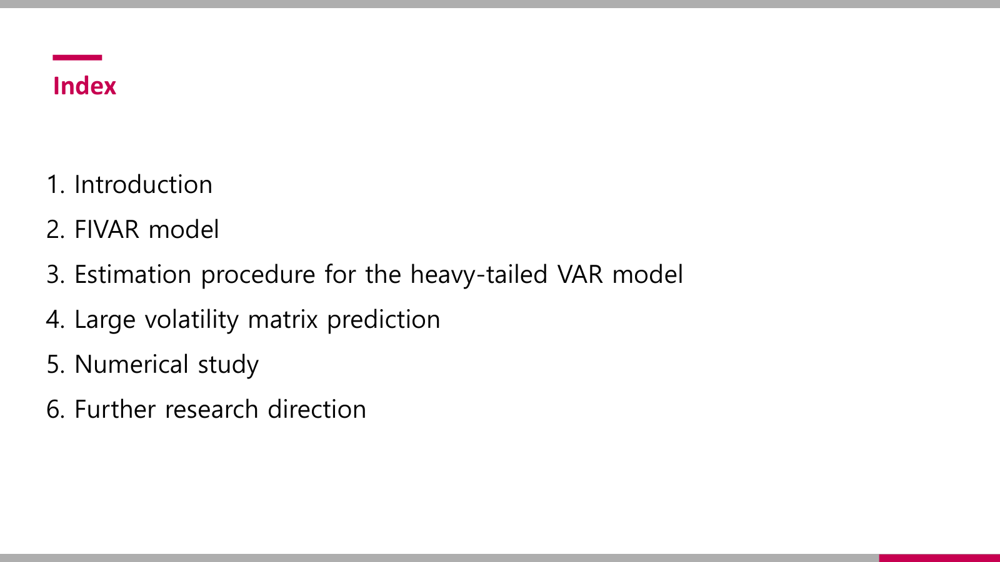

목차는 다음과 같습니다.

## Introduction

High frequency financial data에 기반한 volatility 분석은 최근 경제학과 통계학에서 매우 활발하게 연구되고 있는 분야입니다. 고빈도 데이터를 광범위하게 활용할 수 있게 되면서 integrated volatility를 추정하기 위한 여러 가지 non-parametric 추정 방법들이 개발되었고, 그 성능도 상당히 향상되었습니다.

하지만 이러한 방법들을 다수의 자산에 동시에 적용하려고 할 때, 즉 고차원 자산군을 다룰 때는 새로운 문제가 발생합니다. 바로 자산의 수가 많아질수록 추정해야 할 파라미터의 수가 급격히 증가해서, 기존의 표본 크기만으로는 신뢰성 있게 추정하기 어려워진다는 점입니다.

> **보충: non-parametric estimation**
>
> 비모수적 추정은 어떤 고정된 수식 형태나 분포를 가정하지 않고, 데이터 자체로부터 구조를 유연하게 추정하는 방법을 말합니다. 예를 들어 일반적인 회귀분석에서는 $$y=ax+b$$ 같은 선형 모델을 가정하고 계수 $$a, b$$를 추정하는데, 이런 방식이 모수적(parametric) 방법입니다. 반면 비모수 방법은 이런 형태를 미리 정하지 않고 커널(kernel), 이동평균, 스플라인(spline) 등으로 데이터의 형태에 맞춰 곡선을 그리듯 유연하게 추정합니다. 고빈도 금융 데이터처럼 구조가 복잡하고 점프나 잡음이 많은 경우에는 모수 모형이 틀릴 가능성이 크기 때문에, 이런 유연한 비모수 추정이 더 효과적입니다.
>
> **보충: 왜 파라미터 수가 늘어나는 게 문제인가**
>
> 자산의 개수가 늘어나면 공분산 행렬을 구성하는 원소가 늘어나고, 결국 관측 데이터의 수보다 추정해야 하는 파라미터의 수가 더 많아지는 상황이 생길 수 있습니다.

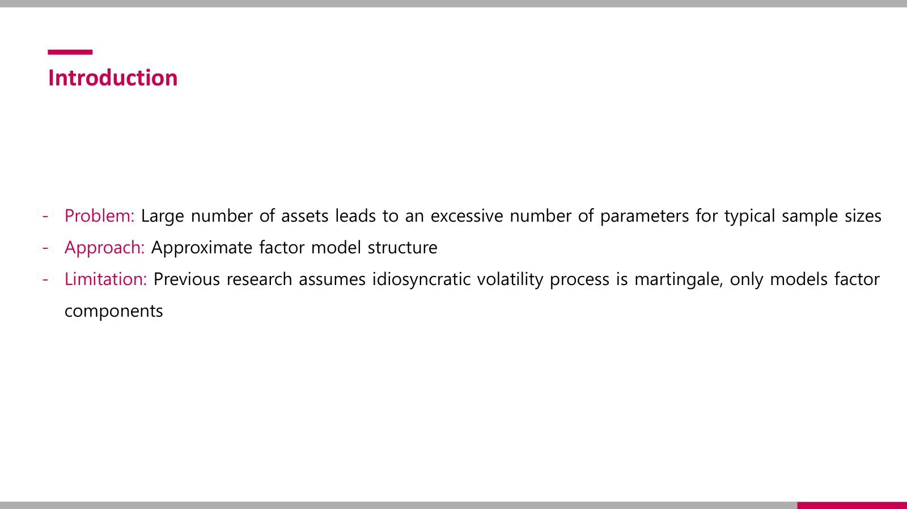

이를 해결하기 위해 기존 연구에서는 approximate factor model 구조를 사용합니다. 즉 전체 자산들의 공통된 움직임을 설명할 수 있는 소수의 요인(factor)을 추출해서, 복잡한 고차원 구조를 보다 단순하고 효과적으로 모델링합니다.

하지만 기존 연구에는 한계점도 존재합니다. 대부분의 기존 방법은 개별 자산의 idiosyncratic volatility를 충분히 고려하지 않고, 그것이 마팅게일(martingale) 구조를 따른다는 전제 아래 factor component만을 모델링합니다. 이 때문에 전체 리스크 구조를 정확히 설명하거나 예측하는 데 한계가 있습니다.

> **보충: martingale**
>
> 과거의 정보를 알고 있을 때 미래의 기댓값이 현재 값과 같은 확률과정입니다. 즉 $$s < t$$에 대해 $$\mathbb{E}[X_t \vert{} \mathcal{F}_s] = X_s$$ 를 만족합니다.

하지만 이 figure는 기존 연구와의 차별점을 보여줍니다. 가장 왼쪽의 boxplot은 idiosyncratic volatility matrix의 고유값 200개에 대한 lag 1 autocorrelation을 나타낸 것인데요, 0.5 근방으로 유의미한 상관관계를 보이고 있습니다. 또 이후에 나오는 4개의 plot은 1, 50, 150, 200번째 고유값의 lag에 따른 autocorrelation을 나타내는데요, 1주에서 4주에 해당하는 lag까지 autocorrelation이 유의미하게 나타납니다.

이런 경향은 전체 volatility를 추정할 때 factor뿐만 아니라 idiosyncratic 요소도 큰 영향을 미칠 수 있다는 것을 보여줍니다.

> **보충: ACF**
>
> 시계열 데이터에서 lag $$h$$만큼 떨어진 데이터와 현재 데이터가 어느 정도의 상관관계를 가지는지를 나타내는 함수입니다. $$\rho(h) = \operatorname{Cov}(x_t, x_{t+h}) / \operatorname{Var}(x_t)$$

앞의 plot에 따르면 volatility dynamics를 정확히 포착하려면 공통 요인(factor)뿐만 아니라 idiosyncratic volatility도 함께 모델링하는 것이 중요합니다.

하지만 여기에는 문제가 있습니다. Volatility matrix는 고차원이라서 자산의 수가 많아질수록 추정해야 할 파라미터의 수가 급격히 증가(over-parameterization)하고, 그래서 추정이 매우 불안정해집니다. 이 문제를 완화하기 위해 기존 연구들은 sparsity를 전제로 합니다. 대표적으로 LASSO나 SCAD 같은 정규화 기법으로 불필요한 파라미터를 0으로 만들어 모델을 단순화합니다.

그런데 이런 접근에도 중요한 한계가 있습니다. 대부분의 sparsity 기반 방법은 데이터가 sub-Gaussian, 즉 꼬리가 비교적 얇은 분포를 따른다고 가정합니다. 그러나 실제 고빈도 금융 데이터는 heavy tail(두꺼운 꼬리) 특성을 보이는 경우가 많기 때문에, 이 가정이 성립하지 않아 모형의 신뢰성과 정확성이 떨어질 수 있습니다.

> **보충**
>
> - LASSO: L1 패널티를 주어 모델의 sparsity를 유도합니다.
> - SCAD: LASSO처럼 L1 형태의 패널티가 있지만, 값이 큰 계수에 대해서는 패널티를 완화합니다.
> - sub-Gaussian: 확률분포의 꼬리가 가우시안 분포에 의해 지배되어, 꼬리가 가우시안만큼 빠르게 줄어드는 분포입니다.

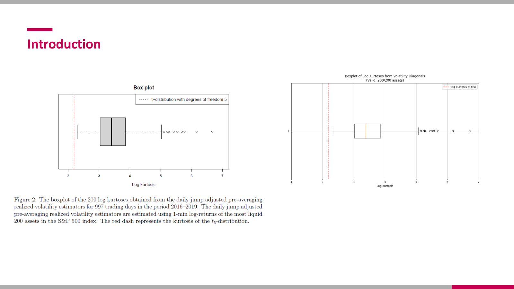

이 plot은 200개 자산에 대해 pre-averaging 방식으로 얻은 volatility의 2016년부터 2019년까지 997 거래일 동안의 log kurtosis를 나타냅니다. 빨간 점선은 자유도가 5인 t 분포의 log kurtosis인데요, 대부분의 자산에서 log kurtosis가 t 분포보다 크게 나타나고, 이는 sub-Gaussian 가정을 만족하지 않는다는 것을 보여줍니다. 따라서 sub-Gaussian을 가정한 기존 방법론은 적합하지 않을 수 있습니다.

> **보충: kurtosis**
>
> 첨도, 즉 확률분포의 꼬리가 두꺼운 정도입니다. 3에 가까울수록 정규분포에 가깝고, 클수록 heavy-tailed입니다.

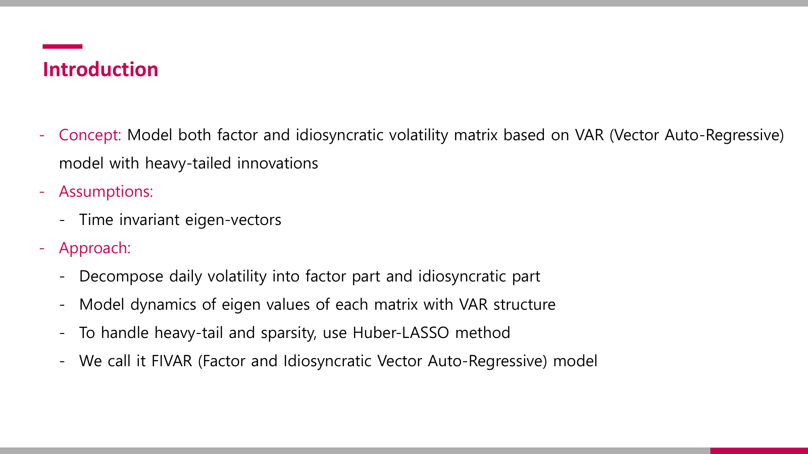

본 논문은 고빈도 금융 데이터의 특성인 heavy-tailedness와 model sparsity를 반영하는 volatility 추정 방법을 제안합니다. 공통 요인(factor)과 개별 리스크(idiosyncratic) 모두에 대한 변동성 행렬을 동시에 모델링하는데, 이를 위해 두 행렬의 고유값(eigenvalue)들을 각각 VAR(Vector Auto-Regressive) 구조로 모델링합니다.

이 모델에서 가장 중요한 가정은 고유벡터(eigenvector)가 시간에 따라 변하지 않는다, 즉 time-invariant하다는 점입니다. 이 가정 덕분에 고유값의 VAR 구조만 집중적으로 분석할 수 있게 됩니다.

실제 접근은 다음과 같이 구성됩니다. 먼저 하루 단위의 전체 변동성 행렬을 factor part와 idiosyncratic part로 분해합니다. 그리고 각 부분에서 추출한 고유값 시계열을 VAR 구조로 동적으로 모델링합니다. 마지막으로 금융 데이터의 heavy-tailed 분포와 sparsity를 동시에 다루기 위해 Huber-LASSO 방법을 도입합니다. 이 전체 구조를 FIVAR, Factor and Idiosyncratic VAR 모형이라고 부릅니다.

## FIVAR model

여기서는 본 논문에서 제안하는 FIVAR($$h$$) 모델의 정의를 소개하겠습니다. Theorem 1에 따르면, 로그 가격 벡터 $$X(t)$$가 FIVAR($$h$$) 모형을 따를 때 이와 관련된 integrated eigenvalue는 위와 같은 VAR 구조의 반복 방정식을 만족합니다.

여기서 $$\xi_d$$는 전일에서 당일까지의 고유값 프로세스를 적분한 벡터이고, $$\nu$$는 평균 벡터, $$A_k$$는 VAR 계수 행렬, 그리고 $$\epsilon_d$$는 평균이 0인 i.i.d. 오차항입니다. 즉 고유값 시계열이 VAR($$h$$) 구조를 따른다는 뜻입니다.

다만 이 모형에도 어려움이 있습니다. idiosyncratic component를 포함하면 차원이 매우 커지고, 금융 데이터의 특성상 오차항 $$\epsilon_d$$가 heavy-tailed, 즉 극단값이 자주 나오는 분포를 가지기 때문에 모델 추정에서 heavy-tailedness와 고차원성(over-parameterization)이라는 두 가지 문제에 동시에 직면하게 됩니다. 그래서 다음 슬라이드에서는 이 두 문제를 함께 다룰 수 있는 robust한 추정 방법을 소개합니다.

## Estimation procedure for the heavy-tailed VAR model

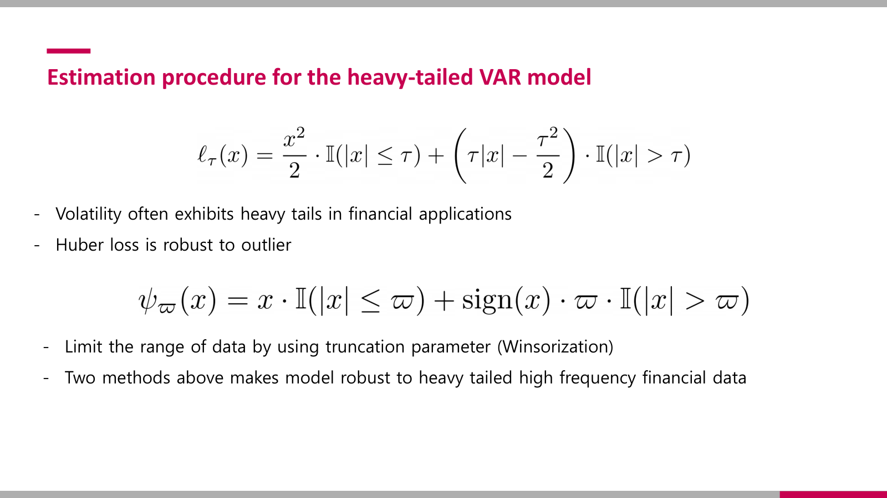

이 슬라이드에서는 heavy-tailedness에 robust하게 고유값의 VAR process를 추정할 수 있도록 하는 기법들을 소개합니다.

우선 Huber loss를 사용합니다. Huber loss는 $$\tau$$를 기준으로, 오차가 $$\tau$$보다 작을 때는 squared error처럼, $$\tau$$보다 클 때는 absolute error처럼 작동합니다. 그래서 outlier에 robust하고 이상치의 영향을 줄일 수 있습니다.

또 학습 전에 데이터를 truncation합니다. $$\varpi$$를 기준으로 데이터의 범위를 $$\pm\varpi$$로 제한해서, heavy-tailed한 고빈도 금융 데이터에 대해서도 robust한 추정이 가능하도록 합니다.

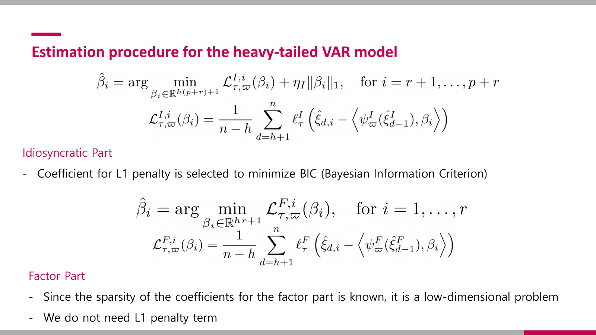

이 truncation 기법들을 적용한 뒤 factor와 idiosyncratic 고유값을 각각 추정합니다. idiosyncratic 부분은 차원이 크기 때문에 model sparsity를 가정하고, Huber loss와 L1 penalty를 결합한 H-LASSO 방법으로 VAR process의 계수 $$\beta$$를 추정합니다. 이때 L1 penalty의 계수는 BIC(Bayesian Information Criterion)를 최소화하도록 선택합니다.

Factor part는 저차원 문제이므로 L1 패널티가 필요하지 않습니다. 따라서 Huber loss만으로 loss function을 정의한 뒤 모델 파라미터를 추정합니다.

## Large volatility matrix prediction

앞에서 나온 모델 파라미터 추정을 하려면 먼저 실제 자산 가격으로부터 매일의 변동성 행렬을 만들어야 하는데, 이를 위해 pre-averaging realized volatility matrix(PRVM)를 사용합니다. 논문의 empirical study에서는 S&P 500 중 200개 자산의 1분 로그 가격을 사용해 일자별로 PRVM 변동성 행렬을 계산합니다.

PRVM은 pre-averaging으로 microstructure noise를 완화하고, truncation으로 극단적인 수익률의 영향을 줄여서 heavy tail에 대한 robustness를 가지게 됩니다.

일별 integrated volatility는 factor part와 idiosyncratic part로 나누어서 각각 구하게 됩니다. 우선 factor 고유값은 다음과 같은 과정으로 구합니다.

먼저 고유값이 음수가 되지 않도록 변동성 행렬을 PSD cone에 사영(projection)합니다. 그다음 학습 기간 $$n$$에 대해 time-invariant eigenvector 가정을 맞추기 위해, 가장 최근 $$\ell$$일 동안의 행렬을 평균내서 얻은 고유벡터를 전체 학습 기간에 사용합니다. 이렇게 해서 얻은 고유값은 자산 개수 $$p$$로 나누어 정규화합니다.

Idiosyncratic volatility matrix도 비슷한 방법으로 추정합니다. 뒤에서 나올 rank estimation으로 추정한 rank 개수만큼의 고유값과 고유벡터로 factor 성분을 만들어 전체 행렬에서 빼서 idiosyncratic volatility matrix를 구합니다. 이후 POET 처리를 위해 thresholding을 합니다.

여기서는 hard thresholding을 적용하는데, 논문에서는 GICS 섹터를 기준으로 같은 섹터에 속하는 자산끼리의 공분산은 유지하고, 다른 섹터에 속하는 자산끼리의 공분산은 0으로 만듭니다.

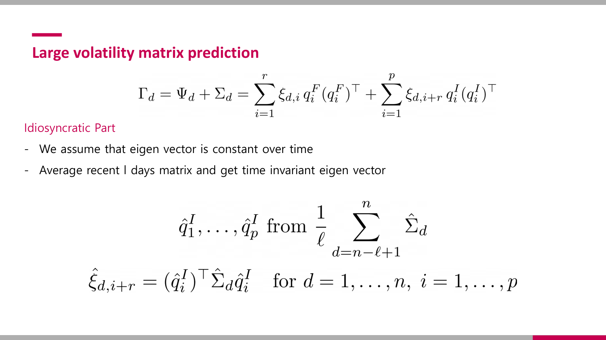

이후 factor에서 했던 것처럼, 학습 기간 $$n$$ 중 최근 22일의 행렬을 평균내서 얻은 고유벡터를 전체 기간에 사용해 idiosyncratic 고유값 시계열을 얻습니다.

이렇게 얻은 factor와 idiosyncratic 고유값을 VAR 구조로 모델링한 뒤, 앞에서 설명한 truncation과 sparsity를 반영한 H-LASSO로 모델 파라미터를 추정합니다. 추정한 계수로 다음 날의 고유값을 예측하고, 고정해둔 고유벡터와 다시 조립하면 다음 날의 변동성 행렬 예측값이 됩니다.

## Numerical study

Numerical study에서는 H-LASSO가 sub-Gaussian 조건을 만족하지 않는 상황에서도 robust한지를 검증하고, 실제 주가 데이터로 변동성 예측을 진행합니다. 우선 위의 rank estimation 식으로 rank를 추정하는데, 모든 실험 기간에 대해 3이 나옵니다. 이어서 VAR 모형의 lag를 BIC를 최소화하도록 선택하는데, lag는 1로 추정됩니다.

왼쪽은 논문의 Figure 7로, 997개 idiosyncratic 변동성 행렬을 평균낸 행렬의 연속된 고유값 차이(eigen gap)를 처음 100개까지 그린 것입니다. 오른쪽은 제가 같은 과정을 직접 구현해서 그린 결과인데요, 전체적인 패턴이 논문과 거의 같게 나왔고, rank 추정 결과도 논문과 같은 3을 얻었습니다.

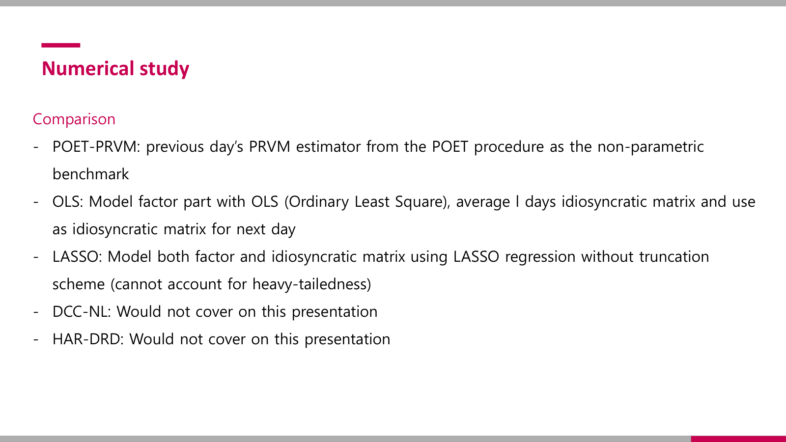

실제 데이터 실험에서 비교하는 모형은 다음과 같습니다. POET-PRVM은 전날의 PRVM에 POET를 적용한 추정치를 그대로 쓰는 비모수 기준선입니다. OLS는 factor 부분만 OLS로 모델링하고, idiosyncratic 행렬은 최근 $$\ell$$일 평균을 다음 날 값으로 씁니다. LASSO는 factor와 idiosyncratic 행렬을 모두 LASSO로 모델링하지만 truncation이 없어서 heavy-tailedness를 반영하지 못합니다. DCC-NL과 HAR-DRD는 이번 발표에서는 다루지 않았습니다.

먼저 모델의 진짜 파라미터와 추정값 사이의 오차를 비교한 시뮬레이션입니다. 오차 기준은 Frobenius norm, max norm, spectral norm이고, 샘플 수 $$n = 100, 200, 500$$, 하루 고빈도 관측 수 $$m = 250, 500, 2000$$에 대해 반복했습니다. 데이터 분포도 heavy-tailed와 sub-Gaussian 두 가지로 나누어 분석했습니다.

결과를 보면 H-LASSO는 대부분의 설정에서 LASSO보다 낮은 추정 오차를 보였습니다. 특히 heavy-tailed 상황에서 Frobenius norm과 spectral norm 오차가 뚜렷하게 줄었고, 샘플 수가 늘어날수록 전체적으로 오차가 줄어드는 경향이 나타났습니다. 다만 max norm은 이상치의 영향을 크게 받아서, 고빈도 관측 수가 적은 일부 설정에서는 차이가 거의 없거나 오히려 불리하게 나오기도 했습니다.

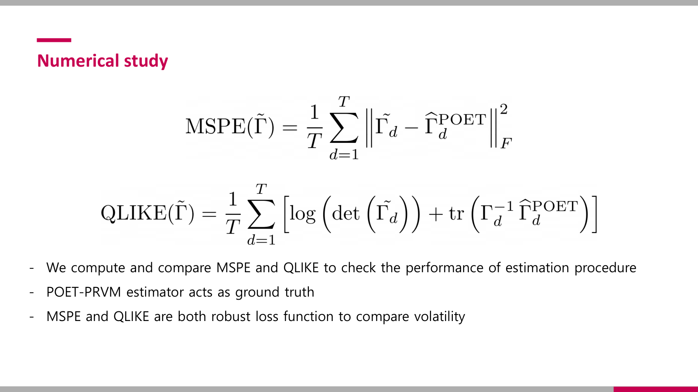

실제 데이터에서는 미래의 변동성 행렬을 얼마나 정확하게 예측했는지를 MSPE와 QLIKE로 비교합니다. 실제 변동성은 관측할 수 없기 때문에 POET-PRVM 추정치를 정답 대용으로 사용하고, 두 지표 모두 이런 대용 정답에 대해 robust한 손실 함수로 알려져 있습니다.

위의 표가 논문의 결과입니다. H-LASSO는 세 기간 모두에서 가장 낮은 MSPE를 보였습니다. POET-PRVM은 전날 추정치를 그대로 쓰기 때문에 변동성의 dynamics를 반영하지 못해서 성능이 가장 낮았고, LASSO는 OLS와 비교해 큰 차이가 없었습니다. factor만 모델링하는 OLS는 idiosyncratic 부분의 dynamics를 설명하지 못하고, LASSO는 heavy tail에 취약하다는 점이 함께 드러나는 결과입니다.

아래는 제가 재현한 MSPE입니다. POET-PRVM은 세 기간에 대해 2.771, 4.111, 1.431로 논문과의 차이가 1% 이내였고, OLS는 2.431, 3.823, 1.038로 6.35%, 8.06%, 0.87% 차이가 났습니다. 반면 LASSO와 H-LASSO는 논문과 거리가 먼 값이 나왔는데, idiosyncratic volatility matrix를 추정하는 단계에 논리적인 오류가 있었던 것 같습니다.

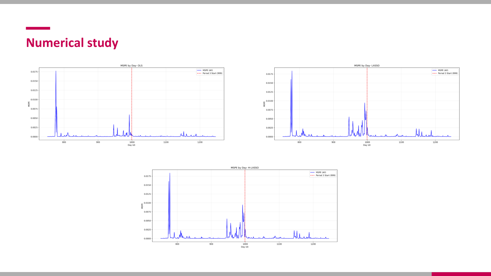

재현한 세 모형의 일자별 MSPE입니다. 빨간 점선은 기간 3(2019년)이 시작되는 지점입니다. 세 모형 모두 비슷한 시점에 오차가 튀지만, LASSO와 H-LASSO는 특히 기간 2 후반부에서 OLS보다 오차가 크게, 더 자주 튀는 것을 볼 수 있습니다. factor만 쓰는 OLS는 논문과 비슷하게 나오는데 idiosyncratic 고유값까지 쓰는 두 모형만 어긋난다는 점에서, 문제가 idiosyncratic 부분에 있다고 봤습니다.

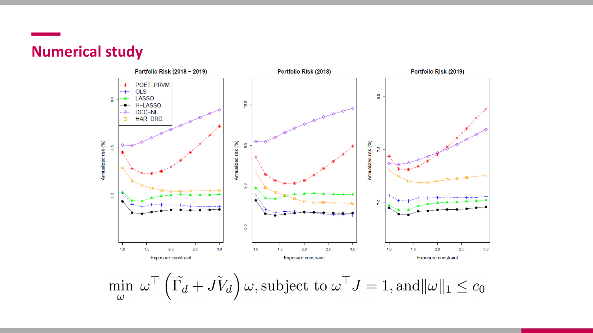

이 plot은 추정한 변동성 행렬로 포트폴리오 위험을 최소화하도록 자산을 배분했을 때의 위험을 exposure constraint에 따라 나타낸 것입니다. 추정된 volatility에 jump term을 더해 리스크 정보를 추가로 반영하고, 그에 따른 포트폴리오의 연환산 위험(annualized risk)을 계산합니다. H-LASSO는 exposure constraint가 커져도 안정적이고 가장 작은 위험을 가집니다. 반면 POET-PRVM과 DCC-NL로 구한 포트폴리오는 exposure constraint가 커질수록 불안정해지는데, 변동성 과정의 dynamics를 설명하지 못하기 때문일 수 있습니다.

> **보충: 축 읽는 법**
>
> - x축 exposure constraint: 포트폴리오 가중치의 L1 norm 상한입니다. 1.0이면 공매도 없이 투자하는 경우이고, 값이 커질수록 공매도와 레버리지를 더 많이 허용합니다.
> - y축 annualized risk(%): 포트폴리오 일별 수익률의 표준편차를 연 단위로 환산한 값입니다.

## Further research direction

마지막으로 후속 연구에 대한 내용입니다. 논문에서는 H-LASSO 모델이 희소성을 가정하는데, 실제로 이 희소성이 존재하는지를 검정할 수 있는 통계적 방법이 필요하다고 언급하고 있습니다. 또 rank와 고유벡터가 시간에 따라 고정된다고 가정한 부분도 현실적인 제약이므로, 이를 완화한 확장 모델이 앞으로의 연구 과제가 될 수 있습니다.

제가 생각한 추가 연구 아이디어는 세 가지입니다. 첫째, 고유값이 시간에 따라 어떻게 변하는지를 LSTM이나 neural SDE 같은 신경망으로 학습하는 방식입니다. 둘째, heavy-tailed 데이터에서는 robust한 추정이 중요하다는 점을 고려해서 그런 모델에도 강건성을 더하는 방향이 필요합니다. 마지막으로 암호화폐처럼 변동성이 큰 자산에도 이 프레임워크를 적용해볼 수 있다고 생각합니다.
