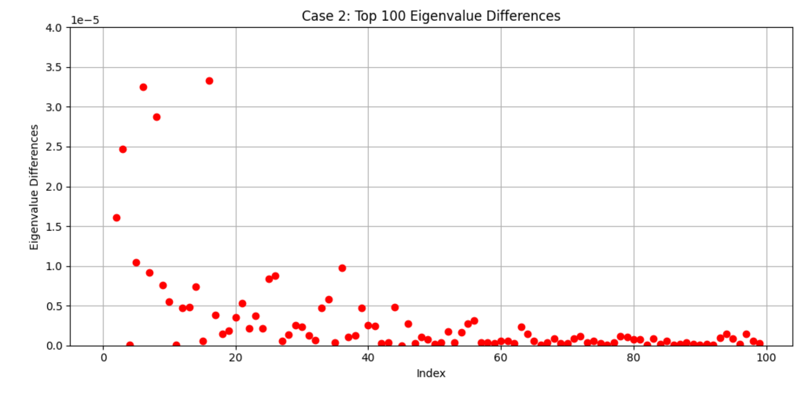
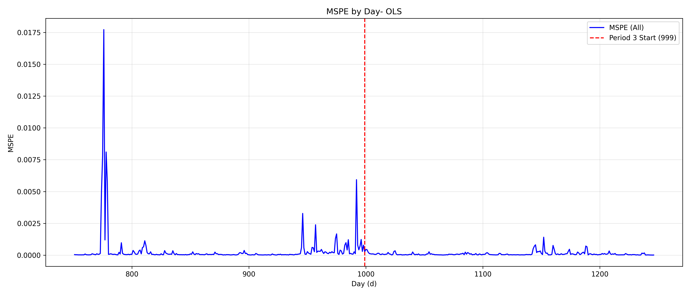

2025년 여름, POSTECH FBDA Lab에서 학부연구생으로 참여하면서 진행한 논문 리뷰와 재현 기록이다. 리뷰한 논문은 Minseok Shin, Donggyu Kim, Yazhen Wang, Jianqing Fan의 *Factor and Idiosyncratic VAR Volatility Matrix Models for Heavy-Tailed High-Frequency Financial Observations* (Journal of Econometrics 252, 106129, 2025)이다. 랩 세미나에서 논문 내용을 발표하는 것과 함께, 논문의 empirical study를 직접 코드로 다시 구현해 결과가 얼마나 재현되는지 확인하는 것이 목표였다.

발표자료: [FIVAR_seminar.pdf](/assets/files/FIVAR_seminar.pdf)

## 문제 배경: 자산이 많아질수록 무너지는 변동성 추정

고빈도(high-frequency) 금융 데이터를 이용한 변동성 분석은 금융계량경제학과 통계학에서 활발하게 연구되는 분야다. 고빈도 데이터를 쉽게 구할 수 있게 되면서 하루 동안의 적분 변동성(integrated volatility)을 추정하는 비모수(non-parametric) 방법들이 여럿 개발되었고 성능도 상당히 좋아졌다. 비모수 추정은 $$y=ax+b$$ 같은 고정된 함수 형태를 가정하지 않고 데이터로부터 구조를 유연하게 추정하는 방식인데, 점프와 잡음이 많은 고빈도 데이터에서는 모수 모형이 틀릴 가능성이 크기 때문에 이쪽이 더 효과적이다.

문제는 이런 방법을 수백 개의 자산에 동시에 적용할 때 생긴다. 자산이 $$p$$개면 공분산 행렬의 원소는 $$p^2$$ 규모로 늘어나고, 결국 관측할 수 있는 표본 수보다 추정해야 할 파라미터 수가 더 많아지는 상황이 된다. 기존 연구는 이를 approximate factor model 구조로 해결했다. 전체 자산의 공통된 움직임을 소수의 요인(factor)으로 설명하고, 나머지를 개별 자산 고유의 변동성(idiosyncratic volatility)으로 두는 것이다. 다만 대부분의 기존 방법은 idiosyncratic 변동성이 마팅게일(martingale), 즉 과거 정보가 주어졌을 때 미래의 기댓값이 현재 값과 같다($$\mathbb{E}[X_t \vert{} \mathcal{F}_s] = X_s$$)고 가정하고 factor 부분만 동적으로 모델링했다.

논문은 이 가정이 실제 데이터와 맞지 않는다는 것부터 보여준다. idiosyncratic 변동성 행렬의 고유값 200개에 대해 lag 1 자기상관(autocorrelation)을 구해보면 0.5 근방의 뚜렷한 값이 나오고, 1, 50, 150, 200번째 고유값의 자기상관 함수를 그려보면 1주에서 4주에 해당하는 lag까지도 유의미한 상관이 남아있다. 변동성의 동역학을 제대로 잡으려면 factor뿐 아니라 idiosyncratic 부분도 함께 모델링해야 한다는 뜻이다.

그런데 idiosyncratic 부분까지 모델링하면 차원 문제가 다시 커진다. 보통은 LASSO나 SCAD 같은 정규화로 파라미터의 희소성(sparsity)을 가정해서 이를 완화하는데, 이 방법들은 대부분 데이터가 sub-Gaussian, 즉 꼬리가 가우시안만큼 빠르게 줄어드는 분포를 따른다고 가정한다. 하지만 2016년부터 2019년까지 997 거래일 동안 200개 자산의 pre-averaging 변동성의 log kurtosis를 보면, 대부분의 자산이 자유도 5인 t 분포의 기준선보다도 높은 첨도를 보인다. 고빈도 금융 데이터는 전형적인 heavy-tailed 분포라서 sub-Gaussian 가정에 기반한 방법은 신뢰하기 어렵다.

## FIVAR 모형

논문이 제안하는 FIVAR(Factor and Idiosyncratic VAR) 모형은 이 두 문제, heavy-tailedness와 고차원성을 동시에 다룬다. 핵심 아이디어는 다음과 같다.

- 하루 단위의 변동성 행렬을 factor 부분과 idiosyncratic 부분으로 분해한다.
- 고유벡터(eigenvector)는 시간에 따라 변하지 않는다(time-invariant)고 가정하고, 각 부분의 고유값(eigenvalue) 시계열만 VAR(Vector Auto-Regressive) 구조로 모델링한다.
- heavy tail과 희소성을 함께 다루기 위해 Huber loss와 L1 패널티를 결합한 Huber-LASSO(H-LASSO)로 VAR 계수를 추정한다.

하루 $$d$$의 적분 변동성 행렬 $$\Gamma_d$$는 factor 부분 $$\Psi_d$$와 idiosyncratic 부분 $$\Sigma_d$$의 합으로 쓰이고, 각 부분은 시간에 따라 변하지 않는 고유벡터 $$q_i^F, q_i^I$$와 매일 변하는 고유값 $$\xi_{d,i}$$로 분해된다.

$$
\Gamma_d = \Psi_d + \Sigma_d = \sum_{i=1}^{r} \xi_{d,i}\, q_i^F (q_i^F)^\top + \sum_{i=1}^{p} \xi_{d,i+r}\, q_i^I (q_i^I)^\top
$$

여기서 $$r$$은 factor의 개수(rank), $$p$$는 자산 수다. 논문의 Theorem 1에 따르면 로그 가격 벡터가 FIVAR($$h$$) 모형을 따를 때, 하루 동안 고유값 프로세스를 적분한 벡터 $$\xi_d$$는 다음과 같은 VAR($$h$$) 구조를 만족한다.

$$
\xi_d = \nu + \sum_{k=1}^{h} A_k \xi_{d-k} + \epsilon_d \quad \text{a.s.}
$$

$$
\begin{aligned}
\xi_d &= (\xi_{d,1}, \dots, \xi_{d,p+r})^\top = \int_{d-1}^{d} \lambda_t(\theta)\, dt, \\
\nu &= (\nu_1, \dots, \nu_{p+r})^\top, \quad A_k = (A_{k,i,j})_{1 \le i,j \le p+r}, \quad 1 \le k \le h
\end{aligned}
$$

$$\nu$$는 평균 벡터, $$A_k$$는 VAR 계수 행렬, $$\epsilon_d$$는 평균이 0이고 과거의 $$\xi_{d-\ell}$$과 독립인 i.i.d. 오차항이다. 문제는 idiosyncratic 성분을 포함하면서 $$\xi_d$$의 차원이 $$p+r$$로 매우 커지고, 동시에 오차항 $$\epsilon_d$$가 heavy-tailed라는 점이다. 그래서 일반적인 최소제곱이나 LASSO로는 안정적인 추정이 어렵고, 이를 위한 별도의 robust 추정 절차가 필요하다.

## Heavy tail에 강건한 추정: Huber loss와 truncation

논문은 두 가지 장치로 heavy tail에 대응한다. 첫 번째는 Huber loss다. 오차의 크기가 $$\tau$$ 이하일 때는 제곱 오차처럼, $$\tau$$를 넘으면 절대 오차처럼 작동해서 이상치가 손실 함수에 미치는 영향을 선형으로 제한한다.

$$
\ell_\tau(x) = \frac{x^2}{2} \cdot \mathbb{I}(\lvert x \rvert \le \tau) + \left(\tau \lvert x \rvert - \frac{\tau^2}{2}\right) \cdot \mathbb{I}(\lvert x \rvert > \tau)
$$

두 번째는 입력 데이터의 truncation(winsorization)이다. 설명 변수로 들어가는 과거 고유값을 $$\pm\varpi$$ 범위로 잘라서 극단값이 그대로 회귀에 들어가지 않도록 한다.

$$
\psi_\varpi(x) = x \cdot \mathbb{I}(\lvert x \rvert \le \varpi) + \operatorname{sign}(x) \cdot \varpi \cdot \mathbb{I}(\lvert x \rvert > \varpi)
$$

이 두 장치를 쓴 상태에서 factor와 idiosyncratic 고유값을 각각 추정한다. idiosyncratic 부분은 차원이 크기 때문에 희소성을 가정하고 Huber loss에 L1 패널티를 더한 H-LASSO로 각 고유값의 VAR 계수 $$\beta_i$$를 추정한다. 패널티 계수 $$\eta_I$$는 BIC를 최소화하도록 고른다.

$$
\begin{aligned}
\hat\beta_i &= \arg\min_{\beta_i \in \mathbb{R}^{h(p+r)+1}} \mathcal{L}^{I,i}_{\tau,\varpi}(\beta_i) + \eta_I \lVert \beta_i \rVert_1, \quad i = r+1, \dots, p+r \\
\mathcal{L}^{I,i}_{\tau,\varpi}(\beta_i) &= \frac{1}{n-h} \sum_{d=h+1}^{n} \ell^I_\tau\left(\hat\xi_{d,i} - \left\langle \psi^I_\varpi(\hat\xi^I_{d-1}), \beta_i \right\rangle\right)
\end{aligned}
$$

반면 factor 부분은 $$r$$이 작아서 애초에 저차원 문제이므로 L1 패널티 없이 Huber loss만으로 추정한다.

$$
\hat\beta_i = \arg\min_{\beta_i \in \mathbb{R}^{hr+1}} \frac{1}{n-h} \sum_{d=h+1}^{n} \ell^F_\tau\left(\hat\xi_{d,i} - \left\langle \psi^F_\varpi(\hat\xi^F_{d-1}), \beta_i \right\rangle\right), \quad i = 1, \dots, r
$$

## 변동성 행렬에서 고유값 시계열 만들기

위 추정을 하려면 먼저 매일의 고유값 시계열 $$\hat\xi_{d,i}$$를 실제 가격 데이터로부터 만들어야 한다. 논문의 empirical study는 S&P 500 중 거래량 상위 200개 종목의 1분 로그 가격을 사용해 매일의 변동성 행렬을 PRVM(Pre-averaging Realized Volatility Matrix)으로 계산한다. PRVM은 짧은 구간의 수익률을 평균내는 pre-averaging으로 시장 미시구조 잡음(microstructure noise)의 영향을 줄이고, 극단적인 수익률에 truncation을 걸어 heavy tail에도 강건하게 만든 추정량이다.

factor 부분은 다음 순서로 만든다. 우선 PRVM 행렬을 PSD cone에 사영(projection)해서 고유값이 음수가 되지 않도록 한다. 그다음 고유벡터가 시간에 따라 변하지 않는다는 가정을 맞추기 위해, 학습 기간의 가장 최근 $$\ell$$일 행렬을 평균낸 행렬 $$\frac{1}{\ell}\sum_{d=n-\ell+1}^{n} \hat\Gamma_d$$의 상위 $$r$$개 고유벡터 $$\hat q_1^F, \dots, \hat q_r^F$$를 구해 전체 학습 기간에 공통으로 쓴다. 매일의 고유값은 이 고유벡터에 그날의 행렬을 사영해서 얻고, 값의 범위를 맞추기 위해 자산 수 $$p$$로 나눈다.

$$
\hat\xi_{d,i} = \frac{1}{p} (\hat q_i^F)^\top \hat\Gamma_d \hat q_i^F, \quad d = 1, \dots, n, \; i = 1, \dots, r
$$

idiosyncratic 부분도 비슷하다. 그날의 행렬을 고유분해해서 상위 $$r$$개 고유값·고유벡터로 만든 factor 성분을 빼면 idiosyncratic 행렬의 초기 추정치 $$\bar\Sigma_d$$가 남는다. 여기에 POET 방식의 hard thresholding을 적용하는데, 논문에서는 GICS 섹터 정보를 써서 같은 섹터에 속하는 두 자산 사이의 공분산은 남기고 다른 섹터 사이의 공분산은 0으로 만든다(대각 원소는 음수가 되지 않도록 0과 비교해 큰 값을 취한다).

$$
\bar\Sigma_d = \hat\Gamma_d - \sum_{k=1}^{r} \bar\xi_{d,k}\, \bar q_{d,k} \bar q_{d,k}^\top
$$

이후 factor 때와 똑같이 최근 22일의 $$\hat\Sigma_d$$를 평균내 고유벡터 $$\hat q_1^I, \dots, \hat q_p^I$$를 고정하고, 매일의 idiosyncratic 고유값 $$\hat\xi_{d,i+r} = (\hat q_i^I)^\top \hat\Sigma_d \hat q_i^I$$를 구한다. 이렇게 얻은 factor·idiosyncratic 고유값 시계열을 VAR 구조에 넣고 앞의 truncation과 H-LASSO로 계수를 추정한 뒤, 다음 날의 고유값을 예측해 고유벡터와 다시 조립하면 다음 날의 변동성 행렬 예측값이 된다.

## 논문의 실험 결과

먼저 factor 개수 $$r$$은 아래의 rank 추정식으로 정한다. 평균낸 idiosyncratic 행렬의 연속된 고유값 차이(eigen gap)를 보고 패널티 항과 비교해 고르는 방식인데, 논문에서는 모든 실험 기간에서 $$\hat r = 3$$이 나왔다. VAR의 lag $$h$$는 BIC를 최소화하도록 골랐고 1로 추정되었다.

$$
\hat r = \arg\min_{1 \le j \le r_{\max}} \sum_{d=1}^{n} \left( \frac{1}{p}\bar\xi_{d,j} + j \cdot c_1 \left( \sqrt{\frac{\log p}{m^{1/2}}} + \frac{\log p}{p} \right)^{c_2} \right) - 1
$$

시뮬레이션에서는 샘플 수 $$n = 100, 200, 500$$, 하루 고빈도 관측 수 $$m = 250, 500, 2000$$, 그리고 heavy-tailed와 sub-Gaussian 두 가지 분포에 대해 실제 파라미터와 추정치 사이의 Frobenius, max, spectral norm 오차를 비교한다. H-LASSO는 거의 모든 설정에서 LASSO보다 오차가 낮았고, 특히 heavy-tailed 상황에서 Frobenius와 spectral norm 오차가 뚜렷하게 줄었다. 샘플 수가 늘수록 오차가 줄어드는 경향도 이론적 수렴 성질과 일치했다. 다만 max norm은 고빈도 관측 수가 많을수록 heavy tail의 극단값이 더 자주 등장해서 일부 설정에서는 차이가 작거나 오히려 불리하게 나왔다.

실제 데이터에서는 POET-PRVM(전날의 PRVM 추정치를 그대로 다음 날 예측값으로 쓰는 비모수 기준선), OLS(factor 부분만 OLS로 VAR 추정하고 idiosyncratic 행렬은 최근 $$\ell$$일 평균으로 대체), LASSO(truncation 없이 두 부분을 LASSO로 추정), H-LASSO를 비교한다. 평가 지표는 POET-PRVM 추정치를 정답 대용으로 둔 MSPE와 QLIKE다.

$$
\text{MSPE}(\tilde\Gamma) = \frac{1}{T}\sum_{d=1}^{T} \left\lVert \tilde\Gamma_d - \widehat\Gamma_d^{\text{POET}} \right\rVert_F^2
$$

결과적으로 H-LASSO가 세 기간(2018–2019, 2018, 2019) 모두에서 가장 낮은 MSPE를 보였다(기간 1 기준 POET-PRVM 2.797, OLS 2.596, LASSO 2.599, H-LASSO 2.232, 단위 $$\times 10^{-4}$$). POET-PRVM은 전날 값을 그대로 쓰기 때문에 변동성의 동역학을 전혀 반영하지 못해 가장 나빴고, LASSO는 Frobenius norm 기준으로는 OLS보다 나았지만 다른 지표에서는 둘의 차이가 거의 없었다. factor만 모델링하는 OLS가 idiosyncratic 부분의 동역학을 설명하지 못하는 것과, LASSO가 heavy tail에 취약한 것이 동시에 드러나는 결과다. 마지막으로 추정된 변동성 행렬로 최소분산 포트폴리오를 구성했을 때도 H-LASSO는 개별 자산 투자 비중 제약(exposure constraint)을 완화해도 연환산 위험이 안정적으로 가장 낮았던 반면, POET-PRVM과 DCC-NL은 제약이 완화될수록 위험이 불안정하게 커졌다.

## 재현 과정과 결과

같은 설정(S&P 500 거래량 상위 200종목, 1분 로그 가격)으로 PRVM 계산부터 고유값 시계열 생성, rank 추정, VAR 계수 추정, MSPE 평가까지를 Python으로 다시 구현했다. 가장 먼저 확인한 건 rank 추정이었다. 평균낸 idiosyncratic 행렬의 상위 100개 eigen gap을 그려보니 논문의 Figure 7과 거의 같은 모양이 나왔고, rank 추정식으로도 논문과 같은 $$\hat r = 3$$을 얻었다.

MSPE 비교에서는 결과가 절반만 재현되었다. POET-PRVM은 세 기간에 대해 2.771, 4.111, 1.431로 논문 값과의 차이가 각각 0.93%, 0.96%, 0.49%에 불과했다. PRVM 계산과 POET thresholding까지의 파이프라인은 논문과 거의 동일하게 구현되었다는 뜻이다. OLS는 2.431, 3.823, 1.038로 차이가 6.35%, 8.06%, 0.87%였는데, 기간 3에서는 거의 일치했지만 2018년이 포함된 기간에서는 논문보다 오차가 낮게 나왔다.

반면 LASSO와 H-LASSO는 논문과 거리가 먼 값이 나왔다. 일자별 MSPE를 그려보면 OLS와 비슷한 시점에 오차가 튀긴 하지만 그 크기가 훨씬 컸고, 특히 기간 2 후반부에서 오차가 연속적으로 크게 튀었다. factor 부분만 쓰는 OLS는 잘 맞는데 idiosyncratic 고유값까지 VAR에 넣는 두 모형만 어긋난다는 점에서, idiosyncratic 변동성 행렬을 추정하는 단계에 논리적인 오류가 있었을 가능성이 높다고 판단했다. 세미나 시점까지는 이 부분을 끝까지 바로잡지 못했고, 발표에서도 재현되지 않은 부분으로 그대로 공유했다.

## 정리하며

논문이 스스로 제시하는 후속 과제는 두 가지다. H-LASSO는 계수의 희소성을 가정하는데, 실제로 그 희소성이 존재하는지 검정하는 절차가 필요하다는 것. 그리고 rank와 고유벡터가 시간에 따라 고정된다는 가정이 현실적인 제약이므로 이를 완화한 모형이 필요하다는 것이다.

여기에 내가 생각한 방향을 몇 가지 더했다. 고유값의 시간에 따른 변화를 선형 VAR 대신 LSTM이나 neural SDE 같은 신경망으로 학습해볼 수 있을 것 같고, 이번 논문에서 배운 것처럼 heavy-tailed 데이터에서는 신경망 모형에도 robust한 손실이나 truncation 같은 강건성 장치를 넣는 것이 중요할 것이다. 또 암호화폐처럼 변동성과 꼬리가 훨씬 극단적인 자산에 이 프레임워크를 적용해보는 것도 흥미로울 것 같다.

개인적으로는 처음으로 계량경제학 논문을 수식 단위까지 따라가며 직접 구현해본 경험이었다. 논문에서는 한두 줄로 지나가는 "최근 22일 평균으로 고유벡터를 고정한다" 같은 처리가 실제 구현에서는 결과를 크게 좌우한다는 걸 체감했고, 재현이 안 된 부분을 어디서부터 의심해야 하는지 범위를 좁혀가는 과정 자체가 가장 많이 배운 부분이었다.
