POSTECH FBDA Lab 세미나에서 발표한 논문 리뷰 및 재현 기록이다. 리뷰한 논문은 Minseok Shin, Donggyu Kim, Yazhen Wang, Jianqing Fan의 *Factor and Idiosyncratic VAR Volatility Matrix Models for Heavy-Tailed High-Frequency Financial Observations* (Journal of Econometrics 252, 106129, 2025)이다. 논문 내용을 정리해 발표하는 것과 함께, 논문의 empirical study를 직접 코드로 다시 구현해서 결과가 얼마나 재현되는지 확인해보는 것이 목표였다. 아래는 발표 슬라이드를 한 장씩 따라가며 정리한 것이고, 슬라이드에 들어간 그림 중 재현 결과가 아닌 것은 모두 위 논문의 figure와 table이다.

발표자료 PDF: [FIVAR_seminar.pdf](/assets/files/FIVAR_seminar.pdf)

발표는 문제 배경(Introduction), FIVAR 모형의 정의, heavy tail에 강건한 추정 방법, 실제 변동성 행렬 예측 절차, 실험 결과와 재현, 후속 연구 방향 순서로 구성했다.

## Introduction

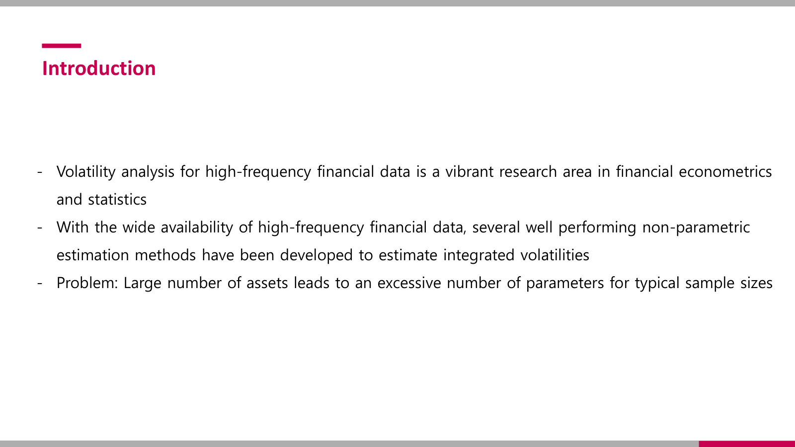

고빈도(high-frequency) 금융 데이터를 이용한 변동성 분석은 금융계량경제학과 통계학에서 활발하게 연구되는 분야다. 고빈도 데이터를 쉽게 구할 수 있게 되면서 하루 동안의 적분 변동성(integrated volatility)을 추정하는 비모수(non-parametric) 방법들이 여럿 개발되었고 성능도 상당히 좋아졌다. 문제는 이런 방법을 수백 개의 자산에 동시에 적용할 때 생긴다. 자산 수가 늘어날수록 추정해야 할 파라미터 수가 급격히 늘어나서, 주어진 표본 크기만으로는 신뢰성 있게 추정하기 어려워진다.

> **보충: non-parametric estimation**
>
> 비모수 추정은 고정된 함수 형태나 분포를 가정하지 않고 데이터로부터 구조를 유연하게 추정하는 방법이다. 일반적인 회귀분석이 $$y=ax+b$$ 같은 선형 모델을 가정하고 계수 $$a, b$$를 추정하는 모수적(parametric) 방법이라면, 비모수 방법은 형태를 미리 정하지 않고 커널(kernel), 이동평균, 스플라인(spline) 등으로 데이터에 맞춰 곡선을 그리듯 추정한다. 고빈도 금융 데이터처럼 구조가 복잡하고 점프나 잡음이 많은 경우에는 모수 모형이 틀릴 가능성이 크기 때문에 비모수 추정이 더 효과적이다.
>
> **보충: 왜 파라미터 수가 늘어나는 게 문제인가**
>
> 자산 수가 늘어나면 공분산 행렬의 원소 수가 자산 수의 제곱 규모로 늘어나고, 결국 관측할 수 있는 데이터보다 추정해야 할 파라미터가 더 많아지는 상황이 생긴다.

기존 연구는 이 문제를 approximate factor model 구조로 풀었다. 전체 자산의 공통된 움직임을 소수의 요인(factor)으로 설명하고, 복잡한 고차원 구조를 단순하게 모델링하는 방식이다. 다만 대부분의 기존 방법은 개별 자산 고유의 변동성(idiosyncratic volatility)이 마팅게일(martingale) 구조를 따른다고 가정하고 factor 부분만 동적으로 모델링했다. 그래서 전체 리스크 구조를 정확히 설명하거나 예측하는 데에는 한계가 있었다.

> **보충: martingale**
>
> 과거 정보가 주어졌을 때 미래의 기댓값이 현재 값과 같은 확률과정이다. 즉 $$s < t$$에 대해 $$\mathbb{E}[X_t \vert{} \mathcal{F}_s] = X_s$$ 를 만족한다.

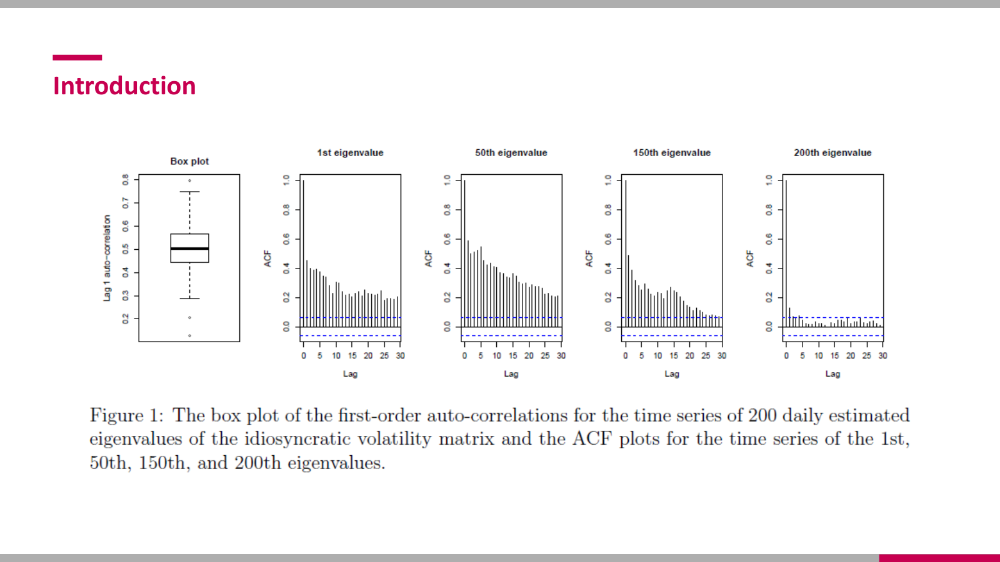

논문은 이 가정이 실제 데이터와 맞지 않는다는 것부터 보여준다. 가장 왼쪽의 boxplot은 idiosyncratic 변동성 행렬의 고유값 200개에 대한 lag 1 자기상관(autocorrelation)인데, 0.5 근방의 뚜렷한 상관을 보인다. 나머지 네 개의 plot은 1, 50, 150, 200번째 고유값의 lag별 자기상관으로, 1주에서 4주에 해당하는 lag까지도 유의미한 상관이 남아있다. 전체 변동성을 추정할 때 factor뿐 아니라 idiosyncratic 성분도 시간에 따라 의미 있게 움직이고 있다는 뜻이다.

> **보충: ACF**
>
> 시계열에서 lag $$h$$만큼 떨어진 값과 현재 값 사이의 상관을 나타내는 함수로, $$\rho(h) = \operatorname{Cov}(x_t, x_{t+h}) / \operatorname{Var}(x_t)$$ 로 정의된다.

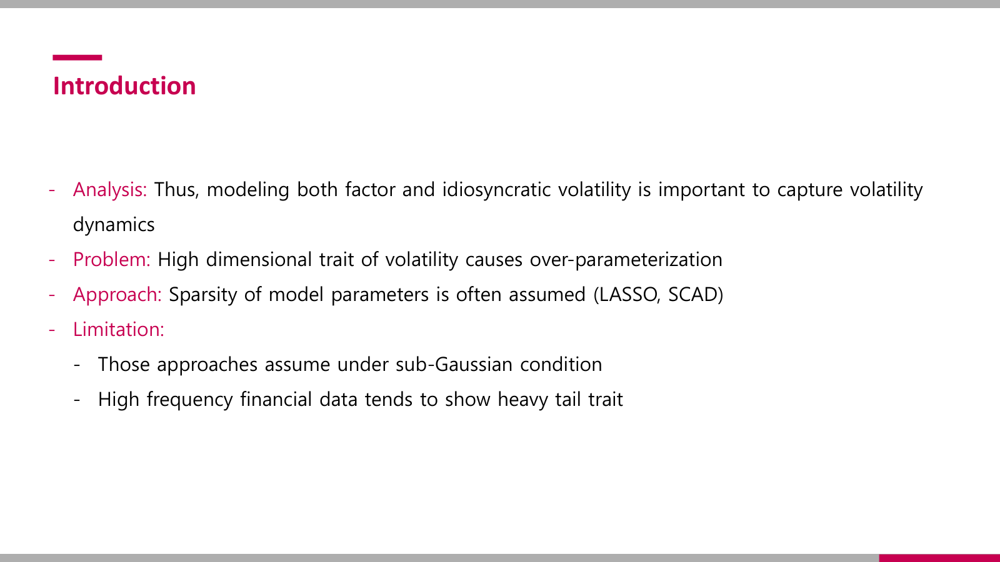

변동성의 동역학을 제대로 잡으려면 idiosyncratic 변동성도 함께 모델링해야 하지만, 그러면 차원 문제가 다시 커진다. 자산 수가 늘어날수록 파라미터가 급격히 늘어나는 over-parameterization 때문에 추정이 매우 불안정해진다. 기존 연구들은 이를 파라미터의 희소성(sparsity)을 가정하고 LASSO나 SCAD 같은 정규화로 불필요한 계수를 0으로 만들어 완화했다.

그런데 이런 sparsity 기반 방법은 대부분 데이터가 sub-Gaussian, 즉 꼬리가 얇은 분포를 따른다고 가정한다. 실제 고빈도 금융 데이터는 두꺼운 꼬리(heavy tail)를 보이는 경우가 많아서 이 가정이 깨지고, 그만큼 모형의 신뢰성과 정확성도 떨어질 수 있다.

> **보충**
>
> - LASSO: L1 패널티를 더해 계수의 희소성을 유도한다.
> - SCAD: LASSO처럼 L1 형태의 패널티를 쓰지만, 값이 큰 계수에 대해서는 패널티를 완화한다.
> - sub-Gaussian: 분포의 꼬리가 가우시안에 의해 지배되어, 가우시안만큼 빠르게 줄어드는 분포다.

실제로 200개 자산에 대해 pre-averaging 방식으로 구한 변동성의 log kurtosis를 2016년부터 2019년까지 997 거래일에 걸쳐 보면, 대부분의 자산이 빨간 점선으로 표시된 자유도 5인 t 분포의 기준선보다도 높은 첨도를 보인다. sub-Gaussian 가정이 성립하지 않는다는 것이고, 그 가정 위에 세워진 기존 방법론은 이 데이터에 적합하지 않을 수 있다.

> **보충: kurtosis**
>
> 첨도, 즉 분포의 꼬리가 두꺼운 정도다. 3에 가까울수록 정규분포에 가깝고, 클수록 heavy-tailed다.

논문이 제안하는 방법은 heavy-tailedness와 sparsity를 동시에 반영하는 변동성 모형이다. factor와 idiosyncratic 변동성 행렬을 함께 모델링하는데, 이를 위해 두 행렬의 고유값(eigenvalue)을 각각 VAR(Vector Auto-Regressive) 구조로 모델링한다. 가장 중요한 가정은 고유벡터(eigenvector)가 시간에 따라 변하지 않는다(time-invariant)는 것이고, 덕분에 고유값의 VAR 구조에만 집중할 수 있다.

접근은 세 단계로 정리된다. 먼저 하루 단위의 변동성 행렬을 factor part와 idiosyncratic part로 분해한다. 그다음 각 부분의 고유값 시계열을 VAR 구조로 모델링한다. 마지막으로 heavy tail과 sparsity를 함께 다루기 위해 Huber loss와 L1 패널티를 결합한 Huber-LASSO(H-LASSO)로 계수를 추정한다. 논문은 이 구조 전체를 FIVAR(Factor and Idiosyncratic VAR) 모형이라고 부른다.

## FIVAR model

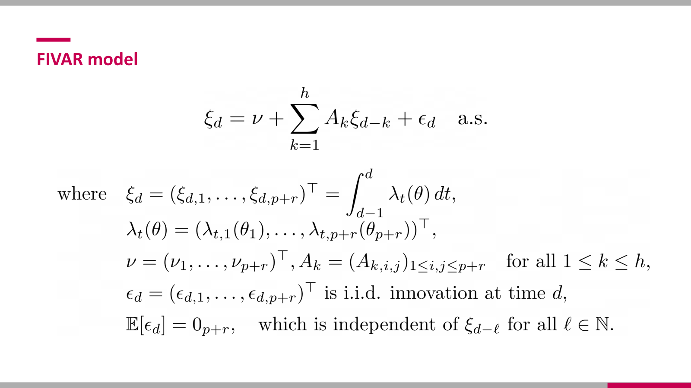

논문의 Theorem 1에 따르면 로그 가격 벡터 $$X(t)$$가 FIVAR($$h$$) 모형을 따를 때, 하루 동안 고유값 프로세스를 적분한 벡터 $$\xi_d$$는 위와 같은 VAR($$h$$) 구조를 만족한다. $$\nu$$는 평균 벡터, $$A_k$$는 VAR 계수 행렬, $$\epsilon_d$$는 평균이 0이고 과거 값과 독립인 i.i.d. 오차항이다.

문제는 idiosyncratic 성분을 포함하면서 차원이 매우 커지고, 동시에 금융 데이터의 특성상 오차항 $$\epsilon_d$$가 heavy-tailed라는 점이다. 결국 이 모형을 추정하려면 heavy-tailedness와 고차원성이라는 두 문제를 동시에 다룰 수 있는 robust한 추정 방법이 필요하다.

## Estimation procedure for the heavy-tailed VAR model

논문은 두 가지 장치로 heavy tail에 대응한다. 첫 번째는 Huber loss다. 오차가 $$\tau$$ 이하일 때는 제곱 오차처럼, $$\tau$$를 넘으면 절대 오차처럼 작동해서 이상치가 손실에 미치는 영향을 제한한다. 두 번째는 입력 데이터의 truncation(winsorization)이다. 설명 변수로 들어가는 값을 $$\pm\varpi$$ 범위로 잘라서 극단값이 그대로 회귀에 들어가지 않도록 한다.

truncation을 적용한 뒤 factor와 idiosyncratic 고유값을 따로 추정한다. idiosyncratic 부분은 차원이 크기 때문에 희소성을 가정하고, Huber loss에 L1 패널티를 더한 H-LASSO로 VAR 계수 $$\beta$$를 추정한다. L1 패널티의 계수는 BIC(Bayesian Information Criterion)를 최소화하도록 고른다. 반면 factor 부분은 원래 저차원 문제라서 L1 패널티 없이 Huber loss만으로 추정한다.

## Large volatility matrix prediction

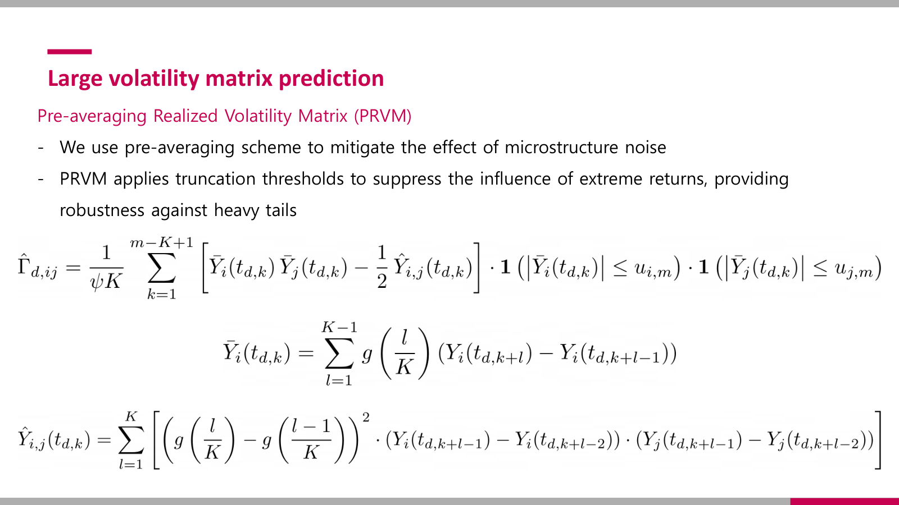

위의 추정을 하려면 먼저 실제 가격 데이터로부터 매일의 변동성 행렬을 만들어야 한다. 논문의 empirical study는 S&P 500 중 200개 종목의 1분 로그 가격으로 매일의 변동성 행렬을 PRVM(Pre-averaging Realized Volatility Matrix)으로 계산한다. PRVM은 pre-averaging으로 시장 미시구조 잡음(microstructure noise)의 영향을 줄이고, 극단적인 수익률에 truncation을 걸어 heavy tail에도 강건하게 만든 추정량이다.

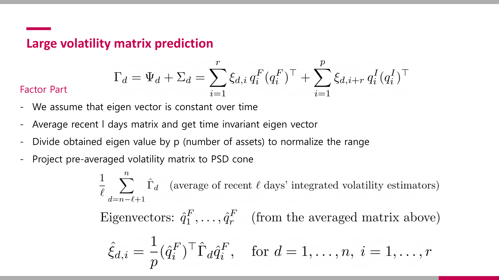

변동성 행렬은 factor part와 idiosyncratic part로 나누어 각각 고유값 시계열을 만든다. factor 부분은 먼저 행렬을 PSD cone에 사영(projection)해서 고유값이 음수가 되지 않도록 한다. 그다음 고유벡터가 시간에 따라 변하지 않는다는 가정을 맞추기 위해, 학습 기간 중 가장 최근 $$\ell$$일의 행렬을 평균내서 얻은 고유벡터를 학습 기간 전체에 공통으로 쓴다. 매일의 고유값은 이 고유벡터에 그날의 행렬을 사영해서 얻고, 값의 범위를 맞추기 위해 자산 수 $$p$$로 나눈다.

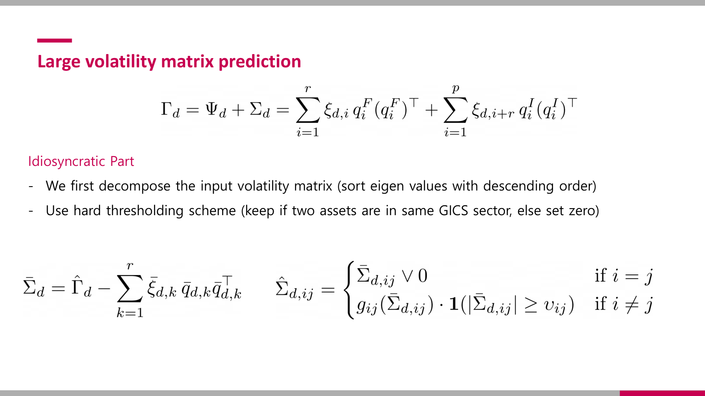

idiosyncratic 부분은 그날의 행렬에서 뒤에 나올 rank 추정으로 정한 개수만큼의 고유값·고유벡터로 만든 factor 성분을 빼서 구한다. 여기에 POET 방식의 hard thresholding을 적용하는데, 논문에서는 GICS 섹터를 기준으로 같은 섹터에 속하는 자산 사이의 공분산은 남기고 다른 섹터 사이의 공분산은 0으로 만든다.

그다음은 factor 때와 같다. 학습 기간 중 최근 22일의 행렬을 평균내 고유벡터를 고정하고, 이를 이용해 매일의 idiosyncratic 고유값 시계열을 얻는다.

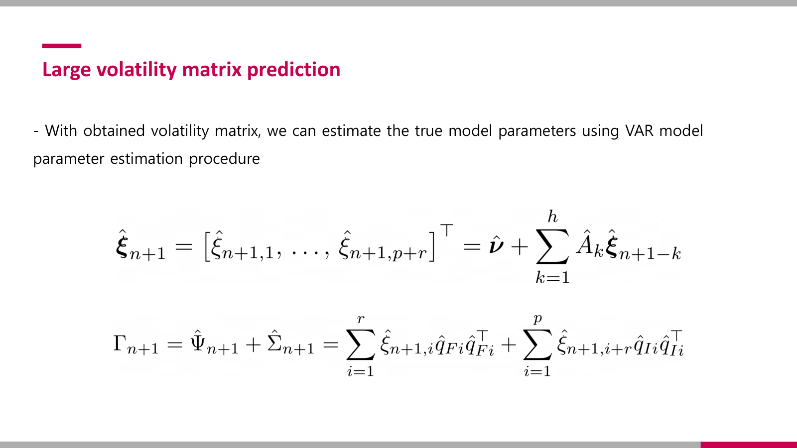

이렇게 얻은 factor와 idiosyncratic 고유값 시계열을 VAR 구조에 넣고, 앞의 truncation과 H-LASSO로 계수를 추정한다. 추정한 계수로 다음 날의 고유값을 예측하고 고정해둔 고유벡터와 다시 조립하면 다음 날의 변동성 행렬 예측값이 된다.

## Numerical study

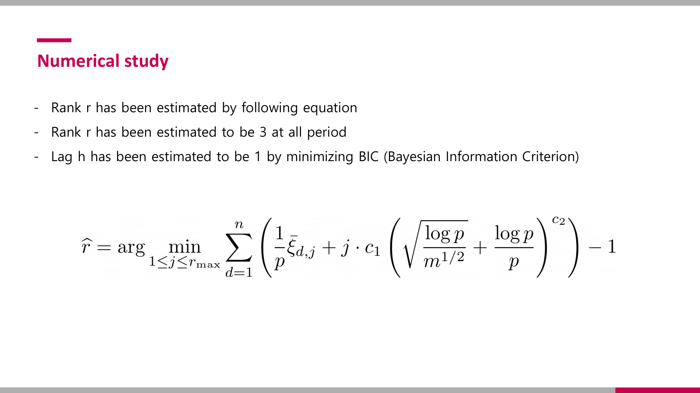

실험은 크게 두 부분이다. 시뮬레이션으로 H-LASSO가 sub-Gaussian 조건이 깨진 상황에서도 robust한지 확인하고, 실제 주가 데이터로 변동성 예측 성능을 비교한다. 먼저 factor 개수 $$r$$은 위의 rank 추정식으로 정하는데, 모든 실험 기간에서 3이 나왔다. VAR의 lag는 BIC를 최소화하도록 골랐고 1로 추정되었다.

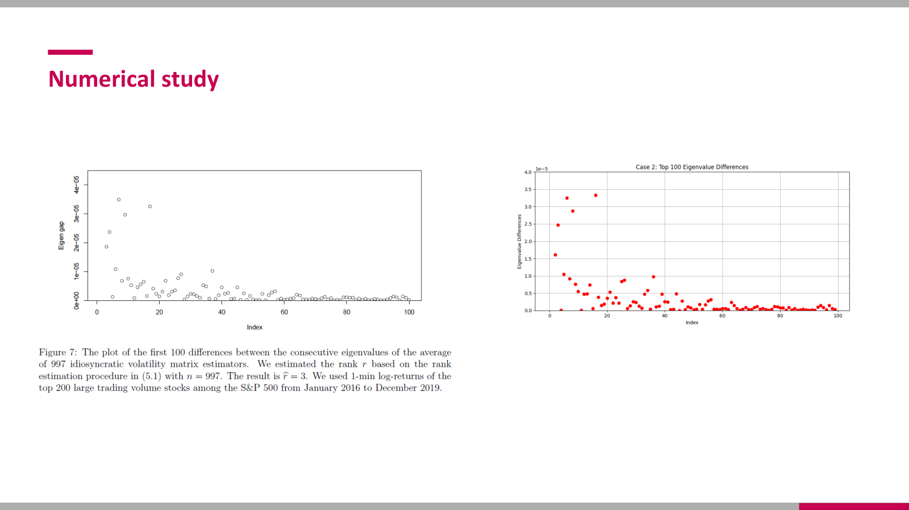

왼쪽은 논문의 Figure 7로, 997개의 idiosyncratic 변동성 행렬을 평균낸 행렬에서 연속된 고유값 차이(eigen gap)를 처음 100개까지 그린 것이다. 오른쪽은 같은 과정을 직접 구현해서 그린 결과다. 전체적인 패턴이 논문과 거의 같게 나왔고, rank 추정 결과도 논문과 같은 3을 얻었다.

실제 데이터 실험의 비교 모형은 다음과 같다. POET-PRVM은 전날의 PRVM에 POET를 적용한 추정치를 그대로 다음 날 예측값으로 쓰는 비모수 기준선이다. OLS는 factor 부분만 OLS로 VAR 추정하고, idiosyncratic 행렬은 최근 $$\ell$$일 평균으로 대신한다. LASSO는 factor와 idiosyncratic 부분을 모두 LASSO로 추정하지만 truncation이 없어서 heavy tail을 반영하지 못한다. DCC-NL과 HAR-DRD는 발표에서 다루지 않았다.

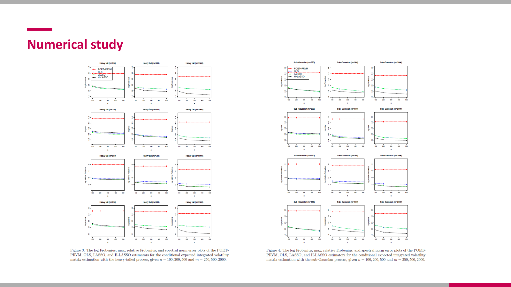

시뮬레이션에서는 실제 파라미터와 추정값 사이의 Frobenius, max, spectral norm 오차를 샘플 수 $$n = 100, 200, 500$$, 하루 고빈도 관측 수 $$m = 250, 500, 2000$$, 그리고 heavy-tailed와 sub-Gaussian 두 가지 분포에 대해 비교한다. H-LASSO는 대부분의 설정에서 LASSO보다 오차가 낮았고, 특히 heavy-tailed 상황에서 Frobenius와 spectral norm 오차가 뚜렷하게 줄었다. 샘플 수가 늘수록 오차가 줄어드는 경향도 확인할 수 있다. 다만 max norm은 이상치의 영향을 크게 받아서, 관측 수가 가장 적은 $$m = 250$$ 설정에서는 H-LASSO가 오히려 약간 불리하게 나오기도 했다.

실제 데이터에서는 다음 날 변동성 행렬의 예측 정확도를 MSPE와 QLIKE로 비교한다. 실제 변동성은 관측할 수 없으니 POET-PRVM 추정치를 정답 대용으로 두는데, 두 지표 모두 이런 대용 정답에 대해 robust한 손실 함수로 알려져 있다.

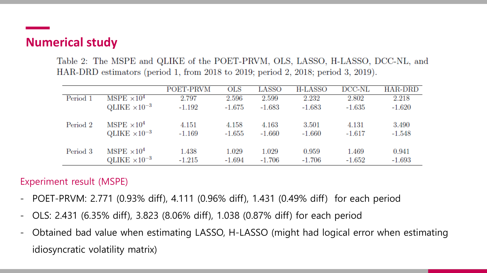

위쪽 표가 논문의 결과다. H-LASSO가 세 기간(2018–2019, 2018, 2019) 모두에서 가장 낮은 MSPE를 보였다. POET-PRVM은 전날 값을 그대로 쓰기 때문에 변동성의 동역학을 전혀 반영하지 못해 가장 나빴고, LASSO는 OLS와 큰 차이가 없었다. factor만 모델링하는 OLS는 idiosyncratic 부분의 동역학을 설명하지 못하고, LASSO는 heavy tail에 취약하다는 점이 동시에 드러나는 결과다.

아래쪽이 직접 재현한 MSPE다. POET-PRVM은 세 기간에 대해 2.771, 4.111, 1.431로 논문과의 차이가 1% 이내였고, OLS는 2.431, 3.823, 1.038로 차이가 각각 6.35%, 8.06%, 0.87%였다. PRVM 계산부터 POET thresholding, factor 부분 추정까지는 논문과 거의 같게 구현되었다는 뜻이다. 반면 LASSO와 H-LASSO는 논문과 거리가 먼 값이 나왔고, idiosyncratic 변동성 행렬을 추정하는 단계에 논리적인 오류가 있었던 것으로 보인다.

재현한 세 모형의 일자별 MSPE를 그려보면(빨간 점선은 기간 3의 시작 지점) 세 모형 모두 비슷한 시점에 오차가 튀지만, LASSO와 H-LASSO는 특히 기간 2 후반부에서 OLS보다 더 크고 잦게 튄다. factor만 쓰는 OLS는 논문과 비슷하게 나오는데 idiosyncratic 고유값까지 쓰는 두 모형만 어긋난다는 점에서, 문제가 idiosyncratic 부분에 있다고 판단했다. 세미나 시점까지 이 부분은 끝내 바로잡지 못했고, 발표에서도 재현되지 않은 결과로 그대로 공유했다.

마지막 실험은 추정한 변동성 행렬로 위험을 최소화하는 포트폴리오를 구성했을 때의 연환산 위험(annualized risk)을 exposure constraint에 따라 비교한 것이다. 추정된 변동성에 jump 항을 더해 리스크 정보를 추가로 반영한다. H-LASSO는 exposure constraint를 완화해도 위험이 안정적으로 가장 낮았던 반면, POET-PRVM과 DCC-NL은 제약이 완화될수록 위험이 불안정하게 커졌다. 변동성 과정의 동역학을 설명하지 못하기 때문으로 볼 수 있다.

> **보충: 축 읽는 법**
>
> - x축 exposure constraint: 포트폴리오 가중치의 L1 norm 상한이다. 1.0이면 공매도 없이 투자하는 경우이고, 값이 커질수록 공매도와 레버리지를 더 많이 허용한다.
> - y축 annualized risk(%): 포트폴리오 일별 수익률의 표준편차를 연 단위로 환산한 값이다.

## Further research direction

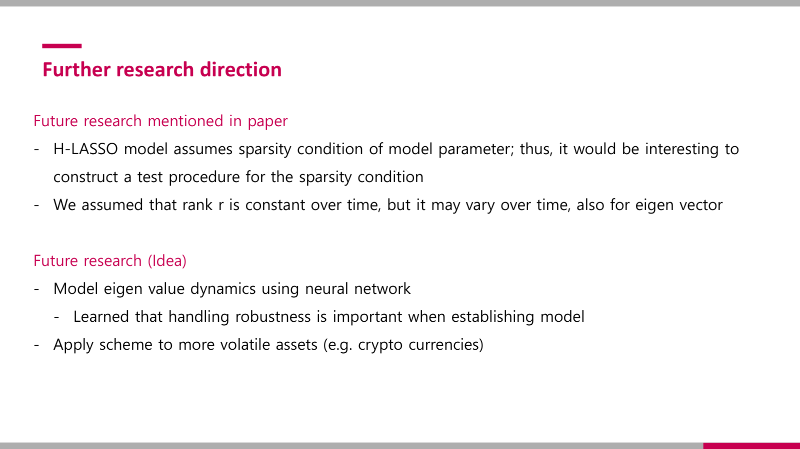

논문이 제시하는 후속 과제는 두 가지다. H-LASSO는 계수의 희소성을 가정하는데, 실제로 그 희소성이 존재하는지 검정하는 절차가 필요하다는 것. 그리고 rank와 고유벡터가 시간에 따라 고정된다는 가정은 현실적인 제약이므로 이를 완화한 모형이 필요하다는 것이다.

여기에 내가 생각한 방향을 몇 가지 더했다. 고유값의 시간에 따른 변화를 선형 VAR 대신 LSTM이나 neural SDE 같은 신경망으로 학습해볼 수 있을 것 같고, 이번 논문에서 배운 것처럼 heavy-tailed 데이터에서는 그런 모형에도 robust한 추정 장치를 넣는 것이 중요할 것이다. 또 암호화폐처럼 변동성이 훨씬 큰 자산에 이 프레임워크를 적용해보는 것도 흥미로울 것 같다.
