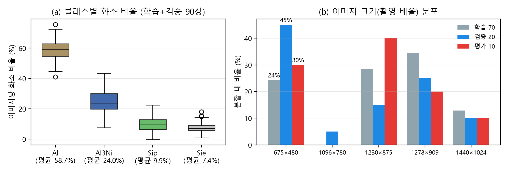
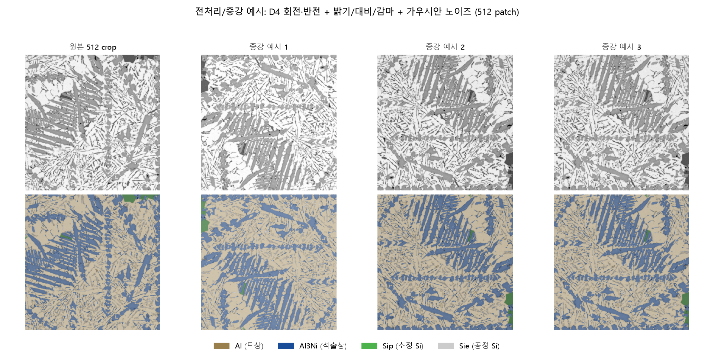
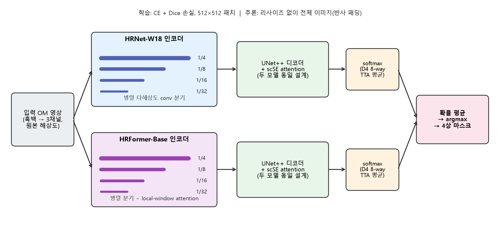
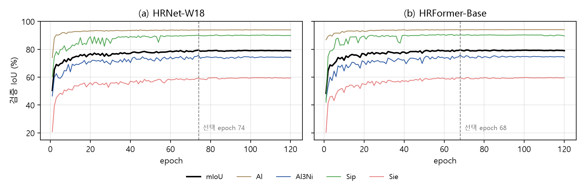
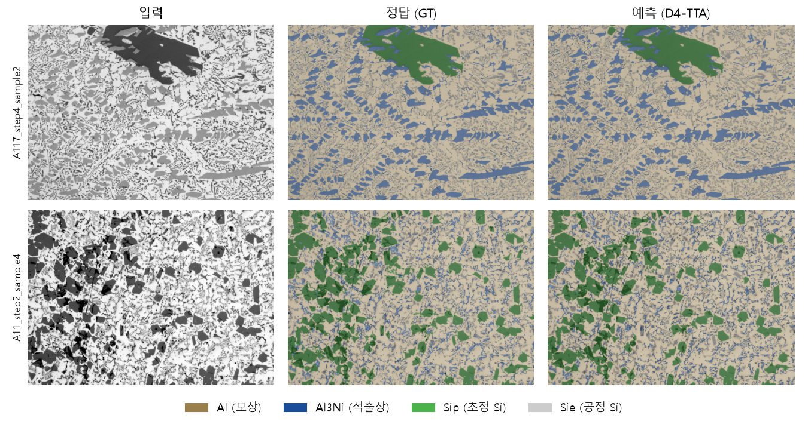
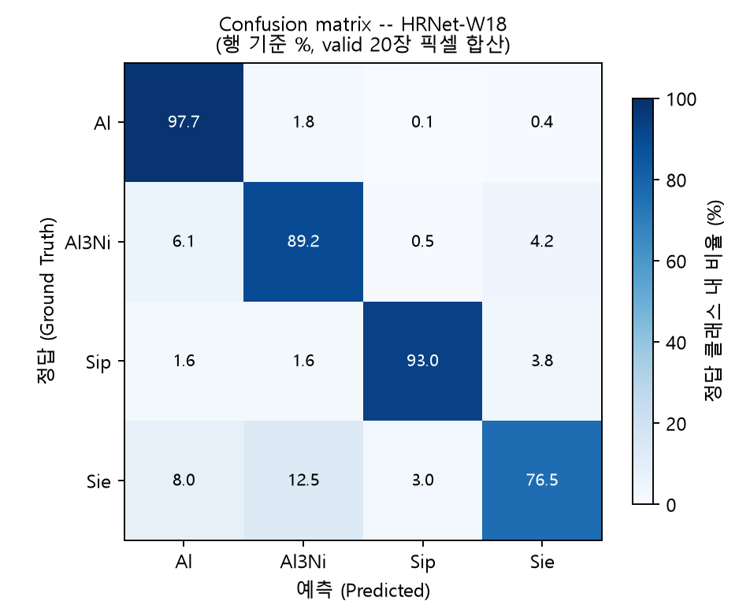
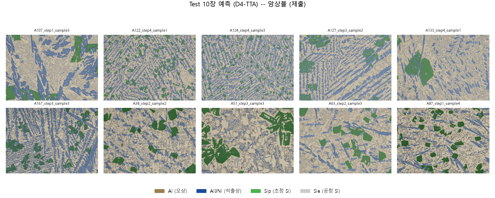
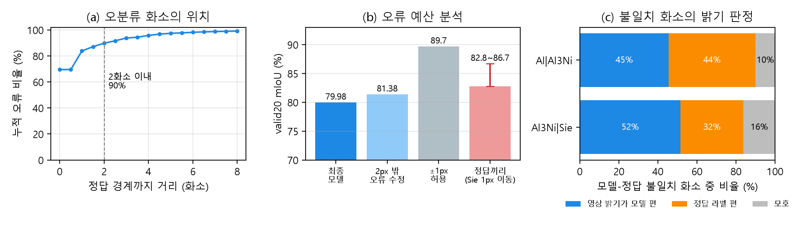

2026 KoMaP AI 경진대회에 감자도리 팀으로 참가했다. 과제는 Al-Si-Ni 합금의 광학현미경(OM) 이미지에서 각 상을 화소 단위로 분할하는 것이었다. 고탄성 주조용 Al-Si-Ni 합금은 Al 기지 안에 Al3Ni 석출상, 초정 Si(Sip), 공정 Si(Sie)가 어떤 비율과 형태로 분포하는지에 따라 기계적 물성이 결정되는데, 현재는 이 상 분율을 사람이 OM 이미지를 직접 보고 판독하는 방식으로 측정하고 있다. 이번 대회는 이 판독 과정을 자동화하는 것이 목표였다.

## 과제 소개

입력은 흑백 OM 이미지이고, 출력은 Al/Al3Ni/Sip/Sie 네 개 클래스로 화소 단위 분할한 마스크(주최측이 정한 4색 RGBA 포맷)이다. 평가는 이미지마다 4-class IoU를 평균한 mIoU를 구하고, 이를 다시 전체 이미지에 대해 평균하는 방식이었다. 데이터는 학습 70장, 검증 20장, 평가 10장으로 나뉘어 있었고, 참고 기준 성능은 약 75%로 제시되었다.

## EDA

먼저 정답 마스크의 클래스별 화소 비율을 계산해보았다. Al이 평균 58.7%, Al3Ni가 24.0%, Sip이 9.9%, Sie가 7.4%로 클래스 불균형이 큰 편이었다. mIoU는 네 클래스를 동일한 가중치로 평균하기 때문에, 전체 화소의 20%도 되지 않는 두 Si 상이 점수의 절반을 결정하는 구조다. 또한 이미지 크기가 다섯 종류로 섞여 있었는데, 이는 촬영 배율의 차이였다. 특히 675×480 크기의 저배율 이미지는 학습 데이터에서는 24%에 불과하지만 검증에서는 45%, 평가에서는 30%를 차지해서, 이 그룹에서의 성능이 최종 점수에 큰 영향을 줄 수 있다고 판단했다.

다음으로 상 경계에서 2화소 이상 떨어진 내부 화소만 모아 상별 밝기 분포를 확인했다. 밝기 순서는 Al(중앙값 226) > Al3Ni(143) > Sie(105) ≥ Sip(47)로 90장 전체에서 일정했지만, Al3Ni의 밝기 중앙값은 이미지마다 94~184로 차이가 컸다. 즉 같은 회색값이라도 이미지에 따라 다른 상을 의미할 수 있다. Al은 밝기만으로도 다른 상과 거의 완벽히 구분되었지만(AUC 0.994 이상), Al3Ni와 Sie는 이미지별로 최적 임계값을 잡아도 15%가 겹쳤다. Sip과 Sie는 같은 Si 상이라 밝기로는 구분할 수 없고 크기와 형태로만 구분해야 했다. 실제로 밝기 히스토그램만 사용하는 베이즈 분류기를 만들어보니 검증 mIoU가 46.9%에 그쳤다. 이는 화소 하나의 밝기만이 아니라 주변의 형태와 문맥을 함께 봐야 한다는 것을 보여준다.

Sie에서 오류가 생기는 원인을 확인하기 위해 이미지별 Sie IoU와 여러 특성 사이의 상관관계를 살펴보았다. Sie 구조의 평균 두께와는 상관이 없었지만(Spearman ρ=0.12, 유의하지 않음), 그 이미지에서 Al3Ni와 Sie의 밝기가 얼마나 겹치는지와는 강한 음의 상관(ρ=−0.61, p<0.001)을 보였다. 즉 Sie를 놓치는 이유는 구조가 가늘어서라기보다 두 상의 밝기가 애매하게 겹치는 영역 때문이라고 해석할 수 있다. 이 결과를 바탕으로 원해상도를 끝까지 보존하면서도 넓은 문맥을 활용해 상을 구분할 수 있는 모델을 설계하기로 했다.

## 전처리와 증강

입력 이미지는 R, G, B 값이 같은 흑백 영상이라 한 채널로 읽은 뒤, ImageNet 사전학습 가중치를 그대로 사용하기 위해 3채널로 복제했다. 화소값은 0~1로만 바꾸고, 히스토그램 평활화나 이미지별 표준화 같은 밝기 정규화는 적용하지 않았다. EDA에서 확인했듯 이미지 간 밝기 차이는 에칭 정도에 따른 상 대비의 변화인데, 이를 입력 단계에서 맞추면 상 판정에 필요한 상대적 밝기 정보가 왜곡될 수 있다고 판단했기 때문이다. 대신 이러한 변화를 증강으로 모사해서 모델이 밝기 변화에 강건해지도록 했다(국소 대비 평활화인 CLAHE를 증강으로 추가해보았지만 개선은 없었다).

증강은 라벨을 바꾸지 않으면서 실제로 있을 법한 변화만 모사하는 것을 원칙으로 했다. 금속 미세조직에는 정해진 방향이 없기 때문에 90° 회전 4가지와 좌우 반전을 조합한 D4 대칭 변환을 무작위로 적용했고, 밝기(±0.08), 대비(±0.15), 감마(±0.15)를 무작위로 바꿔 이미지마다 다른 에칭·조명 조건을 반영했다. 촬영 잡음을 재현하기 위해 표준편차 3 수준의 가우시안 노이즈도 추가했다. 반면 크기 변환, 탄성 변형, CutMix·Mosaic 같은 혼합 증강은 두께가 1~2화소에 불과한 Sie의 굵기와 상 사이의 인접 관계를 왜곡할 수 있어 제외했고, 실제로 비교 실험에서도 기본 증강보다 나은 결과가 나오지 않았다.

학습 시에는 매 epoch마다 이미지당 512×512 패치를 무작위 위치에서 4개씩 잘라 사용했다(epoch당 280개 패치). 세로가 480화소로 패치보다 작은 675×480 이미지는 먼저 반사 패딩으로 채운 뒤 잘랐다. 반대로 검증·평가 추론에서는 리사이즈 없이 이미지 전체를 그대로 모델에 넣었다. 가로세로를 네트워크의 최대 축소 배율인 32의 배수로 맞추기 위한 반사 패딩만 붙이고, 예측 후 원래 크기로 잘라냈다. 리사이즈를 하지 않은 것은 보간 과정에서 1~2화소 두께의 Sie가 흐려지거나 사라지는 것을 막기 위해서였다. 또한 추론 안정성을 위해 D4 8방향 변환 각각에 대해 예측한 뒤 원래 방향으로 되돌려 softmax 확률을 평균하는 TTA를 적용했다.

## 모델 설계

이 과제에서 가장 어려운 부분은 두께가 1~2화소인 Sie를 보존하면서, 밝기가 겹치는 Al3Ni와 Sie를 넓은 문맥으로 구분하는 것이었다. 일반적인 인코더-디코더 구조는 입력을 1/32까지 줄였다가 다시 키우기 때문에, 축소 과정에서 가는 구조의 정보가 사라지기 쉽다. 그래서 인코더로 HRNet(Sun et al., CVPR 2019)을 선택했다. HRNet은 해상도를 줄였다 늘리는 대신 1/4, 1/8, 1/16, 1/32 해상도의 분기를 처음부터 끝까지 병렬로 유지하고, 분기 사이에서 정보를 반복적으로 교환한다. 가장 높은 해상도의 특징을 끝까지 보존하면서 저해상도 분기의 넓은 문맥도 함께 사용할 수 있어 이 과제에 적합하다고 보았다. 두 번째 인코더로는 같은 병렬 다해상도 구조를 유지하면서 분기 내부의 합성곱을 local-window self-attention으로 바꾼 HRFormer(Yuan et al., NeurIPS 2021)를 사용했다. 디코더로는 인코더의 모든 단계 특징을 중첩된 skip connection으로 결합하는 UNet++(Zhou et al., 2018)를 사용했고, 각 디코더 블록에 scSE attention(Roy et al., 2018)을 추가해 채널·공간 방향의 중요도를 다시 가중했다.

이 설계가 적절한지 확인하기 위해 디코더, 손실, 증강, 학습 설정은 모두 고정하고 인코더만 바꿔가며 비교했다.

<table>
<tr><th>인코더</th><th>원해상도 처리 방식</th><th>파라미터</th><th>검증 mIoU(%)</th></tr>
<tr><td>ConvNeXt-V2-Tiny</td><td>stem에서 곧바로 1/4로 축소</td><td>—</td><td>78.01</td></tr>
<tr><td>SE-ResNeXt50</td><td>단계적 축소 후 복원</td><td>—</td><td>78.63</td></tr>
<tr><td>HRNet-W18</td><td>1/4 분기를 끝까지 병렬 유지</td><td>21.4M</td><td>79.64 ± 0.35 (시드 5개)</td></tr>
<tr><td>HRFormer-Base</td><td>HRNet 구조 + local-window attention</td><td>55.9M</td><td>79.75</td></tr>
<tr><td>HRNet-W48</td><td>HRNet-W18과 같은 구조, 폭 확대</td><td>77.6M</td><td>79.15</td></tr>
</table>

초기 단계에서 해상도를 크게 줄이는 ConvNeXt-V2나 단계적으로 축소·복원하는 SE-ResNeXt50보다, 1/4 해상도 분기를 끝까지 유지하는 HRNet과 HRFormer의 성능이 뚜렷하게 높았다. 반면 HRNet과 HRFormer 사이에는 통계적으로 유의한 차이가 없었고, 같은 HRNet 계열에서 폭만 키운 HRNet-W48은 오히려 유의하게 낮았다. 정리하자면 이 데이터에서는 합성곱인지 attention인지, 또는 모델 크기보다 원해상도 경로를 보존하는지 여부가 성능을 결정했다.

최종 모델은 HRNet-W18과 HRFormer-Base를 각각 인코더로 사용하는 두 분할 모델의 앙상블이다. HRNet-W18은 timm의 ImageNet 사전학습 가중치를 그대로 사용했지만, HRFormer-Base는 공개 라이브러리에 등록되어 있지 않아 원저자 공식 구현에서 백본만 가져와 직접 연결했다. 이때 HRNet 계열이 분류용으로 사용하는 incre_modules가 백본 크기와 관계없이 같은 채널 수의 특징을 만든다는 점을 이용해, HRFormer의 출력이 HRNet-W18과 같은 형태의 특징 피라미드가 되도록 어댑터를 구현했다. 그 결과 두 모델은 인코더만 다르고 디코더의 구조와 용량은 동일해서, 인코더 자체의 차이만 비교하고 결합할 수 있었다.

손실 함수로는 Cross-Entropy(CE)와 soft Dice를 1:1로 더해 사용했다. CE는 화소 단위 분류를 안정적으로 학습시키고, Dice는 클래스별 겹침 비율을 직접 최적화하기 때문에 화소 수가 적은 Sip, Sie도 Al과 같은 비중으로 학습된다. 이는 네 클래스를 동일 가중치로 평가하는 mIoU의 구조와도 맞는다. 최적화는 AdamW(학습률 1e-3, weight decay 1e-4)를 사용했고, 학습 초기에 사전학습 특징이 깨지지 않도록 인코더에는 0.1배의 학습률을 적용했다. 학습률은 5 epoch 동안 선형으로 올린 뒤 cosine 스케줄로 초기값의 1%까지 내렸고, 총 120 epoch를 학습했다. AMP와 gradient clipping(1.0)을 적용했고, RTX PRO 4500(32GB)에서 모델당 약 50분이 걸렸다.

검증 데이터가 20장뿐이라 작은 성능 차이가 우연인지 실제 개선인지 구분하기 어려웠다. 그래서 비교 실험에 앞서 같은 설정을 난수 시드만 바꿔 5번 학습해 학습 자체의 변동폭(±0.35%p)을 먼저 측정했고, 이후 모든 비교는 같은 합금의 이미지를 하나의 단위로 묶어 재표본하는 alloy-clustered bootstrap으로 95% 신뢰구간을 계산했다. 이 기준으로 손실 함수를 비교해보았는데, 경계 가중 CE(79.55%), Focal loss(79.39%), label smoothing(79.70%), 다중 클래스 MCC 손실(79.05%) 모두 기본 CE+Dice(79.98%)보다 낮았다. 소수 클래스나 경계를 더 강조하는 손실이 오히려 도움이 되지 않았다는 점은 예상과 달랐다.

앙상블은 같은 구조를 시드만 바꿔 여러 개 묶는 것(HRNet 3개 80.13%, 5개 79.86%)보다 구조가 다른 두 모델을 묶는 쪽이 더 효과적이었다(80.22%). HRNet과 HRFormer는 전체 화소의 2.3%에서 서로 다른 예측을 했는데, 이 차이가 서로의 오류를 보완하는 역할을 한 것으로 보인다. 학습해둔 9개 모델의 모든 조합(502가지)을 평가해보았지만 이 2개 모델 앙상블보다 유의하게 좋은 조합은 없었다.

## 성능

학습된 두 모델로 검증 20장 전체를 원본 해상도 그대로 예측했다. 각 모델이 D4 8방향 TTA로 softmax 확률을 구하고, 두 모델의 확률을 동일 가중치로 평균한 뒤 argmax로 최종 마스크를 만들었다. 최종 앙상블의 mIoU는 80.22%로 참고 기준(약 75%)보다 5.2%p 높았다. 같은 설정을 시드만 바꿔 학습한 5개 모델의 평균이 79.64 ± 0.35%였으므로, 앙상블은 이 평균보다 0.58%p 높았고 95% 신뢰구간이 [+0.15, +1.12]로 통계적으로 유의한 개선이었다(20장 중 13장에서 개선). 다만 검증 점수를 기준으로 저장 시점을 골랐기 때문에, 검증 점수가 실제 평가 성능보다 약간 낙관적일 가능성은 있다.

클래스별로 보면 Al과 Sip은 90% 이상으로 정확도가 높았고, 가장 어려운 클래스는 Sie(60.82%)였다. 입력, 정답, 예측을 나란히 놓고 보면 큰 덩어리 형태의 상은 거의 완벽하게 맞히지만, 가늘게 뻗은 Sie 침상 구조에서는 미세한 차이가 보인다.

혼동행렬을 보면 Sie 화소의 12.5%가 Al3Ni로, 8.0%가 Al로 잘못 분류되었다. Sie와 Al3Ni 사이의 혼동이 가장 컸는데, 이는 EDA에서 확인한 두 상의 밝기 겹침과 일치하는 결과다.

평가 이미지 10장에도 같은 앙상블과 추론 절차(원본 해상도, D4 TTA, 확률 평균)를 적용해 4클래스 마스크를 만들었고, 10장 모두 주최측이 요구한 형식(원본 크기, 4색 RGBA)을 만족하는지 자동으로 검증한 뒤 제출했다.

## 한계

모델을 완성한 뒤에는 남은 오류가 모델의 한계에서 오는 것인지, 다른 원인이 있는지 확인해보았다. 오분류 화소를 분석해보니 84%가 정답 경계에서 1화소 이내, 90%가 2화소 이내에 있었다. 경계에서 2화소보다 먼 오류를 모두 고친다고 가정해도 mIoU는 81.38%에 그친다. 반대로 정답 마스크의 Sie 경계를 1화소만 옮겨서 정답끼리 비교해도 mIoU가 82.8~86.7%로 떨어졌다. 즉 이 지표 자체가 경계 위치에 매우 민감하다.

모델과 정답이 서로 다른 Al3Ni·Sie 화소에서 영상 밝기가 어느 쪽 판정을 지지하는지도 확인했다. 모델 쪽 판정을 밝기가 지지하는 경우가 52%, 정답 쪽을 지지하는 경우가 32%였다. 불일치의 절반 가까이는 정답 라벨 자체가 영상 밝기와 맞지 않는 화소라는 의미다. 또한 이미지별로 경계를 1~2화소씩 옮겨가며 정답과 가장 잘 맞는 위치를 찾아보았는데 20장 모두 이동량 0이 최적이었다. 따라서 적어도 라벨링 기준이 이미지마다 다르게 적용된 것은 아니라고 볼 수 있다.

이 해석을 확인하기 위해 몇 가지 추가 실험도 진행했다. 17억 장으로 사전학습된 DINOv3(Siméoni et al., 2025)의 특징을 HRNet의 저해상도 분기에만 주입하는 구조(HR-DINO)를 만들어 외부 의미 정보가 모호한 영역의 판정에 도움이 되는지 실험했고, 학습을 240 epoch로 늘리거나 저배율 이미지만 1.82배 리샘플해서 배율을 맞추는 방법도 적용해보았다. 세 가지 모두 기존 모델의 시드 변동 범위를 넘지 못했다. 특히 배율을 맞춘 뒤에도 675×480 그룹의 Al3Ni IoU가 오르지 않았는데, 이는 이 그룹의 성능 차이가 화소 크기의 문제가 아니라 저배율로 촬영되는 시점에 이미 사라지는 정보의 문제라는 것을 시사한다. 결국 현재 성능의 한계는 모델의 표현력이나 학습량보다는 라벨과 입력 영상 자체에서 온다고 결론지었다.

## 활용 방안

모델이 예측한 상별 화소 비율은 합금의 조성 변화를 반영한다. 데이터 파일명에 들어 있는 step은 Ni 첨가 단계를 의미하는데, 같은 합금 안에서 step이 오를수록 Al3Ni 화소 비율은 평균 3.1%p 늘고 전체 Si 비율은 5.5%p 줄었다. 따라서 모델의 추론 결과만으로 시편이 어느 조성·공정 단계에 가까운지 추정할 수 있고, 같은 단계인데 상 분율이 정상 범위를 벗어나는 시편을 공정 이상으로 표시하는 품질관리 도구로도 활용할 수 있다. 이때 Al, Sip처럼 경계가 뚜렷한 상은 자동 판정을 그대로 사용하고, Al3Ni·Sie 경계처럼 불확실성이 큰 영역만 사람이 확인하는 2단계 방식이 현실적이라고 생각한다. 또한 원해상도를 보존하는 설계와 통제된 비교 실험 방식은 다른 다상 주조 합금의 조직 분석에도 적용할 수 있을 것이다. 앞의 한계 분석을 고려하면, 성능을 더 높이려면 모델 구조를 바꾸기보다는 Al3Ni·Sie 경계에 대해 여러 라벨러가 다시 주석을 달거나 고배율로 다시 촬영해서 라벨 품질과 입력 정보 자체를 개선하는 것이 더 효과적일 것 같다.

## 보고서에 포함하지 않은 내용

결과 보고서에는 포함하지 않았지만, 실험은 Runpod GPU에서 진행했고 모든 실험을 git 커밋 단위로 관리했다(각 run 폴더에 해당 학습에 사용된 커밋이 COMMIT.txt로 남는다). 모델 선택은 아키텍처(A), 증강(B), 손실(C), 구조/정규화(D: 입력 업스케일, clDice 보조손실, Lovász 혼합, 가중치 EMA) 네 개 축으로 나눠 실험 큐를 만들고, 단계별로 가장 좋은 설정을 좁혀가는 방식으로 진행했다. 보고서의 결론이 달라지는 것은 아니지만, 이렇게 실험을 추적하지 않았다면 손실 함수나 앙상블 구성처럼 차이가 작은 비교 결과는 신뢰하기 어려웠을 것 같다.

---

**참고문헌**

- K. Sun et al., *Deep High-Resolution Representation Learning for Human Pose Estimation*, CVPR 2019.
- Y. Yuan et al., *HRFormer: High-Resolution Transformer for Dense Prediction*, NeurIPS 2021.
- Z. Zhou et al., *UNet++: A Nested U-Net Architecture for Medical Image Segmentation*, DLMIA 2018.
- A. G. Roy et al., *Concurrent Spatial and Channel Squeeze & Excitation in Fully Convolutional Networks*, MICCAI 2018.
- F. Milletari et al., *V-Net: Fully Convolutional Neural Networks for Volumetric Medical Image Segmentation*, 3DV 2016.
- B. Lakshminarayanan et al., *Simple and Scalable Predictive Uncertainty Estimation using Deep Ensembles*, NeurIPS 2017.
- O. Siméoni et al., *DINOv3*, arXiv:2508.10104, 2025.
