2024년 12월~2025년 2월에 포스텍 산업경영공학과 Statistics and Data Science(SDS) 연구실에서 연구 참여를 했다. 2학년을 막 마친 때라 전공지식이 많이 부족한 상태였는데, 다행히 사수님께서 진행하시던 연구와 관련된 논문을 읽고 간단한 실험을 해볼 수 있었다. 수학적 배경이 많이 필요한 논문이 다수 있었는데 수식 위주로 최대한 이해해보려고 했고, 연구 참여 마지막에는 여러 편의 논문을 읽고 어느 정도 유의미한 결과도 얻을 수 있었다. 또한 이때를 계기로 머신러닝, 딥러닝을 연구하려면 수학적 배경이 탄탄해야 함을 느끼고 수학을 복수전공으로 선택했다. 지금 돌아봤을 때 아주 잘한 선택이었다고 생각한다. 과목을 더 수강해야 하는 것은 힘들지만, 수학 과목이 오히려 본전공인 산업경영공학보다 잘 맞게 느껴지기도 하고 수식이나 증명에 익숙해지면서 부담도 없어졌다.

연구 참여 기간 동안 이미지 생성 모델인 diffusion model과 관련해 text-to-image 생성에 사용되는 guidance 방법에 초점을 맞춰 classifier-free guidance(CFG)와 autoguidance 등에 대한 논문을 읽었다. Guidance scale이나 scheduling은 이미지 생성의 다양성과 품질에 영향을 미치는데, 이미지 생성 다양성을 위해 추가 학습 없이 사용할 수 있는 heavy-tail guidance 방법을 toy example과 Stable Diffusion에서 실험해보았다.

발표자료 PDF: [SDS_diffusion_guidance_final.pdf](/assets/files/SDS_diffusion_guidance_final.pdf) (슬라이드 그림 중 논문에서 가져온 것은 그림 설명에 따로 표시했고, 나머지 실험 그림은 직접 돌린 결과다.)

발표는 연구 참여 기간에 수행한 전반적인 일에 대한 정리(Introduction), 주제로 고른 diffusion model과 guidance 방법, guidance network와 샘플링 방식을 조정해 diffusion model을 개선해보는 실험, 그리고 결과 해석 순서로 구성했다.

## Introduction

12월 마지막 주부터 연구 참여를 시작해 diffusion model, Wasserstein distance, VAE 등 여러 주제의 논문을 넓게 읽었다. 연구실 구성원분들이 각자 연구하시는 분야의 기초 논문을 제공해 주셔서, 연구실의 연구 방향을 알고 조금 더 자세히 볼 분야를 정하는 데 도움이 되었다. 1월부터는 diffusion model을 깊게 볼 주제로 정하고 관련 논문을 읽었고, 1월 말부터 2월 동안은 논문의 toy example을 직접 돌려보면서 더 나은 결과를 내도록 바꿔보는 실험을 했다.

기본이 된 논문은 DDPM, diffusion model을 하나의 관점으로 정리한 Luo(2022)의 튜토리얼, 그리고 score-based SDE 논문이다(리뷰: [Understanding Diffusion Models: A Unified Perspective](/posts/understanding-diffusion-models-unified-perspective/), [Score-Based Generative Modeling through SDEs](/posts/score-based-generative-modeling-through-sdes/)). 실험 및 toy project에서는 Classifier-Free Diffusion Guidance(Ho & Salimans, 2022), CFG의 weight scheduler를 분석한 Wang et al.(2024), autoguidance를 제안한 Karras et al.(2024)의 *Guiding a Diffusion Model with a Bad Version of Itself* 등을 참고했다.

## Main theme: Diffusion guidance

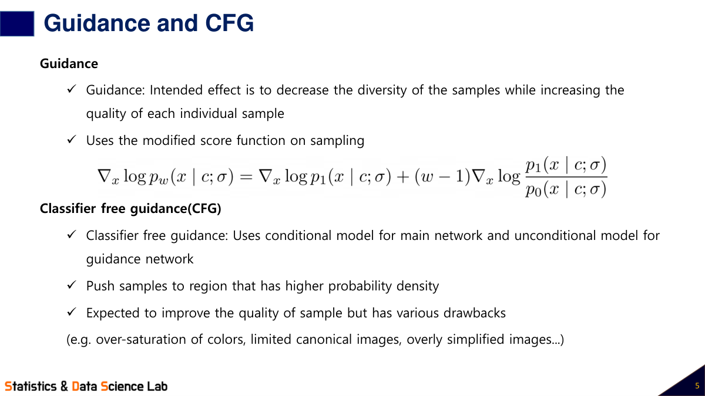

Guidance는 샘플의 다양성을 조금 포기하는 대신 개별 샘플의 품질을 높이려는 방법이다. 샘플링 시에 원래의 score function 대신 위와 같이 guidance network가 추가된 score를 사용한다. $$p_1$$은 main network가 학습한 분포, $$p_0$$는 guidance network가 학습한 분포이고, $$w$$는 guidance weight다. $$w=1$$이면 guidance가 없는 원래 모델과 같고, $$w$$가 커질수록 $$p_1/p_0$$ 비율이 큰 방향으로 샘플을 더 세게 민다. 식을 다시 쓰면 $$(1-w)\nabla_x \log p_0(x \mid c;\sigma)+w\nabla_x \log p_1(x \mid c;\sigma)$$가 되는데, main network와 guidance network의 score function의 가중합으로도 볼 수 있다.

CFG는 main network로 text에 대한 조건부 모델 $$p(x \mid c)$$를, guidance network로는 unconditional 모델 $$p(x)$$를 쓴다. 이때 $$p_1/p_0$$는 input text $$c$$를 잘 설명하는 영역에서 커지므로, 샘플이 text 조건에 맞는 높은 밀도 영역으로 끌려간다. 그 결과 text에 부합하는 이미지가 생성되어 text-image 정합성은 좋아지지만, 색이 과포화되거나, 비슷한 전형적인 이미지만 나오거나, 이미지가 지나치게 단순해지는 등의 부작용이 알려져 있다.

> **보충: 수정된 score와 분포의 관계**
>
> 위 식을 $$x$$에 대해 적분하면 guidance가 샘플링하는 분포는 $$p_w(x \mid c;\sigma) \propto p_0(x \mid c;\sigma)\left(\frac{p_1(x \mid c;\sigma)}{p_0(x \mid c;\sigma)}\right)^{w} = p_1(x \mid c;\sigma)\left(\frac{p_1(x \mid c;\sigma)}{p_0(x \mid c;\sigma)}\right)^{w-1}$$ 이 된다. 즉 $$p_1$$에 두 분포의 비율을 $$w-1$$ 제곱만큼 곱해서 비율이 큰 곳을 강조하는 구조다. (슬라이드 9, 11에서는 $$p_1$$ 앞에 지수 $$w$$를 붙여 썼는데, 슬라이드 5의 식과 맞추려면 $$p_1$$ 앞이 아니라 $$p_0$$ 앞에 $$w$$ 제곱을 써야 한다. 어느 쪽이든 "비율을 거듭제곱해서 강조한다"는 해석은 같다.)

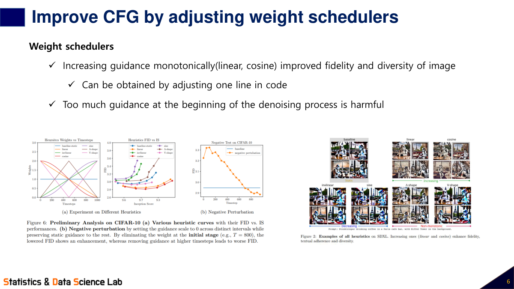

Wang et al.(2024)은 guidance weight $$w$$를 모든 timestep에서 고정하지 않고 시간에 따라 바꾸는 weight scheduler에 관한 실험을 진행했다. Denoising이 진행될수록 guidance를 단조 증가시키는 스케줄(linear, cosine; timestep이 1000→0으로 가면서 guidance가 증가)이 이미지의 fidelity와 diversity를 동시에 개선한다는 결과가 나왔다. 코드상으로는 guidance를 timestep에 대한 함수로 나타내기만 하면 되므로, 코드 한 줄만 바꾸면 되는 수준의 변경이라는 장점도 있다. 왼쪽 그래프의 negative perturbation 실험은 denoising 초반(노이즈가 큰 구간)에 guidance를 없애면 FID가 오히려 좋아지고, 후반 구간에서 없애면 나빠지는 것을 보여준다. 이는 denoising 초반에는 guidance 없이 모델이 전체적인 구도와 다양한 이미지 형태를 탐색하게 하고, 후반으로 갈수록 guidance를 통해 세부 디테일을 끌어올리는 것으로 해석할 수 있다.

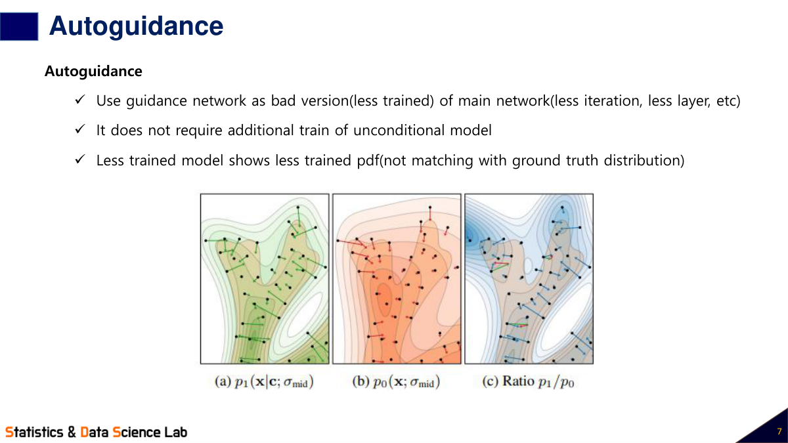

Autoguidance는 guidance network로 unconditional 모델 대신 main network의 "bad version", 즉 학습 iteration이 적거나 layer가 적은 같은 종류의 모델을 쓴다. 학습이 덜 된 모델은 데이터가 놓인 manifold 위에 확률 질량을 충분히 sharp하게 모으지 못해, ground truth보다 더 퍼진 분포를 학습한다. 그림 (c)처럼 두 분포의 비율 $$p_1/p_0$$은 잘 학습된 모델만 높은 확률을 주는 영역, 즉 ground truth manifold에서 커진다.

Autoguidance 논문은 이 효과를 2차원 toy example로 보여준다. Ground truth distribution은 나뭇가지 모양의 manifold이고, guidance가 없으면(b) 샘플이 가지 바깥으로 흩어지는 것을 볼 수 있다. CFG(c)는 샘플을 가지 위로 모으지만 일부 가지에 집중되는데, 이는 기존 CFG의 단점인 이미지 다양성 저하와 연관지어 해석할 수 있다. Autoguidance(e)는 manifold 바깥으로 벗어나는 샘플(outlier)을 줄이면서도 더 많은 가지에 샘플이 고르게 퍼지도록 한다. 이는 autoguidance가 이미지 생성 시 샘플의 품질과 다양성을 동시에 개선할 수 있음을 시사한다.

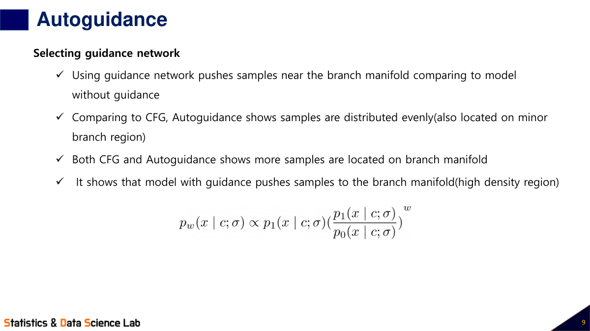

정리하자면 guidance network의 종류에 따라 샘플링 다양성과 품질이 결정된다. CFG와 autoguidance 모두 guidance가 없을 때보다 on-manifold 샘플이 많아지는데, autoguidance는 상대적으로 확률이 낮은 manifold까지 비교적 고르게 샘플이 놓이도록 한다.

## Experiment

No guidance, CFG, autoguidance 모두 샘플링 과정에서 나타나는 문제가 있다. No guidance는 off-manifold 샘플이 많이 나타난다. CFG와 autoguidance는 off-manifold 문제는 완화하지만 특정 manifold 위에 샘플이 집중되며, 이는 샘플링 다양성이 저하된다는 의미이다.

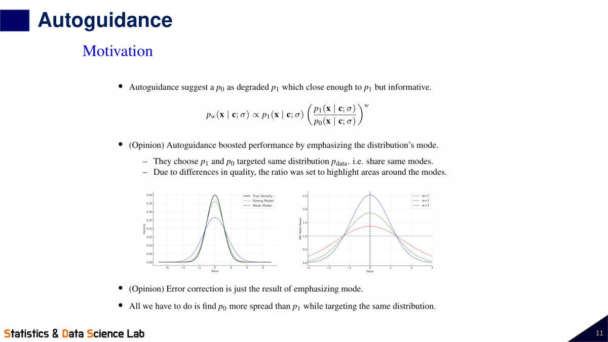

여기서 autoguidance의 장점을 다시 한번 생각해보았다. Autoguidance는 $$p_0$$를 $$p_1$$의 less-trained version으로 둔다. 두 모델이 같은 ground truth distribution을 목표로 학습했으니 분포의 모드(mode) 위치는 같고, 학습된 정도만 차이가 있다. 그래서 두 모델의 비율 $$p_1/p_0$$는 모드 근처에서 1보다 커지고 꼬리 쪽에서 1보다 작아진다. 위 슬라이드의 왼쪽 그래프를 보면 strong model이 ground truth distribution에 더 가깝게 학습되고, weak model은 strong model만큼 sharpness를 포착하지 못한다. 오른쪽 그래프는 $$w$$에 따른 pdf 비율의 거듭제곱을 나타내는데, $$w$$가 클수록 그 차이가 극대화됨을 볼 수 있다. Autoguidance의 성능 향상은 본질적으로 분포의 모드를 강조한 결과이고, 논문이 말하는 오차 보정(error correction) 효과도 결국 모드를 강조한 데서 나온다고 해석할 수 있다. 그렇다면 굳이 덜 학습된 모델을 따로 준비할 필요 없이, 같은 분포를 목표로 하되 $$p_1$$보다 더 퍼진 $$p_0$$를 사용하는 것을 생각해 볼 수 있다.

이러한 과정을 거쳐 도출한 아이디어가 heavy-tail guidance다. $$p_1$$은 $$p_{\text{data}}$$에 가우시안 노이즈 $$\mathcal{N}(0, \sigma^2 I)$$를 convolution한 분포이고, $$p_0$$는 같은 $$p_{\text{data}}$$에 더 퍼진 노이즈를 convolution해서 만든다. 즉 모델이 학습한 데이터 분포 자체를 바꾸는 것이 아니라, 각 데이터 점에 씌우는 노이즈 커널만 꼬리가 두껍거나 폭이 넓은 것으로 바꾸는 것이다. 이렇게 하면 모드의 위치는 크게 바뀌지 않으면서 확률 질량이 꼬리 쪽으로 이동하므로, $$p_1/p_0$$는 모드 근처에서 1보다 커진다. 노이즈 커널로는 $$t$$ 분포 $$\mathcal{T}_\nu(0, \sigma'^2 I)$$를 사용하거나 분산이 더 큰 가우시안 $$\mathcal{N}(0, \sigma_{\text{larger}}^2 I)$$를 사용할 수 있다. 후자는 엄밀히는 꼬리가 두꺼운 분포가 아니라 폭만 넓은 분포지만, diffusion model이 이미 모든 노이즈 수준에 대해 학습되어 있으므로 같은 network를 더 큰 $$\sigma$$에서 평가하는 것만으로 얻을 수 있다.

Heavy-tail guidance를 통해 두 가지 효과를 기대할 수 있다. 우선 꼬리의 두께($$t$$ 분포의 자유도)와 노이즈 크기로 $$p_0$$가 얼마나 퍼질지를 직접 조절할 수 있다. 또한 autoguidance의 less-trained model은 분포의 일부 모드를 아예 학습하지 못할 수 있지만, heavy-tail guidance의 $$p_0$$는 모든 곳에서 양수인 노이즈 커널을 convolution한 것이므로 $$p_{\text{data}}$$의 모든 모드를 덮은 채로 퍼지기만 한다. 다만 $$t$$ 분포 노이즈를 쓰는 버전은 모델이 학습한 적 없는 분포이므로, 그 노이즈로 모델을 새로 학습해야 해서 계산 비용이 든다.

> **보충: 왜 노이즈를 더 섞으면 분포가 퍼지는가**
>
> 확률변수 두 개를 더하면 그 분포는 각 분포의 합성곱이 된다. 데이터 $$x_0 \sim p_{\text{data}}$$에 독립인 노이즈 $$\epsilon$$을 더한 $$x = x_0 + \epsilon$$의 분포는 $$p_{\text{data}} * p_\epsilon$$이고, 노이즈의 분산이 크거나 꼬리가 두꺼울수록 원래 분포의 봉우리가 더 넓게 뭉개진다. 다만 봉우리의 위치(모드)는 크게 바뀌지 않는다는 점이 여기서 중요하다.

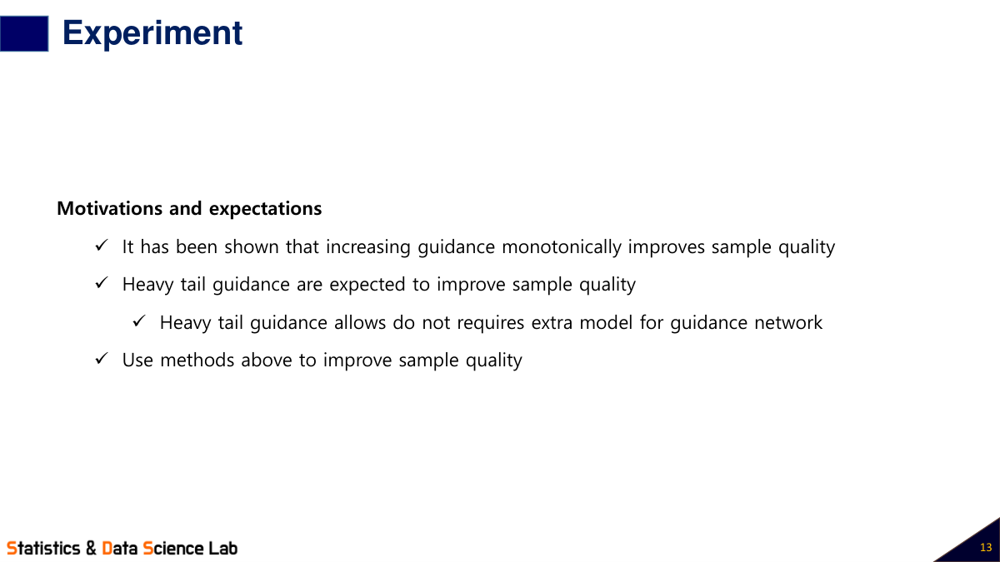

실험의 방향은 두 가지 관찰을 합치는 것이었다. Wang et al.(2024)에서처럼 guidance weight를 단조 증가시키면 품질이 좋아진다는 특성과, heavy-tail guidance가 별도의 guidance network 없이도 품질을 높일 수 있으리라는 기대를 함께 활용해 기존 CFG보다 이미지 생성 품질을 개선하는 것이 목표였다.

### Sigma scaling

실제로 구현한 것은 위의 두 번째 버전, 분산이 더 큰 가우시안을 쓰는 방법이다. Main network가 노이즈 수준 $$\sigma$$에서 denoising할 때, guidance network로는 같은 network를 쓰되 노이즈 수준을 $$k$$배 키운 $$\sigma_{\text{guidance}} = k\sigma$$에서 평가한다. 같은 모델이라도 더 큰 노이즈 수준에서 평가하면 $$p_{\text{data}} * \mathcal{N}(0, k^2\sigma^2 I)$$, 즉 더 퍼진 분포의 score를 주기 때문에 추가 학습 없이 $$p_0$$를 얻을 수 있다. $$k$$를 바꿔가며 결과가 어떻게 달라지는지 봤다.

$$k = 1.00$$이면 $$p_0 = p_1$$이라 guidance가 없는 것과 같다. $$k$$를 1.02, 1.04로 조금 키우면 가지 바깥으로 흩어진 outlier가 줄어들면서도 샘플이 여전히 가지 끝까지 퍼져 있다. 하지만 $$k$$를 1.10, 1.20으로 더 키우면 샘플이 줄기 근처의 가장 밀도가 높은 영역으로 급격히 몰린다. 작은 $$k$$는 다양성을 유지하면서 outlier를 줄이지만, $$k$$가 크면 모드를 지나치게 강조해서 다양성이 무너진다.

샘플링 trajectory를 그려보면 sigma scaling의 성질을 더 잘 확인할 수 있다. Guidance가 없을 때는 궤적이 각자의 가지로 흩어져 내려가는데, $$k$$가 커질수록 궤적들이 가지가 갈라지는 중심 지점 한 곳으로 모여든다. 즉 샘플링이 high-probability mode 방향으로 집중되는 것으로 해석할 수 있다.

### Weight scheduler와 sigma scaling

다음으로 weight scheduler를 추가해 변화를 관찰했다. Toy example의 32 timestep 동안 guidance weight를 cosine 곡선을 따라 scheduling한다. 위 식에서 $$t$$는 $$T$$에서 0으로 줄어들기 때문에, $$w_t$$는 denoising 초반에 0에서 시작해 끝에서 $$\text{guidance}_{\max}$$에 도달한다. 초반의 강한 guidance가 샘플링 다양성을 저하한다는 Wang et al.(2024)의 결과를 반영한 형태다. 이때 guidance network를 $$k=1.20$$으로 scaling한 버전으로 고정한 뒤, guidance 크기에 따른 toy example의 샘플링 결과를 확인했다.

여기서 weight scheduler만 단독으로 쓸 수는 없다. Main network와 guidance network가 같은 모델이고 $$k=1$$이면 $$p_1/p_0 = 1$$이라서, $$w$$를 어떻게 바꿔도 guidance 항이 0이 된다. 그래서 sigma scaling과 weight scheduler를 반드시 함께 써야 한다.

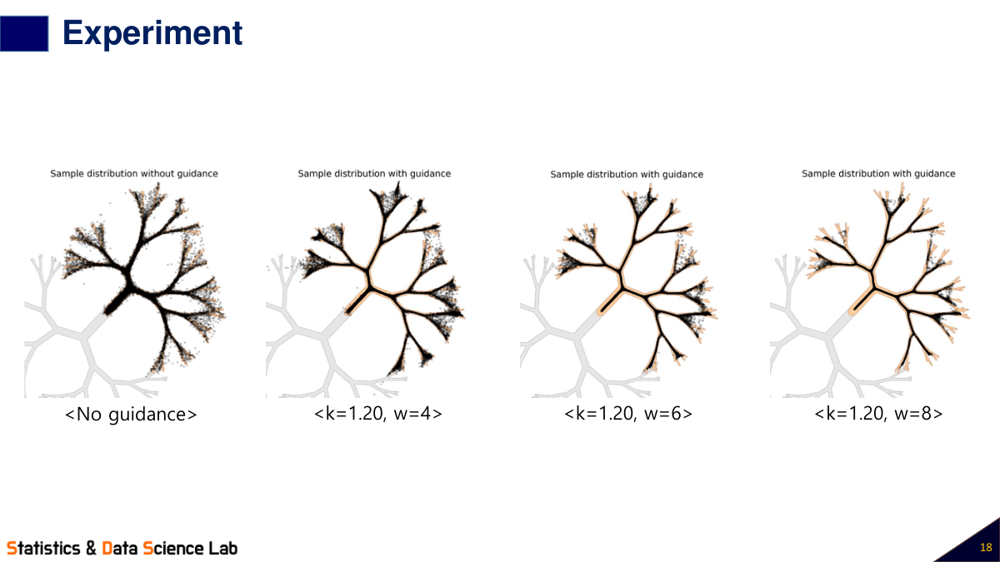

$$k = 1.20$$으로 고정하고 $$\text{guidance}_{\max}$$를 4, 6, 8로 바꿔가며 샘플링한 결과는 위와 같다. Sigma scaling만 쓴 슬라이드 15는 weight를 모든 step에서 고정한 결과로, $$k = 1.20$$에서 샘플이 main branch 근방으로 모이는 현상이 나타났지만, cosine scheduler를 쓰면 샘플이 manifold 전체로 퍼진다. Cosine scheduler는 $$w_t=0$$에서 시작하므로 denoising 초반(guidance_max에 따라 처음 약 1/4~1/3 구간)에는 $$w_t<1$$이 되어, guidance가 모드를 강조하는 대신 오히려 분포를 퍼뜨리는 쪽으로 작용한다. 이 구간에서 샘플이 manifold 전체를 고르게 찾아가고, 후반에 $$w_t$$가 커지면서 ground truth manifold로 끌어당겨지는 것으로 보인다. Weight가 클수록 샘플이 가지 위로 더 강하게 모이지만, 가지 끝 근처에는 여전히 흩어진 샘플들이 남는다.

이를 확인하기 위해 대조 실험을 해봤다(아래 그림). $$\text{guidance}_{\max}=4$$인 cosine과 평균 weight를 맞춘 constant $$w=2$$에서도 샘플이 main branch 위로 집중된다. 즉 차이는 weight의 총량이 아니라 weight를 주는 시점에서 온다. 또 $$w_t<1$$ 구간을 없앤 cosine(floor=1)도 샘플이 대부분의 가지로 퍼지는 반면, 초반 1/3 구간에는 guidance를 주지 않고($$w=1$$) 그 뒤부터 $$w=4$$를 주면 샘플이 main branch로 집중된다. 즉 핵심은 노이즈가 중간 정도인 구간에서 weight를 작게 유지하는 것이고, $$w_t<1$$ 구간은 다양성을 더 늘리는 대신 outlier도 함께 늘린다.

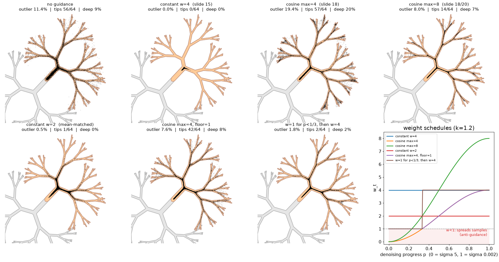

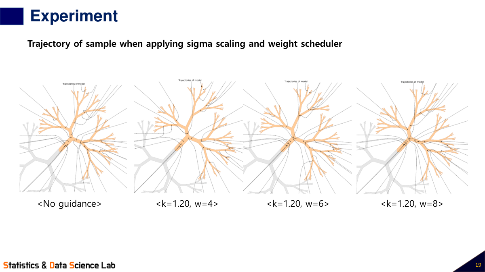

샘플링 trajectory에서도 차이가 보인다. Sigma scaling만 썼을 때처럼 궤적이 중심 한 점으로 모이지 않고, guidance가 없을 때와 비슷하게 여러 가지로 흩어져 내려가다가 끝 부분에서만 가지 쪽으로 꺾인다.

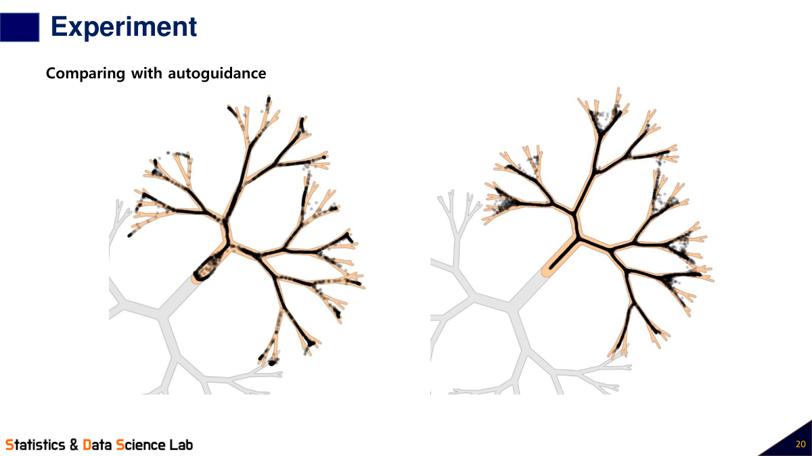

왼쪽이 autoguidance, 오른쪽이 sigma scaling과 weight scheduler를 함께 쓴 결과($$k=1.20$$, $$\text{guidance}_{\max}=8$$)다. 오른쪽은 작은 가지까지 샘플이 퍼져 있어 다양성 면에서는 비슷하거나 나은 편이지만, 가지 끝 근처에 가지 밖으로 벗어난 outlier가 autoguidance보다 많이 남는다.

Toy example의 결과를 정리하면 다음과 같다.

- Sigma scaling은 $$k$$가 커질수록 outlier를 줄이지만, $$k$$가 너무 크면 샘플을 밀도가 가장 높은 영역으로 끌어당긴다.
- Weight scheduler는 sigma scaling과 함께 써야 하고, weight가 클수록 샘플이 밀도가 높은 영역으로 끌려간다.
- 둘을 함께 쓰면 sigma scaling만 쓸 때보다 샘플의 다양성이 늘어난다.
- Autoguidance와 비교하면 다양성은 더해지지만 outlier 문제가 남는다.
- 이 방법이 실제 이미지 데이터에서도 효과가 있을지는 확신할 수 없다.

### Stable Diffusion에 적용

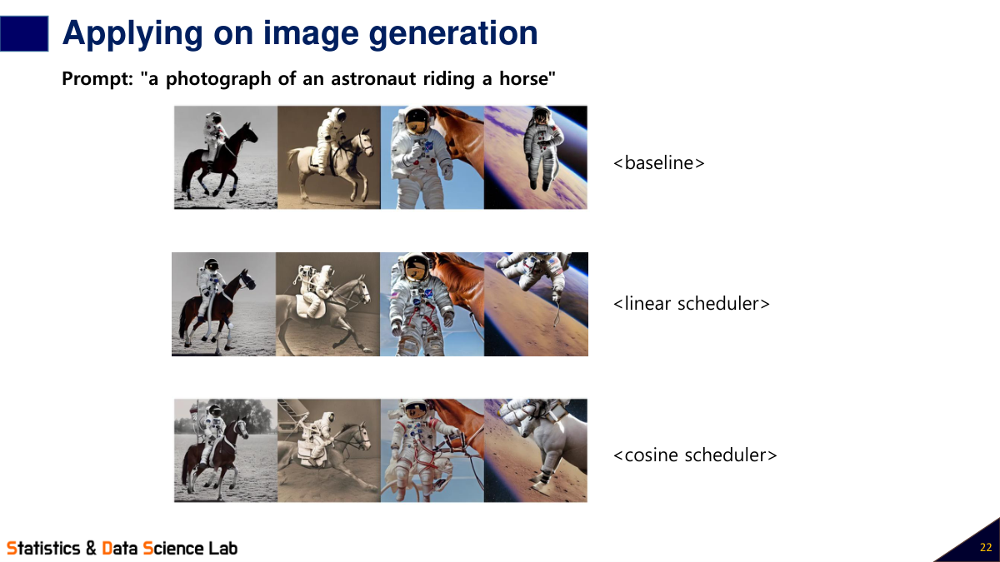

마지막으로 Stable Diffusion에 "a photograph of an astronaut riding a horse" 프롬프트로 적용해봤다. 먼저 기본 CFG(baseline)에 linear, cosine weight scheduler만 바꿔 넣은 결과다. 네 장 모두 전체 구도는 baseline과 거의 같고 세부 표현만 조금씩 달라진다. 이 네 장만으로 품질이나 다양성이 나아졌다고 말하기는 어렵다.

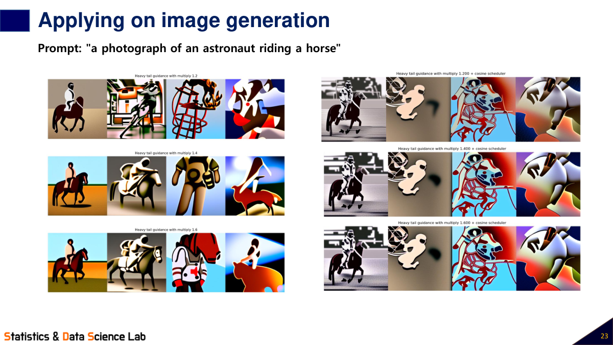

다음은 heavy-tail guidance, 즉 sigma scaling을 적용한 결과다. 왼쪽은 multiplier($$k$$)를 1.2, 1.4, 1.6으로 바꾼 것이고, 오른쪽은 여기에 cosine scheduler를 더한 것이다. 결과는 toy example과 달리 좋지 않았다. 사진 같은 질감이 사라지고 색이 평평하게 뭉개진 그림처럼 바뀌었으며, 일부 이미지는 말과 우주비행사의 형태 자체가 무너졌다. Cosine scheduler를 더한 오른쪽은 multiplier가 달라져도 결과가 거의 같게 나왔다.

Toy example에서 본 효과가 실제 이미지 생성으로는 옮겨지지 않은 셈이다. 지금 돌아보면 몇 가지 원인을 생각해볼 수 있다. 2차원 toy와 달리 Stable Diffusion은 고차원 latent 공간에서 작동하고 노이즈 스케줄도 다르기 때문에, 같은 $$k$$라도 실제로 퍼지는 정도가 훨씬 클 수 있다. 또 학습 때와 다른 노이즈 수준을 network에 넣으면 그 network가 학습한 범위를 벗어난 입력이 되어 엉뚱한 score를 줄 수 있다. 오른쪽에서 multiplier와 관계없이 결과가 거의 같게 나온 점은 구현을 다시 확인해봐야 할 부분이다.

## 정리

연구 참여 기간 동안 diffusion guidance를 "main network와 guidance network의 분포 비율로 모드를 강조하는 것"으로 이해했고, 그 해석을 바탕으로 guidance network를 따로 학습하지 않고 같은 network를 더 큰 노이즈 수준에서 평가해 퍼진 분포를 얻는 방법을 제안해봤다. Toy example에서는 sigma scaling과 cosine weight scheduler를 함께 쓰면 다양성을 유지하면서 outlier를 줄이는 효과가 어느 정도 보였지만, autoguidance만큼 outlier를 잡지는 못했고 Stable Diffusion에서는 이미지가 크게 무너졌다.

후속 연구로는 이미지 데이터에서 $$k$$를 1에 훨씬 가까운 범위로 다시 탐색하고, 실험 결과를 그림으로만 보는 대신 FID나 precision/recall 같은 지표로 품질과 다양성을 정량적으로 비교해볼 수 있다. 또한 가우시안 대신 $$t$$ 분포 노이즈로 학습한 guidance network를 실제로 만들어, 꼬리 두께로 퍼짐 정도를 조절한다는 원래 아이디어를 검증해보고 싶다.
