POSTECH 산업경영공학과 Statistics and Data Science Lab(SDS Lab)에서 2024년 겨울(2024년 12월~2025년 2월) 연구 인턴으로 진행한 내용을 최종 발표 슬라이드를 따라 정리한 기록이다. 인턴 기간 동안 diffusion model 관련 논문을 읽고, 그중 guidance 방법에 초점을 맞춰 classifier-free guidance(CFG)와 autoguidance를 비교한 뒤, guidance network를 따로 학습하지 않고도 쓸 수 있는 heavy-tail guidance를 제안해 toy example과 Stable Diffusion에서 실험해봤다. 슬라이드에 들어간 그림 중 논문에서 가져온 것은 본문에 따로 표시했고, 나머지 실험 그림은 직접 돌린 결과다.

발표자료 PDF: [SDS_diffusion_guidance_final.pdf](/assets/files/SDS_diffusion_guidance_final.pdf)

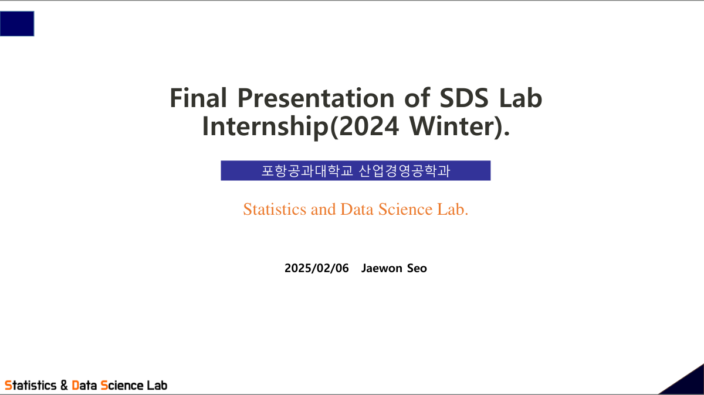

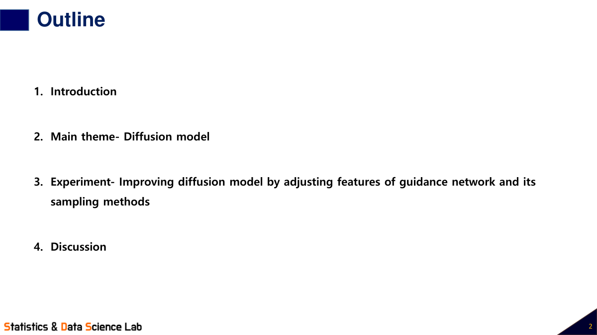

발표는 인턴 기간에 한 일(Introduction), 주제로 고른 diffusion model과 guidance 방법, guidance network와 샘플링 방식을 조정해 diffusion model을 개선해보는 실험, 그리고 결과 해석 순서로 구성했다.

## Introduction

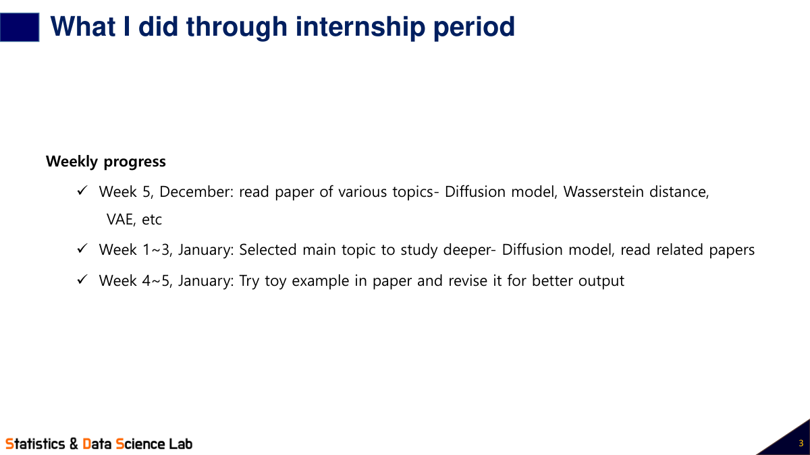

12월 마지막 주에는 diffusion model, Wasserstein distance, VAE 등 여러 주제의 논문을 넓게 읽었다. 1월 첫 3주 동안 diffusion model을 깊게 볼 주제로 정하고 관련 논문을 읽었고, 1월 말 2주 동안은 논문의 toy example을 직접 돌려보면서 더 나은 결과를 내도록 바꿔보는 실험을 했다.

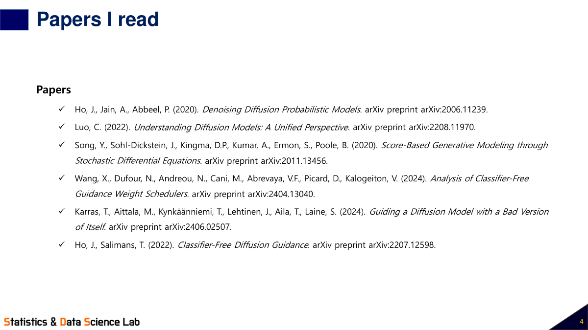

기본이 된 논문은 DDPM, diffusion model을 하나의 관점으로 정리한 Luo(2022)의 튜토리얼, score-based SDE 논문이다. 이 셋은 따로 리뷰로도 정리해두었다([Understanding Diffusion Models: A Unified Perspective](/posts/understanding-diffusion-models-unified-perspective/), [Score-Based Generative Modeling through SDEs](/posts/score-based-generative-modeling-through-sdes/)). 실험에 직접 쓴 것은 나머지 세 편, Classifier-Free Diffusion Guidance(Ho & Salimans, 2022), CFG의 weight scheduler를 분석한 Wang et al.(2024), 그리고 autoguidance를 제안한 Karras et al.(2024)의 *Guiding a Diffusion Model with a Bad Version of Itself*다.

## Main theme: Diffusion guidance

Guidance는 샘플의 다양성을 조금 포기하는 대신 개별 샘플의 품질을 높이려는 방법이다. 샘플링할 때 원래의 score function 대신 위와 같이 수정된 score를 쓴다. $$p_1$$은 main network가 학습한 분포, $$p_0$$는 guidance network가 학습한 분포이고, $$w$$는 guidance weight다. $$w=1$$이면 guidance가 없는 원래 모델과 같고, $$w$$가 커질수록 $$p_1/p_0$$ 비율이 큰 방향으로 샘플을 더 세게 민다.

CFG는 main network로 조건부 모델 $$p(x \mid c)$$를, guidance network로 무조건부 모델 $$p(x)$$를 쓴다. 그러면 비율 $$p_1/p_0$$는 조건 $$c$$를 잘 설명하는 영역에서 커지므로, 샘플이 조건에 맞는 높은 밀도 영역으로 끌려간다. 품질은 좋아지지만 색이 과포화되거나, 비슷한 전형적인 이미지만 나오거나, 이미지가 지나치게 단순해지는 등의 부작용이 알려져 있다.

> **보충: 수정된 score와 분포의 관계**
>
> 위 식을 $$x$$에 대해 적분하면 guidance가 샘플링하는 분포는 $$p_w(x \mid c;\sigma) \propto p_0(x \mid c;\sigma)\left(\frac{p_1(x \mid c;\sigma)}{p_0(x \mid c;\sigma)}\right)^{w} = p_1(x \mid c;\sigma)\left(\frac{p_1(x \mid c;\sigma)}{p_0(x \mid c;\sigma)}\right)^{w-1}$$ 이 된다. 즉 $$p_1$$에 두 분포의 비율을 $$w-1$$ 제곱만큼 곱해서 비율이 큰 곳을 강조하는 구조다. (슬라이드 9, 11에서는 $$p_1$$ 앞에 지수 $$w$$를 붙여 썼는데, 슬라이드 5의 식과 맞추려면 $$p_1$$ 앞이 아니라 $$p_0$$ 앞에 $$w$$ 제곱을 써야 한다. 어느 쪽이든 "비율을 거듭제곱해서 강조한다"는 해석은 같다.)

Wang et al.(2024)은 guidance weight $$w$$를 모든 timestep에서 고정하지 않고 시간에 따라 바꾸는 weight scheduler를 분석했다. 결론은 denoising이 진행될수록 guidance를 단조 증가시키는 스케줄(linear, cosine)이 이미지의 fidelity와 diversity를 동시에 개선한다는 것이다. 코드 한 줄만 바꾸면 되는 수준의 변경이라는 점도 장점이다. 왼쪽 그래프의 negative perturbation 실험은 denoising 초반(노이즈가 큰 구간)에 guidance를 없애면 FID가 오히려 좋아지고, 후반 구간에서 없애면 나빠지는 것을 보여준다. denoising 초반에 너무 강한 guidance를 주는 것이 해롭다는 뜻이다.

Autoguidance는 guidance network로 무조건부 모델 대신 main network의 "나쁜 버전", 즉 학습을 덜 했거나 층 수가 적은 같은 종류의 모델을 쓴다. 무조건부 모델을 따로 학습할 필요가 없다. 덜 학습된 모델은 실제 데이터 분포와 덜 맞는, 더 퍼진 분포를 학습한다. 그림 (c)처럼 두 분포의 비율 $$p_1/p_0$$은 잘 학습된 모델만 높은 확률을 주는 영역, 즉 실제 데이터가 있는 영역에서 커진다.

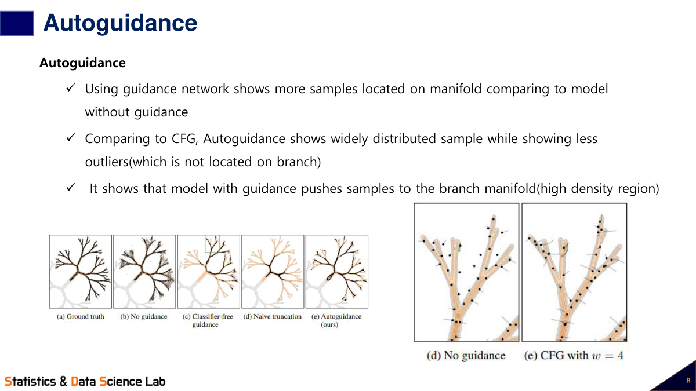

Autoguidance 논문은 이 효과를 2차원 toy example로 보여준다. 데이터 분포는 나뭇가지 모양의 manifold(진한 부분)이고, guidance가 없으면(b) 샘플이 가지 바깥으로 꽤 많이 흩어진다. CFG(c)는 샘플을 가지 위로 모으지만 일부 가지에만 몰리고, autoguidance(e)는 바깥으로 벗어나는 샘플(outlier)을 줄이면서도 더 넓은 가지에 고르게 퍼진다. 어느 쪽이든 guidance는 샘플을 가지 manifold, 즉 밀도가 높은 영역으로 밀어준다.

정리하면 guidance network를 무엇으로 고르느냐가 결과를 정한다. CFG와 autoguidance 모두 guidance가 없을 때보다 가지 위에 놓이는 샘플이 많아지는데, autoguidance는 작은 가지까지 비교적 고르게 샘플이 놓인다.

## Experiment

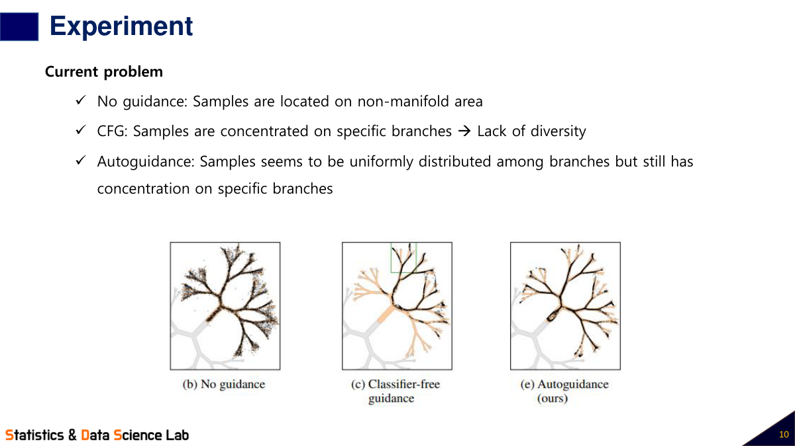

실험의 출발점은 세 방법에 남아 있는 문제였다. guidance가 없으면 샘플이 manifold 바깥에 놓이고, CFG는 특정 가지에 몰려 다양성이 부족하다. Autoguidance는 가지 전체에 고르게 퍼진 것처럼 보이지만 자세히 보면 여전히 특정 가지에 몰리는 경향이 있다.

여기서 autoguidance가 왜 잘 되는지를 다시 생각해봤다. Autoguidance는 $$p_0$$를 $$p_1$$을 열화시킨 분포로 둔다. 두 모델이 같은 $$p_{\text{data}}$$를 목표로 학습했으니 모드(mode)의 위치는 같고, 품질만 다르다. 그래서 비율 $$p_1/p_0$$는 모드 근처에서 1보다 커지고 꼬리 쪽에서 1보다 작아진다. 왼쪽 그래프는 1차원 정규분포에서 강한 모델(초록)과 약한 모델(파랑)을 비교한 것이고, 오른쪽은 비율을 $$w = 1, 2, 3$$ 제곱한 것이다. $$w$$가 클수록 모드 근처가 더 강하게 강조된다.

내 해석은 autoguidance의 성능 향상이 본질적으로 분포의 모드를 강조한 결과이고, 논문이 말하는 오차 보정(error correction) 효과도 결국 모드를 강조한 데서 나온다는 것이다. 그렇다면 굳이 덜 학습된 모델을 따로 준비할 필요 없이, **같은 분포를 목표로 하되 $$p_1$$보다 더 퍼진 $$p_0$$**를 찾기만 하면 된다.

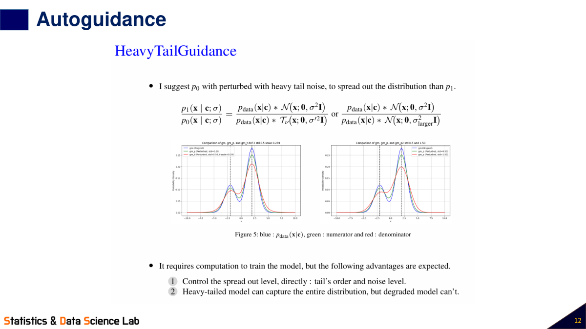

그래서 제안한 것이 heavy-tail guidance다. 노이즈를 섞은 데이터 분포를 생각하면 $$p_1$$은 $$p_{\text{data}}$$에 가우시안 노이즈 $$\mathcal{N}(0, \sigma^2 I)$$를 합성곱(convolution)한 분포다. $$p_0$$는 같은 $$p_{\text{data}}$$에 꼬리가 더 두꺼운 노이즈를 합성곱해서 만든다. 하나는 $$t$$ 분포 $$\mathcal{T}_\nu(0, \sigma'^2 I)$$를 쓰는 방법이고, 다른 하나는 분산이 더 큰 가우시안 $$\mathcal{N}(0, \sigma_{\text{larger}}^2 I)$$를 쓰는 방법이다. 아래 그림은 두 봉우리를 가진 1차원 가우시안 혼합 분포(파랑)에 대해 분자(초록)와 분모(빨강)를 그린 것이다. 두 경우 모두 분모 쪽이 모드 위치는 유지하면서 더 넓게 퍼진다.

기대한 장점은 두 가지다. 첫째, 꼬리의 두께($$t$$ 분포의 자유도)와 노이즈 크기로 $$p_0$$가 얼마나 퍼질지를 직접 조절할 수 있다. 둘째, 덜 학습된 모델은 분포의 일부를 아예 놓칠 수 있지만, heavy-tailed 분포는 전체 분포를 덮은 채로 퍼지기만 한다. 다만 $$t$$ 분포 노이즈를 쓰는 버전은 그 노이즈로 모델을 새로 학습해야 해서 계산 비용이 든다.

> **보충: 왜 노이즈를 더 섞으면 분포가 퍼지는가**
>
> 확률변수 두 개를 더하면 그 분포는 각 분포의 합성곱이 된다. 데이터 $$x_0 \sim p_{\text{data}}$$에 독립인 노이즈 $$\epsilon$$을 더한 $$x = x_0 + \epsilon$$의 분포는 $$p_{\text{data}} * p_\epsilon$$이고, 노이즈의 분산이 크거나 꼬리가 두꺼울수록 원래 분포의 봉우리가 더 넓게 뭉개진다. 다만 봉우리의 위치(모드)는 크게 바뀌지 않는다는 점이 여기서 중요하다.

실험의 방향은 두 가지 관찰을 합치는 것이었다. 하나는 Wang et al.이 보인 것처럼 guidance weight를 단조 증가시키면 품질이 좋아진다는 것, 다른 하나는 heavy-tail guidance가 별도의 guidance network 없이도 품질을 높일 수 있으리라는 기대다. 이 둘을 함께 써서 샘플 품질을 높여보는 것이 목표였다.

### Sigma scaling

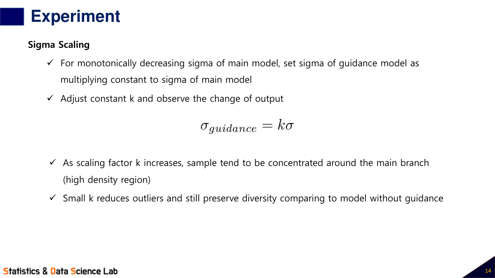

실제로 구현한 것은 위의 두 번째 버전, 분산이 더 큰 가우시안을 쓰는 방법이다. main network가 노이즈 수준 $$\sigma$$에서 denoising할 때, guidance network로는 **같은 network**를 쓰되 노이즈 수준을 $$k$$배 키운 $$\sigma_{\text{guidance}} = k\sigma$$에서 평가한다. 같은 모델이라도 더 큰 노이즈 수준에서 평가하면 $$p_{\text{data}} * \mathcal{N}(0, k^2\sigma^2 I)$$, 즉 더 퍼진 분포의 score를 주기 때문에, 추가 학습 없이 $$p_0$$를 얻을 수 있다. $$k$$를 바꿔가며 결과가 어떻게 달라지는지 봤다.

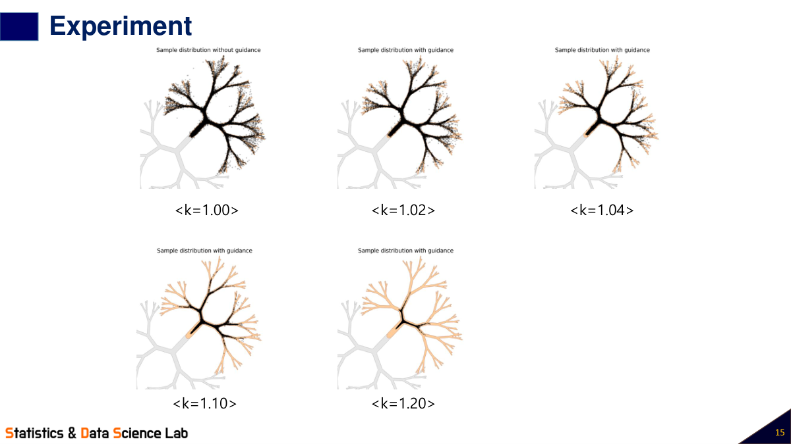

$$k = 1.00$$이면 $$p_0 = p_1$$이라 guidance가 없는 것과 같다. $$k$$를 1.02, 1.04로 조금 키우면 가지 바깥으로 흩어진 outlier가 줄어들면서도 샘플이 여전히 가지 끝까지 퍼져 있다. 하지만 $$k$$를 1.10, 1.20으로 더 키우면 샘플이 줄기 근처의 가장 밀도가 높은 영역으로 급격히 몰린다. 작은 $$k$$는 다양성을 유지하면서 outlier를 줄이지만, $$k$$가 크면 모드를 지나치게 강조해서 다양성이 무너진다.

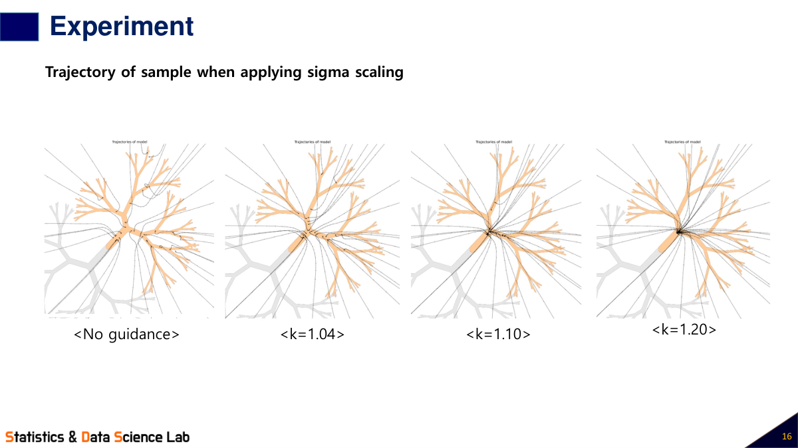

샘플링 궤적을 그려보면 이 현상이 더 분명하다. guidance가 없을 때는 궤적이 각자의 가지로 흩어져 내려가는데, $$k$$가 커질수록 궤적들이 가지가 갈라지는 중심 지점 한 곳으로 모여든다.

### Weight scheduler와 sigma scaling

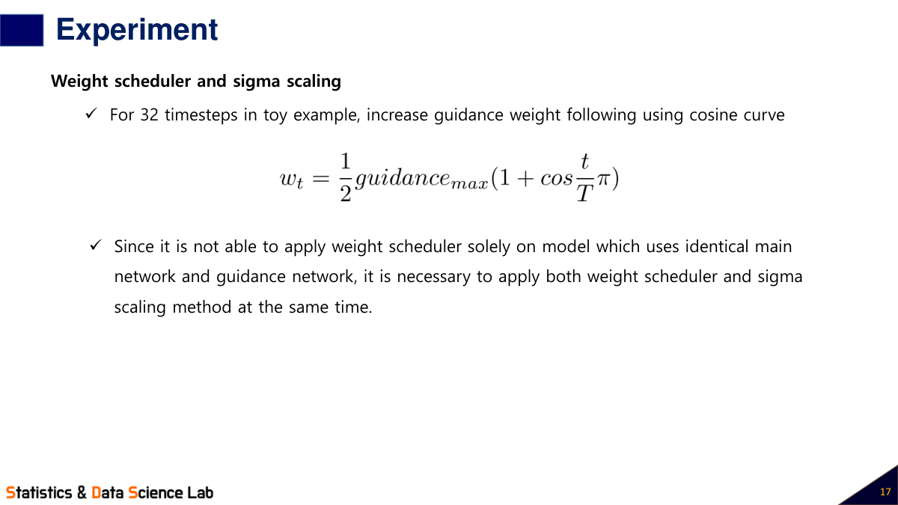

다음으로 weight scheduler를 더했다. toy example의 32 timestep 동안 guidance weight를 cosine 곡선을 따라 키운다. 위 식에서 $$t$$는 $$T$$에서 0으로 줄어들기 때문에, $$w_t$$는 denoising 초반에 0에서 시작해 끝에서 $$\text{guidance}_{\max}$$에 도달한다. 초반에 강한 guidance가 해롭다는 Wang et al.의 관찰을 그대로 반영한 형태다.

여기서 weight scheduler만 단독으로 쓸 수는 없다. main network와 guidance network가 같은 모델이고 $$k=1$$이면 $$p_1/p_0 = 1$$이라서, $$w$$를 어떻게 바꿔도 guidance 항이 0이 된다. 그래서 sigma scaling과 weight scheduler를 반드시 함께 써야 한다.

$$k = 1.20$$으로 고정하고 $$\text{guidance}_{\max}$$를 4, 6, 8로 바꿔봤다. sigma scaling만 썼을 때는 $$k = 1.20$$에서 샘플이 줄기 근처로 무너졌는데, cosine scheduler를 더하니 샘플이 다시 가지 전체로 퍼진다. 초반에 guidance를 약하게 주니 샘플이 일단 각자의 가지를 고른 뒤, 후반에 강해진 guidance가 가지 위로 끌어당기는 것으로 보인다. weight가 클수록 샘플이 가지 위로 더 강하게 모이지만, 가지 끝 근처에는 여전히 흩어진 샘플들이 남는다.

궤적에서도 차이가 보인다. sigma scaling만 썼을 때처럼 궤적이 중심 한 점으로 모이지 않고, guidance가 없을 때와 비슷하게 여러 가지로 흩어져 내려가다가 끝 부분에서만 가지 쪽으로 꺾인다.

왼쪽이 autoguidance, 오른쪽이 sigma scaling과 weight scheduler를 함께 쓴 결과($$k=1.20$$, $$\text{guidance}_{\max}=8$$)다. 오른쪽은 작은 가지까지 샘플이 퍼져 있어 다양성 면에서는 비슷하거나 나은 편이지만, 가지 끝 근처에 가지 밖으로 벗어난 outlier가 autoguidance보다 많이 남는다.

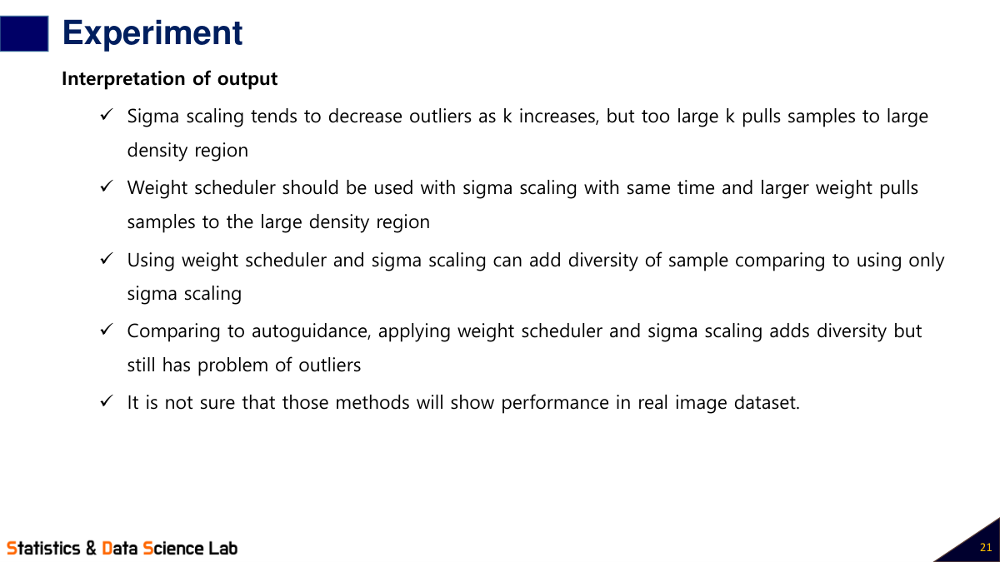

toy example의 결과를 정리하면 다음과 같다.

- Sigma scaling은 $$k$$가 커질수록 outlier를 줄이지만, $$k$$가 너무 크면 샘플을 밀도가 가장 높은 영역으로 끌어당긴다.
- Weight scheduler는 sigma scaling과 함께 써야 하고, weight가 클수록 샘플이 밀도가 높은 영역으로 끌려간다.
- 둘을 함께 쓰면 sigma scaling만 쓸 때보다 샘플의 다양성이 늘어난다.
- Autoguidance와 비교하면 다양성은 더해지지만 outlier 문제가 남는다.
- 이 방법이 실제 이미지 데이터에서도 효과가 있을지는 확신할 수 없다.

### Stable Diffusion에 적용

마지막으로 Stable Diffusion에 "a photograph of an astronaut riding a horse" 프롬프트로 적용해봤다. 먼저 기본 CFG(baseline)에 linear, cosine weight scheduler만 바꿔 넣은 결과다. 네 장 모두 전체 구도는 baseline과 거의 같고 세부 표현만 조금씩 달라진다. 이 네 장만으로 품질이나 다양성이 나아졌다고 말하기는 어렵다.

다음은 heavy-tail guidance, 즉 sigma scaling을 적용한 결과다. 왼쪽은 multiplier($$k$$)를 1.2, 1.4, 1.6으로 바꾼 것이고, 오른쪽은 여기에 cosine scheduler를 더한 것이다. 결과는 toy example과 달리 좋지 않았다. 사진 같은 질감이 사라지고 색이 평평하게 뭉개진 그림처럼 바뀌었으며, 일부 이미지는 말과 우주비행사의 형태 자체가 무너졌다. cosine scheduler를 더한 오른쪽은 multiplier가 달라져도 결과가 거의 같게 나왔다.

toy example에서 본 효과가 실제 이미지 생성으로는 옮겨지지 않은 셈이다. 지금 돌아보면 몇 가지 원인을 생각해볼 수 있다. 2차원 toy와 달리 Stable Diffusion은 고차원 latent 공간에서 작동하고 노이즈 스케줄도 다르기 때문에, 같은 $$k$$라도 실제로 퍼지는 정도가 훨씬 클 수 있다. 또 학습 때와 다른 노이즈 수준을 network에 넣으면 그 network가 학습한 범위를 벗어난 입력이 되어 엉뚱한 score를 줄 수 있다. 오른쪽에서 multiplier와 관계없이 결과가 거의 같게 나온 점은 구현을 다시 확인해봐야 할 부분이다.

## 정리

인턴 기간 동안 diffusion guidance를 "main network와 guidance network의 분포 비율로 모드를 강조하는 것"으로 이해했고, 그 해석을 바탕으로 guidance network를 따로 학습하지 않고 같은 network를 더 큰 노이즈 수준에서 평가해 퍼진 분포를 얻는 방법을 제안해봤다. toy example에서는 sigma scaling과 cosine weight scheduler를 함께 쓰면 다양성을 유지하면서 outlier를 줄이는 효과가 어느 정도 보였지만, autoguidance만큼 outlier를 잡지는 못했고 Stable Diffusion에서는 이미지가 크게 무너졌다.

후속으로 해볼 것은 분명하다. 이미지 데이터에서 $$k$$를 훨씬 1에 가까운 범위로 다시 탐색하고, 실험 결과를 그림으로만 보는 대신 FID나 precision/recall 같은 지표로 품질과 다양성을 정량적으로 비교해야 한다. 그리고 가우시안 대신 $$t$$ 분포 노이즈로 학습한 guidance network를 실제로 만들어, 꼬리 두께로 퍼짐 정도를 조절한다는 원래 아이디어를 검증해보고 싶다.
